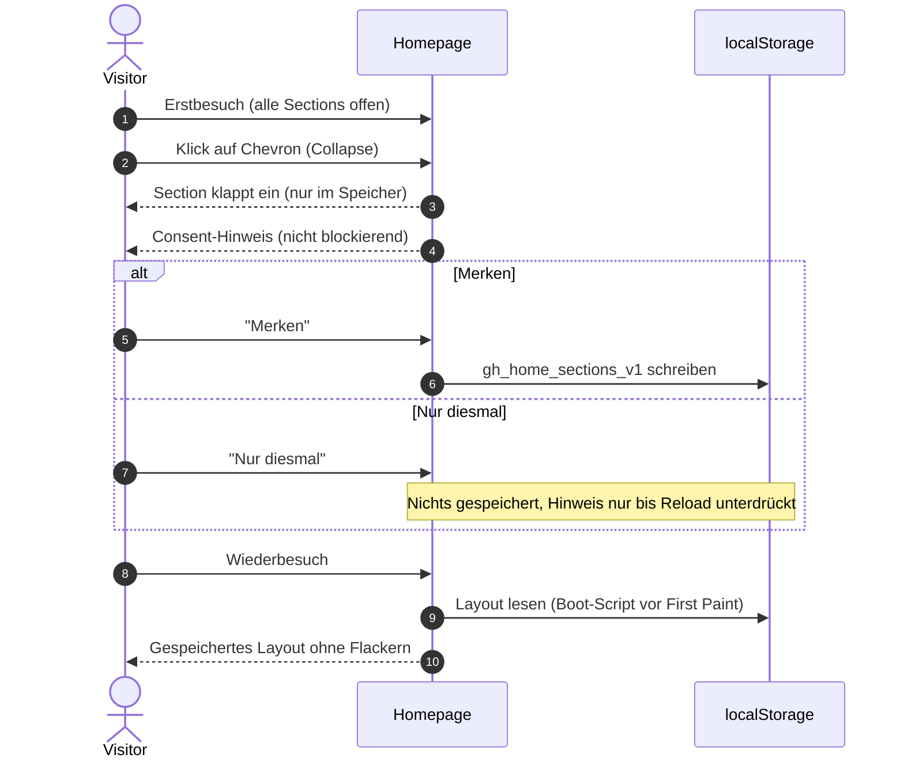
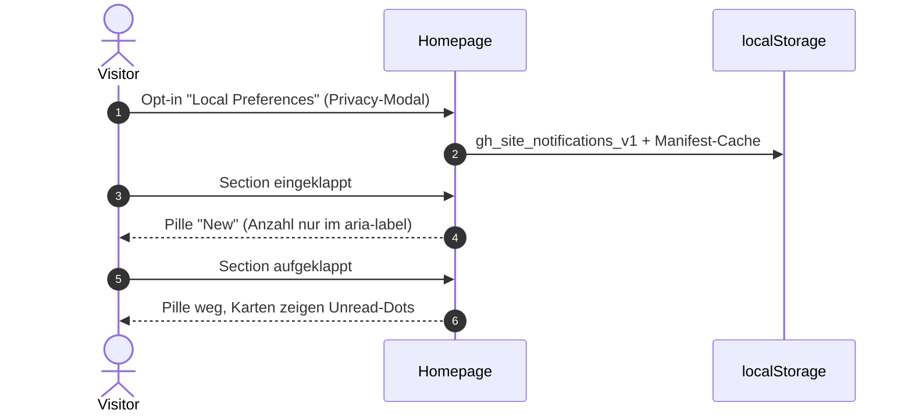

# SYSTEM-008: Privacy- & Unread-User-Journey der Startseite

- **ID:** `SYSTEM-008`
- **Domäne:** `ux` / `privacy`
- **Status:** `implemented`
- **Priorität / Hebel:** `MITTEL`
- **Ursprung:** Session 2026-10-16 (einklappbare Startseiten-Sections)

---

## 1. Zweck

Knappe Referenz, wie Erstbesuch, Einwilligung (§ 165 TKG 2021 / DSGVO), Persistenz, Widerruf und Wiederbesuch mit Unread-Hinweis zusammenspielen. Grundregel: **Vor einer expliziten Einwilligung wird nichts in `localStorage` geschrieben.**

## 2. Journey (Layout merken)

## 3. Journey (Unread-Pill)

## 4. Widerruf

- Privacy-Modal → Schalter „Homepage Layout“ aus → Key `gh_home_sections_v1` wird gelöscht; Sections bleiben bis zum Reload im aktuellen Zustand, danach alle offen.
- Der Schalter und der Inline-Hinweis sind synchron (Event `gh-home-layout-toggle`).

## 5. Beteiligte Dateien

- `src/commons/client/section-collapse.ts` (Logik, Prompt, Persistenz)
- `src/components/SectionToggle.astro`, `src/components/HomeLayoutConsent.astro`, `src/components/PrivacyModal.astro`
- `src/pages/datenschutz.astro` (Anker `#home-layout`)
- `src/commons/client/unread-counts.ts`, `src/commons/client/notifications.ts`
