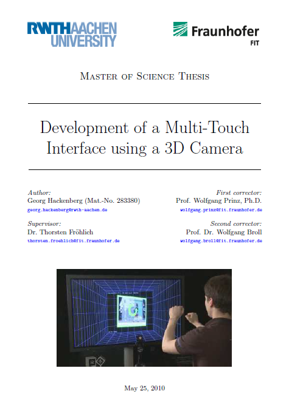
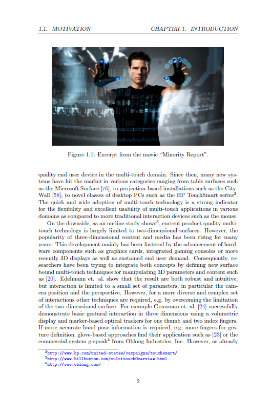
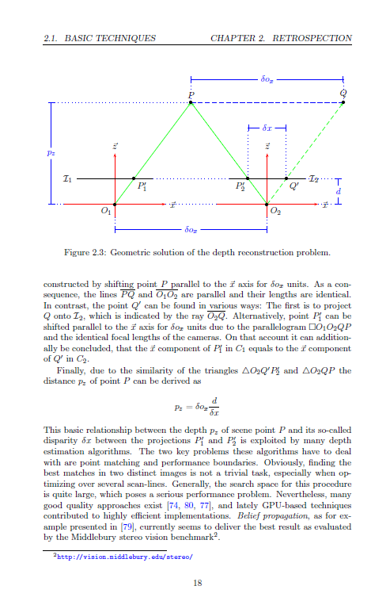
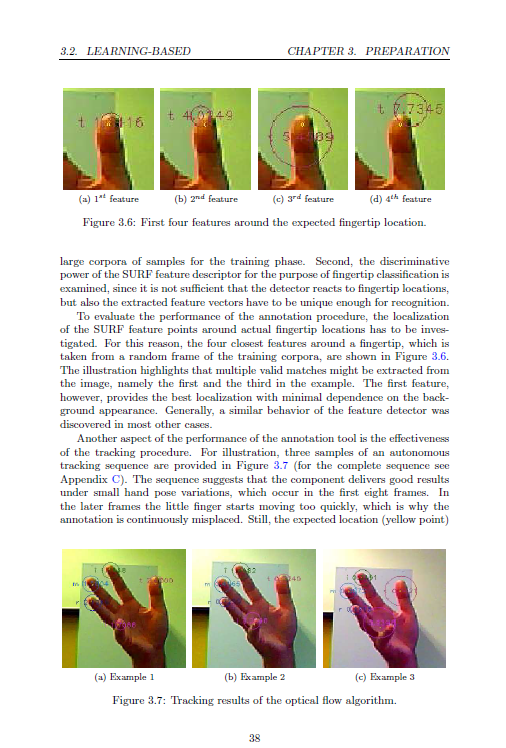
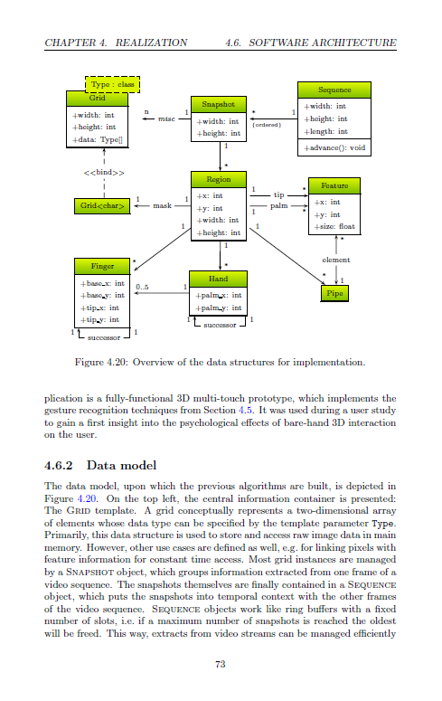

The thesis documents two approaches I have tried to implement computer vision based 3D hand gesture interaction.
The more promising approach is selected to implement a first prototype for evaluation with users.
Finally, the findings are summarized and future work is listed.

The introduction motivates spatial hand tracking by examining visionary interaction paradigms such as *Minority Report*:

To reconstruct 3D hand postures from stereo cameras, the first approach models epipolar geometry and triangulation rays:

The second approach evaluates machine learning classifiers and feature extraction pipelines for robust gesture recognition:

Finally, a unified object-oriented data model integrates raw sensor frames, tracked hand blobs, and recognized interaction events:

If you have feedback or questions please do not hestitate to contact me!
Use the comment feature below to give other people the chance to engage into the discussion.
