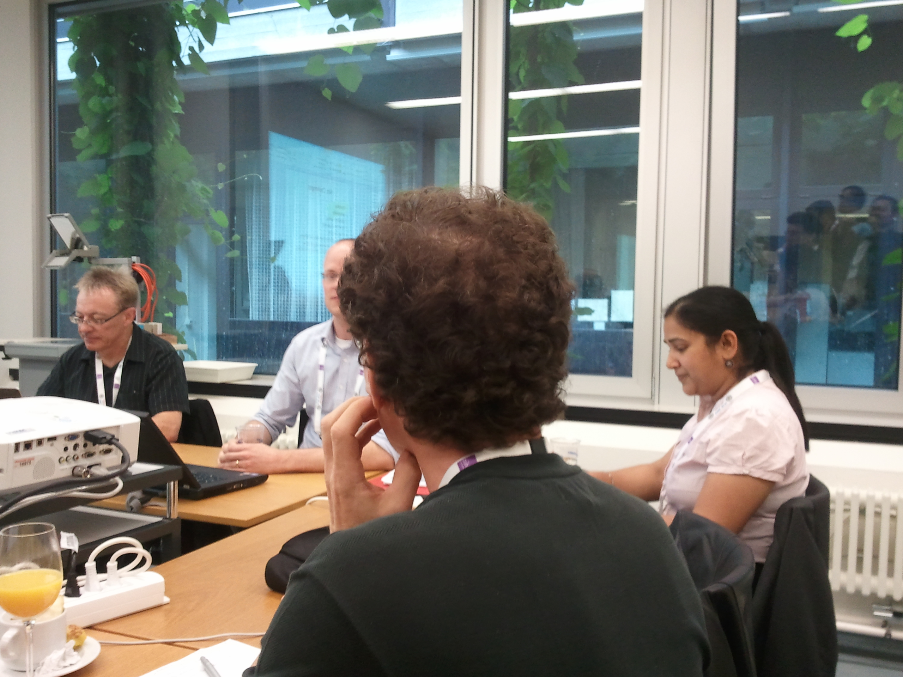

To give you an impression of the workshop I took a picture from inside the meeting room.
On the picture you see the three chair members as well as one of my colleagues - Pragya - during a brainstorming session.
After the presentations of the research and position papers we were thinking about how to bring forward this particular area of science in the future.
I am very optimistic things are going to pick up speed quickly and emerge into an interesting and vivid branch of computer science.

