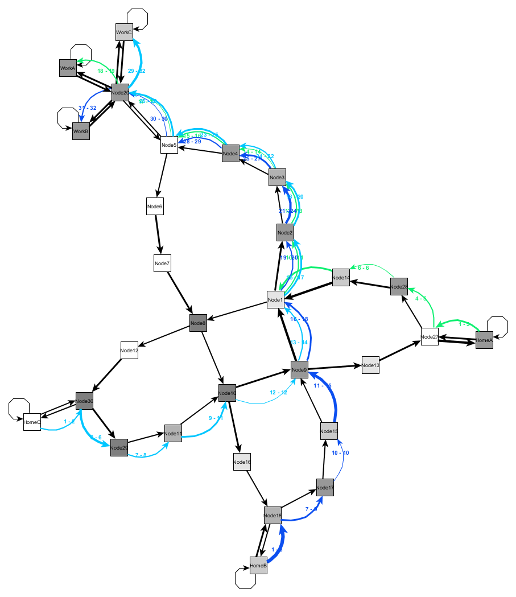

The following graph shows the driving behavior of three color coded traffic participants from their home to their work location.
The number of colored edges indicates the driving speed on a particular route section: The more the slower, the less the faster.

Currently we are working on improving the visualization and scaling the model to more traffic participants (ideally in the hundreds or thousands).
Further we work on aligning the traffic model with established approaches to ensure the overall validity.
