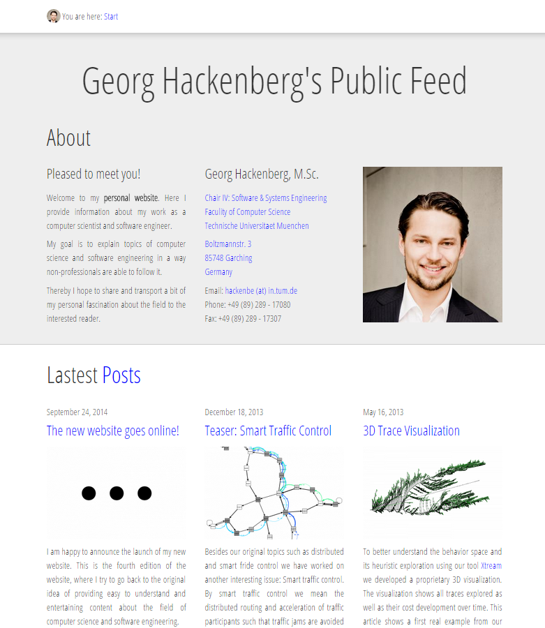

The following screenshot shows the new style of the website. I tried to inspire myself by recent web designs, which try to work with larger text and overall stronger focus on image material. I hope you like it and I am interested very much in feedback!

