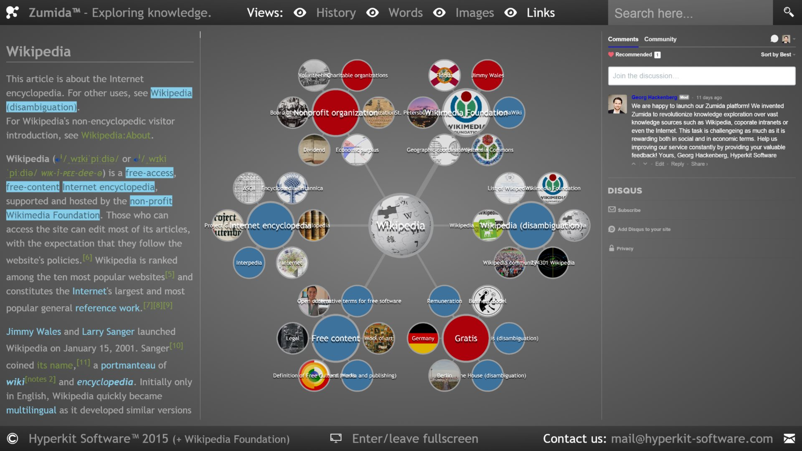

Here is a screenshot of the website. On the left side you find the original Wikipedia article. In the center you find a visualization of the first six links visible in the article. On the right side you find a discussion area for feedback.

