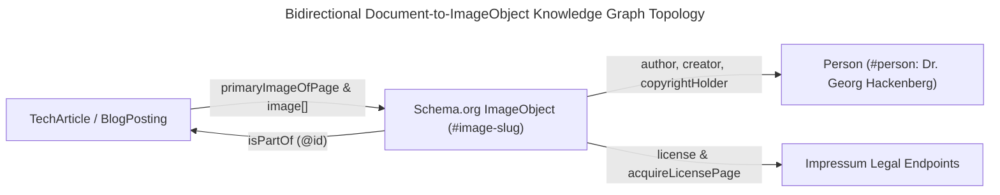
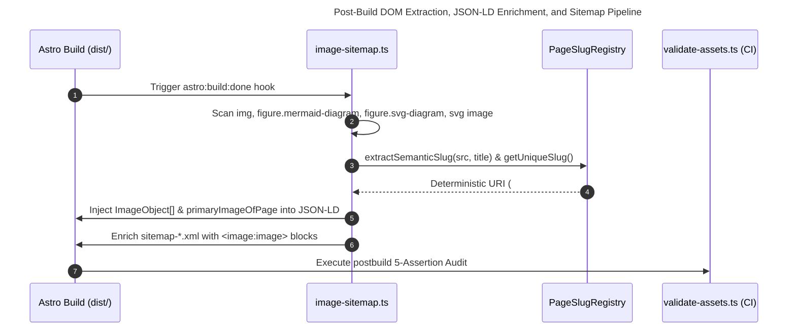

Build-time Schema.org `ImageObject` knowledge graph compilation and deterministic asset governance transform passive HTML graphics into machine-verifiable linked data entities. By scanning compiled DOM trees with Cheerio, stripping content-hash suffixes into stable `@id` fragment URIs, injecting licensing metadata into JSON-LD, and enforcing five post-build CI assertions, static sites achieve 100% multimodal attribution parity.

The following architectural comparison contrasts naive static image hosting and manual HTML attributes against our automated build-time AST and DOM governance pipeline on `hackenberg.tech`:

| Architectural Dimension | Naive Static Image Hosting | Manual Microdata & Alt-Tag Authoring | Build-Time AST/DOM `ImageObject` & Asset Governance (`hackenberg.tech`) |
| :--- | :--- | :--- | :--- |
| **Semantic Identity (`@id`)** | None; volatile bundler file paths (`/_astro/img.a1b2c3.webp`) change on every edit. | Ad-hoc inline `itemscope` without persistent, dereferenceable entity URIs. | Deterministic `@id` minting (`${canonicalPageUrl}#image-${uniqueSlug}`) via `extractSemanticSlug()` and `PageSlugRegistry`. |
| **Title & Caption Hygiene** | Frequently missing `alt` or duplicated `alt === title` placeholders. | Prone to human drift across Markdown ``, inline `<svg>`, and Mermaid diagrams. | **Zero-Fallback Invariant**: Early Remark AST gate plus post-build DOM gate require distinct `title` ($\ge 3$ chars) and `caption` ($\ge 3\text{–}5$ chars). |
| **Rights & Attribution Graph** | Unstructured pixel files stripped of provenance in multimodal RAG pipelines. | Partial inline attributes; rarely linked to a canonical author entity node. | Full JSON-LD `ImageObject` with `license`, `acquireLicensePage`, `creditText`, `copyrightNotice`, and `creator` linked to `#person`. |
| **Crawler Discovery (`sitemap.xml`)** | Standard page URLs only; relies on secondary image-crawl passes. | Manual XML lists that rapidly fall out of sync with physical assets. | Automated Cheerio DOM extraction injecting `<image:image>`, `<image:loc>`, `<image:title>`, and `<image:caption>` into `sitemap-*.xml`. |
| **Physical & Hash Integrity** | Risk of broken `srcset` candidates, unhashed cache-poisoned images, or leaked `/_astro/` folders. | Verified manually in the browser; no automated post-build regression barrier. | **5-Assertion CI Gate** (`validate-assets.ts`): Folder absence, zero `_astro` leaks, 100% physical disk existence, content hashing, and JSON-LD parity. |

> [!TIP]
> **Production Source Code on GitHub:**  
> You can inspect our complete production implementation in [`src/plugins/image-sitemap.ts`](https://github.com/ghackenberg/ghackenberg.github.io/blob/main/src/plugins/image-sitemap.ts), the early Markdown AST validator in [`src/plugins/remark-validate-images.ts`](https://github.com/ghackenberg/ghackenberg.github.io/blob/main/src/plugins/remark-validate-images.ts), the static Mermaid exporter in [`src/plugins/remark-mermaid.ts`](https://github.com/ghackenberg/ghackenberg.github.io/blob/main/src/plugins/remark-mermaid.ts), and the 5-stage post-build CI auditor in [`src/scripts/validate-assets.ts`](https://github.com/ghackenberg/ghackenberg.github.io/blob/main/src/scripts/validate-assets.ts).

## Why Do Multimodal RAG Crawlers and Google Image Rich Results Require Structured `ImageObject` Metadata?

Multimodal retrieval-augmented generation (RAG) crawlers and Google Image Rich Results require structured `Schema.org/ImageObject` metadata because raw raster bitmaps and inline SVGs carry zero self-contained semantic provenance. Explicit JSON-LD properties—specifically `license`, `acquireLicensePage`, `creditText`, `copyrightNotice`, and `creator`—bind visual assets to a verifiable knowledge graph node and legal copyright holder.

When Ramanathan Guha, Dan Brickley, and Steve Macbeth reflected on the evolution of Schema.org [@guha-2016-schema-org], they emphasized a transition from flat keyword indexing to a decentralized web of typed entities connected by explicit relational predicates. Today, this entity graph is serialized predominantly via W3C JSON-LD 1.1 [@w3c-2020-json-ld11], allowing search engines and autonomous AI agents to parse page semantics without executing complex client-side JavaScript or guessing relationships from visual proximity.

However, in typical technical blogs and academic portfolios, structured data terminates at the document boundary (`BlogPosting`, `TechArticle`, or `ScholarlyArticle`). While the article node itself might declare a single string URL for its OpenGraph preview image, the dozens of architectural diagrams, mathematical schematics, and photographic figures inside the document body remain "anonymous DOM nodes." This creates three severe engineering deficits in the era of Generative Engine Optimization (GEO) and Artificial Intelligence Optimization (AIO):

1. **Multimodal Context Detachment:** When vision-language scrapers and multimodal RAG pipelines ingest technical diagrams (such as our [2D Signed Distance Field lattices](/posts/2026_10_14_treewalker_text_geometrie_sdf_hero_grid/) or [build-time Mermaid topologies](/posts/2026_09_22_build_time_static_mermaid_in_astro/)), an isolated `` or `<svg>` tag without a corresponding `ImageObject` [@schema-org-2024-imageobject] lacks machine-readable bindings back to its parent document (`isPartOf`) and human author (`creator`).
2. **Missing Licensable Badges and Attribution in Search:** Google Search Central's specification for Image Metadata [@google-2024-image-license-metadata] defines six structured `ImageObject` properties—requiring `contentUrl` plus at least one licensing or attribution field (`license`, `acquireLicensePage`, `creditText`, `copyrightNotice`, or a structured `creator` entity), all six of which our pipeline enforces as mandatory to guarantee complete copyright attribution and licensing links in Google Images and multimodal search panels. Furthermore, machine-readable licensing (`license` and `acquireLicensePage`) prevents enterprise architectural blueprints and proprietary engineering schematics from being ingested as unattributed "orphan works" by commercial multimodal scrapers.
3. **Volatile Bundler Identifiers:** Static site generators (SSGs) like Astro and Vite append cryptographic content hashes to filenames for immutable HTTP caching (e.g., `hero-a1b2c3d4.jpg`). If an external knowledge graph references the physical asset URL as its primary key, every image re-compression or pixel tweak invalidates the entity's identity across the web.



To resolve the tension between immutable, content-hashed physical file URLs (`contentUrl`) and stable semantic graph URIs (`@id`), our architecture separates **physical storage addressing** from **logical entity identity**. Every visual artifact on `hackenberg.tech` is compiled into a first-class `ImageObject` [@schema-org-2024-imageobject] node whose `@id` is anchored deterministically to the canonical page URL and a hash-stripped semantic slug.

## How Does Our Dual-Gate Zero-Fallback Pipeline Enforce Distinct Image Titles and Captions?

Our dual-gate zero-fallback pipeline enforces distinct image titles and descriptive captions by combining a compile-time Remark AST plugin (`remark-validate-images.ts`) with a post-build Cheerio DOM inspector (`image-sitemap.ts`). Every non-decorative ``, `<figure class="mermaid-diagram">`, `<figure class="svg-diagram">`, and `<svg><image>` must provide non-empty, non-identical `title` and `caption` strings, or the build terminates immediately.

According to W3C Web Content Accessibility Guidelines (WCAG) 2.2 Success Criterion 1.1.1 [@w3c-2023-wcag22-non-text], every non-text UI element must provide a text alternative that serves the equivalent purpose. In content engineering, however, authors routinely conflate two fundamentally different semantic layers:

- **The Entity Name (`title` / `schema:name`):** A concise, nominal identifier (typically 4–10 words) that names the artifact in an index, tooltip, or knowledge graph node (e.g., *"2D Collision-Free Portrait Placement Solver"*).
- **The Descriptive Caption (`alt` / `schema:caption` / `schema:description`):** A rich, self-contained explanation (typically 15–35 words) detailing the visual topology, axes, and key takeaway for screen readers and text-only LLM crawlers.

When CMS templates silently fall back to setting `alt = title` or `title = filename`, both accessibility and generative extractability degrade. We therefore enforce a **Strict Zero-Fallback Invariant** across three formal conditions for every visual element $e$ on a page:

$$\text{Valid}(e) \iff \big(|\text{title}(e)| \ge 3\big) \;\land\; \big(|\text{caption}(e)| \ge L_{\min}\big) \;\land\; \big(\text{lower}(\text{title}(e)) \neq \text{lower}(\text{caption}(e))\big)$$

where $L_{\min} = 5$ characters for architectural diagrams (`figure.mermaid-diagram` and `figure.svg-diagram`) and $L_{\min} = 3$ characters for standard raster and vector images.

### Gate 1: Early AST Interception in `remark-validate-images.ts`

During the Markdown-to-HTML compilation phase, [`src/plugins/remark-validate-images.ts`](https://github.com/ghackenberg/ghackenberg.github.io/blob/main/src/plugins/remark-validate-images.ts) traverses the Unist/MDAST syntax tree before Rehype HTML conversion. If an author writes a Markdown image `` missing either string or duplicating the text, the plugin throws a formatted diagnostic error with exact file, line, and column coordinates:

```typescript
// Excerpt from src/plugins/remark-validate-images.ts
const issues: string[] = [];
if (!alt || alt.length < 3) {
  issues.push('Missing or too short description/caption in brackets:  (min 3 chars)');
}
if (!title || title.length < 3) {
  issues.push('Missing or too short title in quotes:  (min 3 chars)');
}
if (alt && title && alt.toLowerCase() === title.toLowerCase()) {
  issues.push('Description and title must be distinct (provide a concise title and a detailed descriptive caption).');
}
```

Similarly, [`src/plugins/remark-mermaid.ts`](https://github.com/ghackenberg/ghackenberg.github.io/blob/main/src/plugins/remark-mermaid.ts) parses the YAML frontmatter inside every ` ```mermaid ` code fence (`parseMermaidMetadata(code)`), requiring both `title` and a distinct `caption` before launching or querying the SHA-256 disk cache (`.cache/mermaid/`). Crucially, `remark-mermaid.ts` also exports the light-mode SVG to a deterministic physical path (`/${collection}/${slug}/${titleSlug}-${shortHash}.svg`) and embeds `<meta itemprop="contentUrl" content="..." />` alongside `<meta itemprop="name" />` and `<meta itemprop="description" />` inside the `<figure class="mermaid-diagram">` wrapper. For standalone `.svg` files referenced in Markdown, [`src/plugins/rehype-inline-svg.ts`](https://github.com/ghackenberg/ghackenberg.github.io/blob/main/src/plugins/rehype-inline-svg.ts) performs an equivalent transformation into `<figure class="svg-diagram">`, scoping internal SVG `<defs>` IDs with an 8-character MD5 prefix (`svg-${hash}-`) to prevent DOM ID collisions while preserving the canonical `contentUrl`.

### Gate 2: Exhaustive Post-Build DOM Auditing in `image-sitemap.ts`

Because Astro pages also render images via `.astro` components, JSX templates, and inline SVGs that bypass the Markdown Remark pipeline, AST validation alone is insufficient. Hooked into `astro:build:done` via `imageSitemapEnforcer()` in [`astro.config.ts`](https://github.com/ghackenberg/ghackenberg.github.io/blob/main/astro.config.ts), [`validateAndEnrichImageSitemaps()`](https://github.com/ghackenberg/ghackenberg.github.io/blob/main/src/plugins/image-sitemap.ts#L148-L590) loads every generated HTML file in `dist/` with Cheerio and inspects three distinct DOM selectors:

1. **Standard HTML Images (`$('img')`):** Audits `src`, `alt`, and `title`, explicitly exempting decorative elements marked with `aria-hidden="true"`, `role="presentation"`, or `role="none"`.
2. **Compiled Architectural Diagrams (`$('figure.mermaid-diagram, figure.svg-diagram')`):** Extracts `data-diagram-title` (or `meta[itemprop="name"]`), `data-diagram-caption` (or `meta[itemprop="description"]`), and `meta[itemprop="contentUrl"]`.
3. **Embedded Sub-Images Inside Raw SVGs (`$('svg image')`):** Audits `href` / `xlink:href`, `title`, and `aria-label` / `alt` on `<image>` nodes inside raw SVGs that are not already encapsulated by a `.mermaid-diagram` or `.svg-diagram` figure (ignoring inline `data:` URIs).

```typescript
// Excerpt from src/plugins/image-sitemap.ts (Step 2B: Diagram Figure Validation)
$('figure.mermaid-diagram, figure.svg-diagram').each((_, el) => {
  totalImagesScanned++;
  const $fig = $(el);
  const diagramTitle = ($fig.attr('data-diagram-title') || $fig.find('meta[itemprop="name"]').attr('content') || '').trim();
  const diagramCaption = ($fig.attr('data-diagram-caption') || $fig.find('meta[itemprop="description"]').attr('content') || '').trim();
  const diagramContentUrl = ($fig.find('meta[itemprop="contentUrl"]').attr('content') || '').trim();

  const missingProps: string[] = [];
  if (!diagramTitle || diagramTitle.length < 3) {
    missingProps.push('Missing or too short diagram title (min 3 chars)');
  }
  if (!diagramCaption || diagramCaption.length < 5) {
    missingProps.push('Missing or too short diagram caption (min 5 chars)');
  }
  if (!diagramContentUrl) {
    missingProps.push('Missing contentUrl for exported diagram SVG asset');
  }
  // ...
});
```

If even a single image across the entire compiled site violates these criteria, `validateAndEnrichImageSitemaps()` prints a structured diagnostic report for every offending DOM node and aborts the build with an exception before any JSON-LD or sitemap enrichment occurs.

## How Does `image-sitemap.ts` Mint Deterministic `@id` URIs and Enrich JSON-LD & XML Sitemaps?

Once all DOM images pass validation, `image-sitemap.ts` strips ephemeral bundler hashes from filenames via `extractSemanticSlug()` and resolves collisions through `PageSlugRegistry` to mint stable `${canonicalPageUrl}#image-${uniqueSlug}` URIs. It then idempotently injects linked `ImageObject` entities into each page's `<script type="application/ld+json">` block and appends `<image:image>` nodes to `sitemap-*.xml`.



### 1. Stripping Bundler Hashes with `extractSemanticSlug()` and `PageSlugRegistry`

When Vite or Astro's asset pipeline processes an image like `system_architecture.BNv8c83L_Z18dULf.webp` or `preview-a1b2c3d4.jpg`, the hash suffix guarantees cache-busting on CDNs but pollutes semantic identifiers. In [`src/plugins/image-sitemap.ts`](https://github.com/ghackenberg/ghackenberg.github.io/blob/main/src/plugins/image-sitemap.ts#L28-L86), `extractSemanticSlug()` strips both multi-segment Astro/Vite hashes and 6+ character trailing hyphenated hashes, normalizes German umlauts (`ä` $\rightarrow$ `ae`, `ö` $\rightarrow$ `oe`, `ü` $\rightarrow$ `ue`, `ß` $\rightarrow$ `ss`) and Unicode NFD diacritics via `slugify()`, and filters out generic placeholder stems:

```typescript
// Excerpt from src/plugins/image-sitemap.ts
function slugify(text: string): string {
  return text
    .toLowerCase()
    .replace(/ä/g, 'ae')
    .replace(/ö/g, 'oe')
    .replace(/ü/g, 'ue')
    .replace(/ß/g, 'ss')
    .normalize('NFD')
    .replace(/[\u0300-\u036f]/g, '')
    .replace(/[^a-z0-9]+/g, '-')
    .replace(/^-+|-+$/g, '');
}

function extractSemanticSlug(src: string, title?: string): string {
  let base = '';
  if (src && !src.startsWith('data:')) {
    const rawFilename = path.basename(src.split('?')[0].split('#')[0]);
    const noExt = rawFilename.replace(/\.[a-zA-Z0-9]+$/, '');
    // Strip Astro / Vite hash suffixes:
    // system_architecture.BNv8c83L_Z18dULf.webp -> system_architecture
    // preview-a1b2c3d4.jpg -> preview
    const noHash = noExt
      .replace(/\.[a-zA-Z0-9_-]{6,}(?:_[a-zA-Z0-9_-]+)?$/i, '')
      .replace(/-[a-zA-Z0-9_-]{6,}$/i, '');

    const candidate = slugify(noHash);
    const isPureHash = /^[a-f0-9]{16,}$/i.test(candidate);
    const isGeneric = ['image', 'img', 'preview', 'thumb', 'thumbnail', 'diagram', 'icon', 'asset'].includes(candidate);

    if (candidate && !isPureHash && !isGeneric) {
      base = candidate;
    }
  }

  if (!base && title) {
    base = slugify(title);
  }

  return base || 'image';
}
```

Notice the selective fallback logic: when a hash-stripped filename stem matches one of the eight generic tokens in `isGeneric` (`image`, `img`, `preview`, `thumb`, `thumbnail`, `diagram`, `icon`, `asset`—such as `preview-8f9e1a2b.jpg` or `diagram-a1b2c3d4.svg`) or consists of a raw 16+ character hexadecimal digest (`isPureHash`), `extractSemanticSlug()` automatically falls back to `slugify(title)`. Conversely, non-generic stems like `hero-a1b2c3d4.jpg` retain their hash-stripped semantic stem (`#image-hero`). To guarantee zero URI collisions when multiple images on the same page share a base slug, `PageSlugRegistry` maintains a per-page `Set<string>` and appends deterministic `-1`, `-2` suffixes as needed, yielding canonical JSON-LD `@id` URIs of the form:

$$\text{URI}_{\text{ImageObject}} = \text{canonicalPageUrl} \mathbin{\Vert} \texttt{"\#image-"} \mathbin{\Vert} \text{uniqueSlug}$$

### 2. Primary Hero Discovery & Idempotent JSON-LD Graph Injection

Before constructing the `ImageObject` array for a page, `validateAndEnrichImageSitemaps()` inspects the existing `<script type="application/ld+json">` payload for any primary content entity matching our ten target Schema.org types (`Article`, `BlogPosting`, `TechArticle`, `ScholarlyArticle`, `Course`, `LearningResource`, `PresentationDigitalDocument`, `SoftwareApplication`, `SoftwareSourceCode`, and `Service`).

If a target entity declares a physical OpenGraph/hero preview image in `node.image` (e.g., `https://hackenberg.tech/posts/.../hero-a1b2c3d4.jpg`) that exists on disk in `dist/` but was not rendered as a visible `` tag inside the HTML body, the enforcer automatically prepends (`images.unshift(...)`) that hero asset to the page's `images` array using the entity's `headline`/`name` and `description`. Because `pageDataList` and `pageImagesMap` share the exact same `PageImage[]` array reference (`imagesForPage`), calling `images.unshift(...)` in Step 4 mutates the shared array in-place—ensuring both that `imageObjects[0]` is the canonical hero representation in JSON-LD and that Step 5's XML sitemap enrichment (`<image:image>`) automatically includes the prepended hero image.

Next, each `PageImage` is transformed into a complete Schema.org `ImageObject` [@schema-org-2024-imageobject] compliant with Google's Image License Metadata specification [@google-2024-image-license-metadata] and W3C JSON-LD 1.1 [@w3c-2020-json-ld11]:

```typescript
// Excerpt from src/plugins/image-sitemap.ts
const personEntity = {
  '@type': 'Person',
  '@id': 'https://hackenberg.tech/#person',
  name: 'Dr. Georg Hackenberg',
  url: 'https://hackenberg.tech',
};

const imageObjects = images.map((img) => {
  const baseSlug = extractSemanticSlug(img.src, img.title);
  const uniqueSlug = slugRegistry.getUniqueSlug(baseSlug);
  const entityId = `${canonicalPageUrl}#image-${uniqueSlug}`;
  const mimeType = getMimeType(img.url);

  return {
    '@context': 'https://schema.org',
    '@type': 'ImageObject',
    '@id': entityId,
    url: entityId,
    contentUrl: img.url,
    name: img.title,
    caption: img.caption,
    description: img.caption,
    encodingFormat: mimeType,
    license: 'https://hackenberg.tech/impressum/#urheberrecht',
    acquireLicensePage: 'https://hackenberg.tech/impressum/#kontakt',
    creditText: 'Dr. Georg Hackenberg',
    copyrightNotice: '© Dr. Georg Hackenberg. All rights reserved.',
    author: { ...personEntity },
    creator: { ...personEntity },
    copyrightHolder: { ...personEntity },
    isPartOf: { '@id': canonicalPageUrl },
  };
});
```

Note the two intentional Schema.org distinctions in this graph construction:
- **`ImageObject.url` vs. `ImageObject.contentUrl`:** While `url` (`entityId`) points to the dereferenceable `#image-${uniqueSlug}` fragment URI inside the host HTML document where the image appears in context, `contentUrl` (`img.url`) points directly to the physical, content-hashed byte stream (`.webp`, `.jpg`, or exported `.svg`).
- **`primaryImageOfPage` vs. `image[]`:** On every matching page-level content entity, `node.primaryImageOfPage = { '@id': primaryImage['@id'] }` designates the single canonical representative image (`imageObjects[0]`), whereas `node.image = imageRefs` links the complete ordered collection of all `ImageObject` nodes on the page.

The enforcer then filters out any pre-existing `ImageObject` nodes sharing the `${canonicalPageUrl}#image-` prefix to ensure **100% idempotency across repeated runs**, and serializes the enriched JSON-LD array back into the HTML `<head>`.

### 3. Automated XML Sitemap Enrichment (`<image:image>`)

In the final step of `validateAndEnrichImageSitemaps()`, the plugin iterates over all chunked XML sitemaps generated by `@astrojs/sitemap` (`sitemap-posts.xml`, `sitemap-courses.xml`, `sitemap-projects.xml`, etc., excluding `sitemap-index.xml`). Following the Google Image Sitemaps specification [@google-2024-image-sitemaps] for `<image:image>` and `<image:loc>` discovery—while retaining the `sitemap-image/1.1` schema's `<image:title>` and `<image:caption>` tags for third-party XML and multimodal RAG indexers—it matches each `<loc>` entry against `pageImagesMap` and injects XML-escaped `<image:image>` blocks:

```xml
<url>
  <loc>https://hackenberg.tech/posts/2026_10_16_schema_org_image_object_metadata_asset_governance/</loc>
  <image:image>
    <image:loc>https://hackenberg.tech/posts/2026_10_16_schema_org_image_object_metadata_asset_governance/hero-a1b2c3d4.jpg</image:loc>
    <image:title>Schema.org ImageObject Knowledge Graph and Asset Governance Pipeline on Ultrawide Monitor</image:title>
    <image:caption>Close-up illustration of a curved ultra-wide monitor in the Grünau im Almtal timber office displaying a Schema.org ImageObject JSON-LD knowledge graph, copyright license shield, and XML image sitemap pipeline</image:caption>
  </image:image>
</url>
```

Because `imagesForPage` collects raster `` elements, prerendered Mermaid SVGs (`figure.mermaid-diagram`), and inlined custom SVGs (`figure.svg-diagram`), search engine crawlers immediately discover every technical schematic on the site without having to parse inline SVG DOM trees first.

## How Does `validate-assets.ts` Enforce Five Post-Build Asset Integrity Assertions in CI?

Our post-build verification script (`src/scripts/validate-assets.ts`) enforces five deterministic CI assertions across `dist/`: forbidden top-level folder absence, zero `/_astro/` path leaks, 100% physical file existence across all `src` and `srcset` attributes, mandatory content hashing for raster and audio files, and complete `ImageObject` JSON-LD and Microdata parity.

Even with build-time plugins in place, bundler upgrades (such as Vite or Rolldown configuration changes in `astro.config.ts`) or custom component edits can silently introduce subtle regressions: an image might leak into Astro's default `/_astro/` folder, a `srcset` attribute might point to a non-existent path, or an unhashed raster file might be copied into `dist/`. To make such regressions impossible to merge, `npm run postbuild` executes [`src/scripts/validate-assets.ts`](https://github.com/ghackenberg/ghackenberg.github.io/blob/main/src/scripts/validate-assets.ts) as a hard release gate.

| Assertion # | Gate Name | Target Scope in `dist/` | Invariant Enforced & Failure Trigger |
| :--- | :--- | :--- | :--- |
| **Assertion 1** | **Folder Absence Check** | Top-level directory tree (`dist/*`) | Fails if `dist/_astro`, `dist/images`, `dist/avatar`, `dist/branding`, `dist/technologies`, or `dist/diagrams` exist; all shared assets must live in `dist/assets/*` or co-located collection folders. |
| **Assertion 2** | **Zero `_astro` Leak Check** | Every HTML attribute on every DOM node (`$('*')`) | Fails if `isForbiddenAstroReference(val)` detects `/_astro/`, `@_@astro`, or `_astro_type_script` (while whitelisting legitimate article slugs containing `_astro`). |
| **Assertion 3** | **100% Physical Asset Existence** | All local `/...` URLs matching `ASSET_EXTENSION_REGEX` | Parses single attributes (`href`, `src`, `content`, `poster`) and multi-candidate `srcset` lists, URI-decodes paths, and verifies `fs.existsSync(physicalPath)` on disk. |
| **Assertion 4** | **Strict Content Hashing** | All `.png`, `.jpe?g`, `.webp`, `.avif`, `.gif`, and `.mp3` files | Verifies `HASHED_IMAGE_REGEX` (`-[a-zA-Z0-9_-]{6,}\.ext$`) and `HASHED_AUDIO_REGEX`, exempting only 8 root PWA/OpenGraph icons (`rootWhitelist`), and blocks `dist/assets/preview-*` leaks. |
| **Assertion 5** | **`ImageObject` JSON-LD & Microdata Parity** | Every HTML page containing content images or Microdata | Verifies complete licensing fields on any `[itemtype*="ImageObject"]` Microdata element, confirms `ImageObject` JSON-LD presence with valid `@id`, `contentUrl`, `name`, `encodingFormat`, `license`, `acquireLicensePage`, `creditText`, `copyrightNotice`, and `Person` `creator`, and asserts `primaryImageOfPage` + `image[]` on target page entities. |

### Deep Dive into Assertion 5: Independent Verification of the Knowledge Graph

Following the principle of independent verification (separation of compiler and auditor), Assertion 5 in [`src/scripts/validate-assets.ts`](https://github.com/ghackenberg/ghackenberg.github.io/blob/main/src/scripts/validate-assets.ts#L320-L537) does not trust `image-sitemap.ts` blindly. Instead, it independently re-scans every HTML file in `dist/` for content images across ``, `figure.mermaid-diagram, figure.svg-diagram`, and `svg image`, and also checks for any HTML Microdata declarations (`[itemtype*="ImageObject"]`):

```typescript
// Excerpt from src/scripts/validate-assets.ts (Assertion 5: Microdata & JSON-LD Verification)
$('[itemtype*="ImageObject"]').each((_, el) => {
  const $el = $(el);
  const requiredMicrodataProps = ['license', 'acquireLicensePage', 'creditText', 'copyrightNotice'];
  const missingMicrodata = requiredMicrodataProps.filter(
    (prop) => $el.find(`[itemprop="${prop}"]`).length === 0
  );
  if (missingMicrodata.length > 0) {
    console.error(
      `[validate-assets] ❌ Assertion 5 Failed: Page ${relPath} contains incomplete Microdata ImageObject missing: ${missingMicrodata.join(', ')}`
    );
    errorsCount++;
    assertion5Errors++;
  }
});
```

Why do [`remark-mermaid.ts`](https://github.com/ghackenberg/ghackenberg.github.io/blob/main/src/plugins/remark-mermaid.ts) and [`rehype-inline-svg.ts`](https://github.com/ghackenberg/ghackenberg.github.io/blob/main/src/plugins/rehype-inline-svg.ts) emit `<meta itemprop="name">`, `<meta itemprop="description">`, and `<meta itemprop="contentUrl">` inside `<figure>` **without** adding `itemscope itemtype="https://schema.org/ImageObject"` on the `<figure>` tag itself? Because declaring `itemtype="https://schema.org/ImageObject"` in HTML Microdata without duplicating all five licensing and creator tags inside every single `<figure>` triggers "Incomplete Microdata `ImageObject`" warnings in Google Search Console! By keeping lightweight `itemprop` meta hooks on the `<figure>` for our build-time Cheerio extractor while centralizing the authoritative `ImageObject` declaration inside the page's JSON-LD `<script type="application/ld+json">`, we eliminate HTML bloat and guarantee 100% schema completeness.

Finally, Assertion 5 iterates through every parsed `ImageObject` in the page's JSON-LD array to verify that all nine mandatory properties (`@id` prefixed by `canonicalPageUrl`, `contentUrl`, `name`, `encodingFormat`, `license`, `acquireLicensePage`, `creditText`, `copyrightNotice`, and a valid `Person` `creator`) are populated, and confirms that every page-level `Article`, `BlogPosting`, `Course`, `PresentationDigitalDocument`, or `Service` node carries valid `primaryImageOfPage` and `image[]` references.

## Five Architectural Takeaways for Semantic Asset Engineering

Engineering a zero-fallback visual asset pipeline requires treating raster bitmaps, inline SVGs, and static Mermaid diagrams as first-class knowledge graph entities rather than passive files. Combining compile-time AST gates, deterministic `@id` slug minting, JSON-LD rights injection, and independent CI verification guarantees 100% attribution parity across search engines and multimodal AI crawlers:

1. **Decouple Physical Content Hashing from Logical `@id` Identity:** Use immutable content hashes (`[name]-[hash][extname]`) on disk for CDN cache efficiency, but strip hashes via `extractSemanticSlug()` when minting Schema.org `@id` URIs (`#image-${uniqueSlug}`).
2. **Enforce Zero-Fallback Distinctness at Both AST and DOM Layers:** Catch missing or duplicated `title` and `alt`/`caption` strings early in Markdown (`remark-validate-images.ts`, `remark-mermaid.ts`) and verify the final compiled HTML across all component types in `astro:build:done`.
3. **Export Inline Vector Diagrams to Addressable `contentUrl` Endpoints:** Inline SVGs and build-time Mermaid diagrams render with zero client-side JavaScript and zero layout shift, while exporting their canonical SVG file to disk enables both `ImageObject.contentUrl` linking and `<image:image>` XML sitemap indexing.
4. **Centralize Rights Metadata in JSON-LD Over Redundant Inline Microdata:** Inject `license`, `acquireLicensePage`, `creditText`, `copyrightNotice`, and linked `#person` `creator` references into `<script type="application/ld+json">` so every visual artifact satisfies Google Image Rich Results and multimodal RAG attribution criteria.
5. **Pair Build-Time Compilers with an Independent Post-Build CI Auditor:** Enforce folder hygiene, zero `_astro` leaks, 100% `src`/`srcset` physical existence, strict raster/audio hashing, and JSON-LD schema parity in `validate-assets.ts` before any deployment can succeed.
