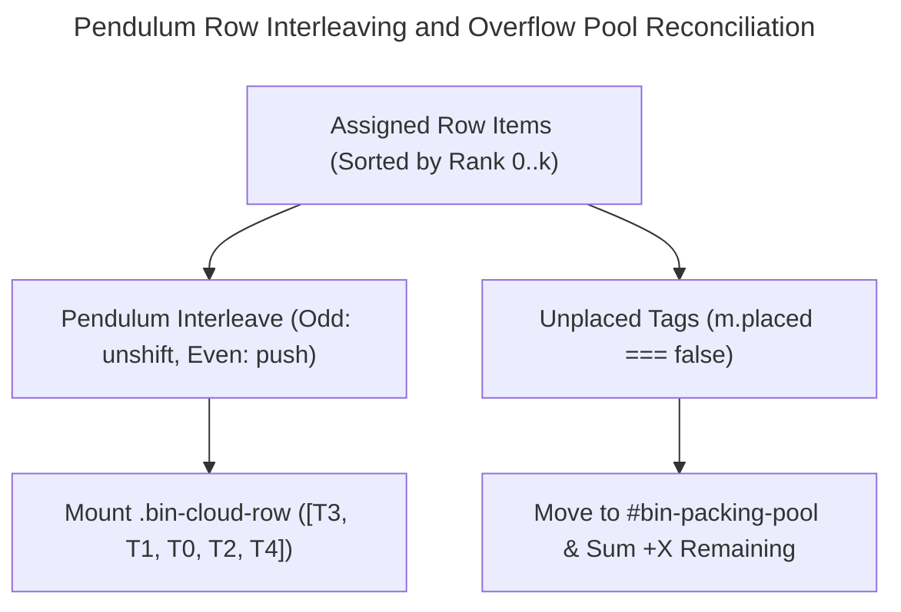

A **2D Elliptical Bin-Packing Tag Cloud Layout Engine** is a deterministic client-side combinatorial solver that measures sub-pixel DOM badge widths and packs interactive topic pills into discrete horizontal rows constrained by a parametric elliptical width envelope, placing high-frequency core tags dead-center while dynamically aggregating unplaced items into an overflow counter.

The table below contrasts naive CSS flexbox wrapping and randomized canvas spiral clouds against our deterministic 2D elliptical DOM bin-packing engine implemented on `hackenberg.tech`:

| Architectural Dimension | Naive CSS Flexbox (`flex-wrap: wrap`) | Randomized Canvas / SVG Spiral Clouds (`Wordle`) | 2D Elliptical DOM Bin-Packing (`hackenberg.tech`) |
| :--- | :--- | :--- | :--- |
| **Spatial Silhouette** | Rigid rectangular bounding box or ragged bottom row with unaligned outer edges. | Arbitrary 2D Archimedean spiral; prone to vertical overflow or unreadable rotated text. | Deterministic parametric ellipse ($R \in \{5, 6\}$ rows) with smooth chord-width tapering. |
| **Visual Hierarchy & Foveal Focus** | Top-left reading bias (`rank 0` placed at top-left corner); violates radial tag cloud ergonomics. | Stochastic central placement; non-deterministic jitter across page reloads. | **Center-Outward Core Anchoring** places `rank 0` in the dead-center row and interleaves outward via a pendulum ordering. |
| **Row Utilization & Gap Control** | Greedy sequential line-breaking leaves wide horizontal gaps and single-pill orphan rows. | Pixel-level quadtree collision tests ($O(N \cdot K)$ spiral steps); high CPU cost on resize. | **Best-Fit Subset-Sum Scoring** balances frequency rank ($s_{\text{rank}}$) and fill ratio ($f$) to eliminate 1-pill orphan rows. |
| **DOM Accessibility & Rich Tooltips** | Native `<a>` links, but static item count overflows narrow mobile viewports vertically. | Flattened `<canvas>` bitmap or overlapping SVG `<text>`; incompatible with rich HTML hover popovers. | 100% semantic DOM nodes (`<a>` + multi-domain progress bar tooltips) with live `#bin-packing-pool` overflow accounting. |
| **Responsive Budget & Overflow** | Either truncates at a fixed server limit or forces 12+ vertical lines on $320\text{ px}$ screens. | Scales down font sizes globally until peripheral labels become illegible ($< 7\text{ px}$). | Reserves bottom-row budget for `#bin-overflow-node` and dynamically updates `+X remaining` tag and content sums. |

> [!TIP]
> **Production Source Code:**  
> Both the Astro server-side frequency quantization and the client-side 2D elliptical bin-packing solver (`initTagCloudEngines` and `runEllipticalBinPacking`) are open-source in [`src/pages/index.astro`](https://github.com/ghackenberg/ghackenberg.github.io/blob/main/src/pages/index.astro) (lines 231–331 for server-side taxonomy preparation, lines 2304–2526 for the DOM stage, and lines 3568–3778 for the solver).

## Why Do Standard CSS Flex-Wrap Lists Fail as Visual Tag Clouds?

Standard CSS `flex-wrap: wrap; justify-content: center` containers fail as visual tag clouds because the browser's greedy inline line-breaker evaluates items strictly top-to-bottom and left-to-right, forcing every line toward 100% container width and relegating the highest-weight topic tags to the upper-left corner rather than the visual center.

Empirical target-selection and recall studies in human-computer interaction demonstrate that the spatial geometry of a tag cloud directly governs how rapidly readers extract thematic structure. Rivadeneira et al. [@rivadeneira-2007-tag-clouds] established four cognitive tasks for tag clouds—*search*, *browsing*, *impression formation*, and *recognition*—and showed that spatial organization strongly influences impression formation. Expanding on this work, Bateman et al. [@bateman-2008-seeing-things-clouds] proved through controlled visual-feature experiments that **font size** and **font weight** dominate user selection attention, while clickmap distributions revealed that tags in the **central core** attract significantly more selections than tags stranded along the outer top and bottom edges.

When developers attempt to build a tag cloud using standard HTML and Tailwind CSS (`flex flex-wrap justify-center gap-2.5`), three structural failure modes emerge immediately:

1. **Top-Left Gravity Bias:** Sorting tags in descending order of frequency ($c_0 \ge c_1 \ge \dots \ge c_{N-1}$) and feeding them into a standard flex container places all `text-xl font-extrabold` badges along the very top edge (`row 0`), while the bottom row (`row R-1`) contains only tiny `text-xs font-medium` pills. Instead of a balanced lens or cloud silhouette, the layout forms an inverted, top-heavy trapezoid.
2. **Rectangular Box Saturation vs. Orphan Rows:** Because CSS flexbox fills each line greedily up to the container's `clientWidth` before wrapping, rows $0$ through $R-2$ stretch across the full rectangular width, while the final row often wraps a single leftover pill (`1-pill orphan row`). On a $375\text{ px}$ mobile viewport, a single oversized tag near a line boundary can leave $45\%$ of the preceding line empty.
3. **Lack of Bounded Vertical Budgets:** While hierarchical spiral-packing algorithms such as Wordle [@viegas-2009-wordle] solve 2D shape packing by testing candidate bounding boxes along an expanding Archimedean spiral $r(\theta) = a + b\theta$ using hierarchical bounding boxes and quadtrees, they operate on static 2D canvas bitmaps or raw SVG `<text>` primitives. In an interactive web application where each tag is a focusable glassmorphic pill (`<a>`) paired with a rich multi-domain breakdown popover (`div.group-hover/tag:flex`), rotating or arbitrarily positioning pills breaks keyboard navigation (`Tab` order), clips absolute-positioned CSS tooltips, and causes severe vertical expansion on narrow screens.

To reconcile the **foveal centrality and organic silhouette** of Viégas et al. [@viegas-2009-wordle] and Bateman et al. [@bateman-2008-seeing-things-clouds] with the **semantic accessibility and zero-reflow responsiveness** of native DOM elements, we formulated the tag cloud layout as a constrained **2D Elliptical Bin-Packing Problem**.


## Server-Side Taxonomic Aggregation and Four-Tier Typographic Scaling

Server-side taxonomic aggregation computes cross-domain content frequencies across eight Astro collections at build time and maps each tag's normalized frequency ratio $\tau_i \in [0, 1]$ onto four discrete typographic weight and size tiers, while pre-calculating baseline overflow counters for tags beyond the top $N = 21$ visible slice.

Before the client-side bin-packing engine runs in the browser, [`src/pages/index.astro`](https://github.com/ghackenberg/ghackenberg.github.io/blob/main/src/pages/index.astro#L194-L331) aggregates every canonical tag from `src/content/tags/` across all eight content domains on the platform:

1. **Research & Professional Interests** (`interests`)
2. **Technical Blog Posts** (`posts`)
3. **Peer-Reviewed Academic Publications** (`publications`)
4. **Slide-as-Code Presentations** (`presentations`)
5. **University Courses** (`courses`)
6. **Software & Engineering Projects** (`projects`)
7. **B2B Advisory Services** (`services`)
8. **Interactive WebGL & Canvas Visualizations** (`visualizations`)

For each tag $i \in \{0, \dots, M-1\}$, its total cross-domain frequency $c_i$ is the sum of occurrences across these eight collections:

$$c_i = \sum_{d \in \mathcal{D}} c_{i,d}, \qquad \mathcal{D} = \{\text{interests}, \text{posts}, \text{pubs}, \text{pres}, \text{courses}, \text{projects}, \text{services}, \text{vis}\}$$

Let $c_{\max} = \max_i c_i$ and $c_{\min} = \min_i c_i$. Following the empirical findings of Bateman et al. [@bateman-2008-seeing-things-clouds] that coupling font size with font weight produces stronger visual pop-out than continuous linear font scaling alone, we compute the normalized frequency ratio $\tau_i$ and assign each tag to one of four discrete typographic tiers:

$$\tau_i = \begin{cases} \dfrac{c_i - c_{\min}}{c_{\max} - c_{\min}} & \text{if } c_{\max} > c_{\min} \\[6pt] 0.5 & \text{otherwise} \end{cases}$$

The piecewise mapping in [`src/pages/index.astro`](https://github.com/ghackenberg/ghackenberg.github.io/blob/main/src/pages/index.astro#L281-L299) clamps `minTagCount` via `Math.min(..., 1)` so that $\tau_i$ always normalizes against a near-zero baseline floor ($\le 1$), and assigns responsive Tailwind utility classes for mobile (`< 640px`), tablet (`sm:`), and desktop (`md:`) viewports:

```typescript
const maxTagCount = Math.max(...tagCloudList.map(t => t.totalCount), 1);
const minTagCount = Math.min(...tagCloudList.map(t => t.totalCount), 1);

tagCloudList.forEach(t => {
  const ratio = maxTagCount > minTagCount
    ? (t.totalCount - minTagCount) / (maxTagCount - minTagCount)
    : 0.5;
  if (ratio > 0.75) {
    t.fontSizeClass = "text-[13px] leading-tight sm:text-lg md:text-xl";
    t.fontWeightClass = "font-extrabold";
  } else if (ratio > 0.45) {
    t.fontSizeClass = "text-xs leading-tight sm:text-base md:text-lg";
    t.fontWeightClass = "font-bold";
  } else if (ratio > 0.2) {
    t.fontSizeClass = "text-[11px] leading-tight sm:text-sm md:text-base";
    t.fontWeightClass = "font-semibold";
  } else {
    t.fontSizeClass = "text-[11px] leading-tight sm:text-xs md:text-sm";
    t.fontWeightClass = "font-medium";
  }
});
```

After sorting all $M$ tags by $c_i$ descending (with alphabetical tie-breaking via `localeCompare`), the server slices the top $N = 21$ tags into `visibleSlice` (`rank = 0..20`) and aggregates the remaining $M - 21$ tags into `overflowTags`. Both the baseline remaining tag count (`data-base-rest-tags={restTagsCount}`) and the deduplicated union of content items tagged with any overflow tag (`data-base-rest-items={restTotalContentCount}`) are serialized directly onto `#bin-packing-stage`.

## Stage 1: Why Must Tag Cloud Engines Measure Sub-Pixel DOM Widths Instead of Character Counts?

Tag cloud engines must measure live sub-pixel DOM widths via `Element.getBoundingClientRect().width` because proportional web fonts, kerning pairs, four-tier font-size and font-weight classes, responsive horizontal padding, and variable-digit badge counters make static character-length estimates diverge by up to 38% from actual rendered pixel widths.

A common shortcut in SSR tag cloud implementations is estimating pill width $w_i$ as an affine function of string length, such as $\hat{w}_i = \alpha \cdot |\text{name}_i| + \beta$. In a multi-tier typographic system using variable-width humanist sans-serif fonts (`Inter`), this heuristic fails for four compounding reasons:

1. **Glyph Advance-Width Variance:** In proportional fonts, narrow glyphs like `'i'`, `'l'`, and `'t'` occupy less than one-third the horizontal advance width of wide glyphs like `'m'`, `'w'`, or uppercase `'W'`. Two 12-character tags—such as `#optimization` ($12\text{ chars}$) and `#web-assembly` ($12\text{ chars}$)—differ in rendered text width by more than $24\text{ px}$ at `md:text-xl`.
2. **Four-Tier Scale Multiplier:** Because Tier 1 tags (`ratio > 0.75`) render at `md:text-xl font-extrabold` ($20\text{ px}$, weight $800$) while Tier 4 tags (`ratio <= 0.2`) render at `md:text-sm font-medium` ($14\text{ px}$, weight $500$), a 10-character Tier 1 tag is wider than a 15-character Tier 4 tag.
3. **Composite Pill Chrome:** Each `.bin-pill-link` anchor contains a leading `#` prefix, a responsive horizontal gap (`gap-1 sm:gap-1.5`), a rounded count badge (`px-1 sm:px-1.5 py-0.25 rounded-md`) whose width depends on whether `totalCount` is 1, 2, or 3 digits, and outer pill padding (`px-2.5 sm:px-3.5`) plus a $1\text{ px}$ border on each side.
4. **Breakpoint-Dependent CSS Tokens:** Crossing the `sm:` ($640\text{ px}$) or `md:` ($768\text{ px}$) media query boundaries changes padding, gap, and font size simultaneously.

To obtain ground-truth pixel geometry without hardcoding fragile font-metric lookup tables, Stage 1 of `runEllipticalBinPacking()` in [`src/pages/index.astro`](https://github.com/ghackenberg/ghackenberg.github.io/blob/main/src/pages/index.astro#L3600-L3618) temporarily mounts all 21 `.bin-tag-node` elements and `#bin-overflow-node` into a single flat flex container (`#bin-packing-rows`) and queries the W3C CSSOM View [`getBoundingClientRect()`](https://www.w3.org/TR/cssom-view-1/#dom-element-getboundingclientrect) API [@w3c-2016-cssom-view]:

```typescript
const isMobile = containerW < 460;
const gapPx = isMobile ? 6 : 10;
const effectiveW = Math.min(containerW, 920);

// 1. Temporarily place all nodes in a single flat flex container to measure exact pixel widths
binRowsContainer.innerHTML = '';
binRowsContainer.className = 'flex flex-wrap items-center justify-center gap-1.5 sm:gap-2.5 w-full';
allTagNodes.forEach((node) => binRowsContainer.appendChild(node));
if (overflowNode) binRowsContainer.appendChild(overflowNode);

const measured = allTagNodes.map((node, idx) => ({
  node,
  rank: idx,
  width: Math.ceil(node.getBoundingClientRect().width) || 95,
  total: parseInt(node.dataset.total || '0', 10) || 0,
  placed: false,
}));

const overflowW = overflowNode ? (Math.ceil(overflowNode.getBoundingClientRect().width) || 120) : 0;
```

Rounding each sub-pixel floating-point measurement upward via `Math.ceil(node.getBoundingClientRect().width)` guarantees a conservative integer upper bound $w_i = \lceil w_{i,\text{exact}} \rceil$. This prevents sub-pixel fractional accumulation across 4–6 pills in a `flex-nowrap` row from ever exceeding the parent container width by $0.5\text{ px}$ and triggering horizontal clipping.

## Stage 2: Parametric Elliptical Envelope Capacity Modeling

Parametric elliptical envelope modeling discretizes the tag cloud into $R \in \{5, 6\}$ horizontal rows and assigns each row $r$ a maximum pixel capacity $C_r$ derived from the canonical ellipse chord equation over a normalized vertical coordinate $u_r \in [-1, 1]$, tapering smoothly from $100\%$ width at the equator toward a floor ratio $\rho_{\min}$ with attenuated polar chords at $|u_r| = 1$.

Once the exact item widths $w_0, \dots, w_{N-1}$ and overflow badge width $w_{\text{overflow}}$ are known, we define the 2D target silhouette. Let $W$ denote `binStage.clientWidth`. To keep the cloud compact and focal on ultrawide monitors, we clamp the effective major-axis width to $W_{\text{eff}} = \min(W, 920\text{ px})$.

Next, the engine selects the discrete row count $R$ (`numRows`) and the polar minimum width ratio $\rho_{\min}$ (`minEnvelopeRatio`) based on the available container width $W$:

$$R(W) = \begin{cases} 5 & \text{if } W < 380\text{ px} \\ 6 & \text{if } 380\text{ px} \le W < 680\text{ px} \\ 5 & \text{if } W \ge 680\text{ px} \end{cases} \qquad \rho_{\min}(W) = \begin{cases} 0.78 & \text{if } W < 420\text{ px} \\ 0.58 & \text{if } W \ge 420\text{ px} \end{cases}$$

Why does $R(W)$ transition from $5 \to 6 \to 5$ across breakpoints, and why does $\rho_{\min}$ increase from $0.58$ on desktop to $0.78$ on narrow mobile viewports?
- On **desktop viewports ($W \ge 680\text{ px}$)**, $5$ rows with a pronounced polar taper ($\rho_{\min} = 0.58$) produce a classic, wide horizontal lens where the top and bottom rows (`r = 0` and `r = 4`) are noticeably narrower than the equatorial row (`r = 2`).
- On **intermediate tablet/large-phone viewports ($380\text{ px} \le W < 680\text{ px}$)**, tags transition across the `sm:` typography breakpoint; expanding to $R = 6$ rows provides extra vertical capacity so mid-rank tags remain visible rather than overflowing prematurely.
- On **narrow smartphones ($W < 420\text{ px}$)**, because the polar chord factor at $|u_r| = 1$ retains an attenuated radical $\sqrt{1 - 0.86} = \sqrt{0.14} \approx 0.3742$—meaning $E(\pm 1) = \rho_{\min} + 0.3742(1 - \rho_{\min})$—a $0.58$ floor ratio on a $320\text{ px}$ screen would yield $E(\pm 1) \approx 0.737$ and shrink the polar row capacities to $\lfloor 320 \times 0.737 \rfloor = 235\text{ px}$ (leaving only $235 - 120 - 6 = 109\text{ px}$ in the bottom row alongside `#bin-overflow-node`). Raising $\rho_{\min}$ to $0.78$ boosts $E(\pm 1)$ to $0.862$ ($\lfloor 320 \times 0.862 \rfloor = 275\text{ px}$), leaving $149\text{ px}$ alongside the overflow badge in the bottom row and $275\text{ px}$ for 2 compact pills in the top row while preserving a gentle elliptical curve.

For each row index $r \in \{0, 1, \dots, R-1\}$, we define the midpoint index $r_{\text{mid}} = \frac{R - 1}{2}$ and the normalized vertical coordinate $u_r \in [-1, +1]$:

$$u_r = \frac{r - r_{\text{mid}}}{r_{\text{mid}}} \in [-1, +1]$$

The horizontal chord factor $E(u_r)$ blends the baseline polar ratio $\rho_{\min}$ with an elliptical radical attenuated by an eccentricity factor $\alpha = 0.86$:

$$E(u_r) = \rho_{\min} + (1 - \rho_{\min}) \sqrt{\max\!\left(0,\, 1 - 0.86\, u_r^2\right)}$$

Multiplying $E(u_r)$ by $W_{\text{eff}}$ yields the integer pixel capacity $C_r$ of row $r$:

$$C_r = \left\lfloor W_{\text{eff}} \cdot \left(\rho_{\min} + (1 - \rho_{\min}) \sqrt{\max\!\left(0,\, 1 - 0.86\, u_r^2\right)}\right) \right\rfloor$$

At the equator ($u_r = 0$), $E(0) = 1.0$ and $C_r = W_{\text{eff}}$. At the top and bottom poles ($|u_r| = 1$), $\sqrt{1 - 0.86} = \sqrt{0.14} \approx 0.3742$, yielding two distinct geometric regimes:
- For **5-Row Regimes ($R = 5$, $r_{\text{mid}} = 2.0$, Desktop $\rho_{\min} = 0.58$)**:
  - Poles ($r \in \{0, 4\}$, $|u_r| = 1.0$): $E(\pm 1) = 0.58 + 0.42 \times 0.3742 = 0.737 \;(73.7\% \text{ of } W_{\text{eff}})$.
  - Intermediate rows ($r \in \{1, 3\}$, $|u_r| = 0.5$): $E(\pm 0.5) = 0.58 + 0.42 \times \sqrt{0.785} = 0.952 \;(95.2\% \text{ of } W_{\text{eff}})$.
  - Dead-center row ($r = 2$, $u_2 = 0.0$): $E(0) = 1.000 \;(100.0\% \text{ of } W_{\text{eff}})$.
- For **6-Row Regimes ($R = 6$, $r_{\text{mid}} = 2.5$, Intermediate Viewports $380\text{ px} \le W < 680\text{ px}$)**:
  - Because $r_{\text{mid}} = 2.5$ is a half-integer, no single row sits at $u_r = 0$; instead, the two inner equatorial rows ($r \in \{2, 3\}$) straddle the equator symmetrically at $u_{2,3} = \pm 0.2$ ($E(\pm 0.2) \approx 0.993$ for $\rho_{\min} = 0.58$), the intermediate rows ($r \in \{1, 4\}$) sit at $u_{1,4} = \pm 0.6$ ($E(\pm 0.6) \approx 0.929$), and the outer polar rows ($r \in \{0, 5\}$) sit at $u_{0,5} = \pm 1.0$. Crucially, this explains why Phase 1 sets its core region filter to $|u_r| \le 0.72$: since $0.6 < 0.72 < 1.0$, the threshold $|u_r| \le 0.72$ cleanly selects all $R - 2$ non-polar rows across both 5-row ($|u_r| \in \{0, 0.5\}$) and 6-row ($|u_r| \in \{0.2, 0.6\}$) regimes.

Finally, before placing any content tags, the solver pre-allocates the width of `#bin-overflow-node` ($w_{\text{overflow}}$) inside the bottom row ($r = R - 1$), guaranteeing that the `+X remaining` archive link is always anchored at the bottom-right periphery of the ellipse:

```typescript
const rows: EllipticalRow[] = [];
for (let r = 0; r < numRows; r++) {
  const u = midRow > 0 ? (r - midRow) / midRow : 0; // [-1, +1]
  const ellipseFactor = minEnvelopeRatio + (1 - minEnvelopeRatio) * Math.sqrt(Math.max(0, 1 - 0.86 * u * u));
  rows.push({
    index: r,
    u,
    capacity: Math.floor(effectiveW * ellipseFactor),
    usedWidth: 0,
    items: [],
    hasOverflowBadge: false,
  });
}

// Reserve space in the bottom row (numRows - 1) for the +X remaining overflow pill
if (overflowNode) {
  const lastRow = rows[numRows - 1];
  lastRow.hasOverflowBadge = true;
  lastRow.usedWidth = overflowW;
}
```

## How Does Our Three-Phase Heuristic Solve Elliptical Bin Packing in Real Time?

Our three-phase heuristic solves the NP-hard variable-sized bin-packing problem in $O(N^2 + N \cdot R)$ time—executing in under $0.8\text{ ms}$ per layout pass—by decomposing placement into **Phase 1 (Center-Outward Core Anchoring)**, **Phase 2 (Adaptive Best-Fit Subset-Sum Gap Filling)**, and **Phase 3 (Center-Heavy Pendulum Interleaving)** across the elliptical row capacities.

In combinatorial optimization, packing $N$ items of arbitrary widths $w_i$ into $R$ bins of capacities $C_r$ is a generalization of the classical 1D Bin Packing and Multiple Subset-Sum problems, which are strongly NP-complete [@garey-1979-intractability]. Classical offline approximation heuristics surveyed by Coffman et al. [@coffman-1996-bin-packing]—such as *First-Fit Decreasing (FFD)* and *Best-Fit Decreasing (BFD)*—assume identical bins and optimize solely to minimize the number of bins used. Because our Phase 2 `while (keepFilling)` loop performs at most $N$ successful item placements and $R$ row-termination checks across the entire cloud—each scanning $N$ items in `measured`—the worst-case time complexity is bounded by $O(N^2 + N \cdot R)$, which for $N = 21$ and $R \le 6$ requires at most $(21 + 6) \times 21 = 567$ elementary operations.

In a visual tag cloud, however, our objective function is fundamentally multi-criteria:
1. **Radial Centrality:** The highest-ranked tags ($\text{rank} \in \{0, \dots, 6\}$) must cluster inside the equatorial zone ($|u_r| \le 0.72$), not scatter into the polar rows.
2. **Envelope Fidelity & Anti-Orphan Constraint:** Every row $r$ should fill as close to its elliptical target capacity $C_r$ as possible without leaving awkward single-pill rows (`row.items.length === 1`).
3. **Horizontal Symmetry:** Within each row, the largest, highest-ranked pills must sit near the horizontal midpoint, tapering symmetrically toward both left and right row edges.

Let us examine how each of the three phases in [`src/pages/index.astro`](https://github.com/ghackenberg/ghackenberg.github.io/blob/main/src/pages/index.astro#L3655-L3748) enforces these constraints.

### Phase 1: Center-Outward Core Anchoring (`rank < 7`)

First, we sort the row descriptors by their absolute distance $|u_r|$ from the equator (`centerOutwardRows`), producing the sequence $[2, 1, 3, 0, 4]$ for $R = 5$ rows (or $[2, 3, 1, 4, 0, 5]$ for $R = 6$ rows). A helper predicate `canFitInRow(row, itemW)` checks whether adding an item of width $w_i$ (plus the inter-pill flex gap $g \in \{6\text{ px}, 10\text{ px}\}$ if the row is non-empty) respects $C_r$, with a graceful mobile safeguard allowing a single wide tag in an empty row if $w_i \le W$:

$$\text{needed}(r, w_i) = w_i + \begin{cases} g & \text{if } |I_r| > 0 \lor \text{hasOverflowBadge}_r \\ 0 & \text{otherwise} \end{cases}$$

$$\text{canFit}(r, w_i) \iff \Big(|I_r| = 0 \land \neg\text{hasOverflowBadge}_r \land w_i \le W\Big) \;\lor\; \Big(U_r + \text{needed}(r, w_i) \le C_r\Big)$$

In **Phase 1**, we isolate the top 7 core tags (`coreItems`, $\text{rank} \in \{0, \dots, 6\}$) and restrict their primary target region to the central rows satisfying $|u_r| \le 0.72$ (`centralRows`, which selects rows $\{2, 1, 3\}$ for $R=5$ and rows $\{2, 3, 1, 4\}$ for $R=6$):

- **Dead-Center Anchor (`cIdx === 0`):** The `#1` highest-frequency tag on the entire website (`rank = 0`) is placed unconditionally into `centerOutwardRows[0]` (the equatorial row).
- **Load-Balanced Core Distribution (`cIdx = 1..6`):** Each remaining core tag filters `centralRows` to those where `canFitInRow` holds, and sorts candidates lexicographically by **(1) fewest currently placed items** $|I_r|$ ascending, and **(2) largest residual capacity** $(C_r - U_r)$ descending:

```typescript
// 3. Phase 1: Place top-frequency tags (rank 0..6) into the central rows first so the largest pills anchor the center
const centralRows = centerOutwardRows.filter((r) => Math.abs(r.u) <= 0.72);
const coreItems = measured.filter((m) => m.rank < 7);

coreItems.forEach((core, cIdx) => {
  if (cIdx === 0) {
    // Place #1 tag directly in the dead-center row
    addItemToRow(centerOutwardRows[0], core);
    return;
  }
  // Find the central row with the most remaining capacity where core fits
  const candidateRows = centralRows
    .filter((r) => canFitInRow(r, core.width))
    .sort((a, b) => (a.items.length - b.items.length) || ((b.capacity - b.usedWidth) - (a.capacity - a.usedWidth)));

  if (candidateRows.length > 0) {
    addItemToRow(candidateRows[0], core);
  } else {
    // Fallback to any row from center outward that fits
    const anyRow = centerOutwardRows.find((r) => canFitInRow(r, core.width));
    if (anyRow) addItemToRow(anyRow, core);
  }
});
```

Sorting first by `a.items.length - b.items.length` prevents two or three medium-short core tags from crowding into a single central row while leaving an adjacent central row with only one giant pill. Every equatorial row receives a balanced backbone of 1–3 high-weight core tags before Phase 2 begins.

### Phase 2: Best-Fit Subset-Sum Gap Filling with Anti-Orphan Weighting

Once the 7 core tags anchor the center, **Phase 2** iterates through `centerOutwardRows` from the equator outward to the poles. For each row $r$, the solver repeatedly selects the optimal unplaced candidate $i \in \mathcal{U}_r = \{m \mid \neg m.\text{placed} \land \text{canFit}(r, m.\text{width})\}$ until no remaining unplaced tag fits in row $r$.

Let $C_{\text{rem}}(r)$ denote the net remaining pixel budget in row $r$ after accounting for the inter-pill gap $g$:

$$C_{\text{rem}}(r) = C_r - U_r - \begin{cases} g & \text{if } |I_r| > 0 \lor \text{hasOverflowBadge}_r \\ 0 & \text{otherwise} \end{cases}$$

For each fitting candidate tag $i \in \mathcal{U}_r$, we compute two normalized metrics in $[0, 1]$:
1. **Complementary Fill Ratio ($f_i$):** How snugly candidate $i$'s pixel width $w_i$ fills the remaining row budget $C_{\text{rem}}(r)$:
   $$f_i = \begin{cases} \min\!\left(1,\, \dfrac{w_i}{C_{\text{rem}}(r)}\right) & \text{if } C_{\text{rem}}(r) > 0 \\[6pt] 0.5 & \text{otherwise} \end{cases}$$
2. **Normalized Frequency Rank Score ($s_{\text{rank}, i}$):** How important tag $i$ is in the global taxonomy ($N = |\text{measured}|$):
   $$s_{\text{rank}, i} = 1 - \frac{\text{rank}_i}{N}$$

If we weighted $s_{\text{rank}, i}$ exclusively, the solver would degenerate into First-Fit Decreasing and leave large unused margins whenever the next highest-ranked tag happens to be slightly too wide or too narrow. Conversely, if we weighted $f_i$ exclusively, low-priority peripheral tags could usurp prime central space simply because their pixel width matched $C_{\text{rem}}(r)$.

We resolve this tension via an **adaptive convex combination** $S(r, i)$ that switches weights depending on whether row $r$ currently contains only a single pill ($|I_r| = 1$):

$$S(r, i) = \begin{cases} 0.65\, f_i + 0.35\, s_{\text{rank}, i} & \text{if } |I_r| = 1 \quad \text{(Anti-Orphan Complementary Mode)} \\[4pt] 0.65\, s_{\text{rank}, i} + 0.35\, f_i & \text{if } |I_r| \neq 1 \quad \text{(Rank-Priority Mode)} \end{cases}$$

```typescript
// 4. Phase 2: Best-Fit Subset-Sum Gap Filling across all rows from center outward
// Pair long tags with shorter tags so rows reach their elliptical target envelope without 1-pill gaps
centerOutwardRows.forEach((row) => {
  let keepFilling = true;
  while (keepFilling) {
    const unplaced = measured.filter((m) => !m.placed && canFitInRow(row, m.width));
    if (unplaced.length === 0) {
      keepFilling = false;
      break;
    }
    const remainingCap = row.capacity - row.usedWidth - (row.items.length > 0 || row.hasOverflowBadge ? gapPx : 0);
    // Score candidates: balance frequency rank priority with how snugly they fill remainingCap
    let bestCandidate = unplaced[0];
    let bestScore = -Infinity;
    for (const cand of unplaced) {
      const fillRatio = remainingCap > 0 ? Math.min(1, cand.width / remainingCap) : 0.5;
      const rankScore = 1 - cand.rank / measured.length;
      // If row currently has only 1 pill, strongly reward picking a complementary pill to avoid 1-pill rows
      const score = row.items.length === 1
        ? (fillRatio * 0.65 + rankScore * 0.35)
        : (rankScore * 0.65 + fillRatio * 0.35);
      if (score > bestScore) {
        bestScore = score;
        bestCandidate = cand;
      }
    }
    addItemToRow(row, bestCandidate);
  }
});
```

When a row has exactly one pill ($|I_r| = 1$—for instance, after Phase 1 placed a wide core pill like `#artificial-intelligence` into a central row), the $0.65 f_i$ weight strongly rewards selecting a complementary pill whose width fills the remaining chord capacity, eliminating isolated single-pill rows and pairing long labels with shorter companions. Once $|I_r| \ge 2$ (or when starting an empty polar row $|I_r| = 0$), the solver flips to $0.65 s_{\text{rank}, i} + 0.35 f_i$, prioritizing high-rank tags while still breaking ties in favor of tighter geometric packing.

### Phase 3: Center-Heavy Pendulum Interleaving (`unshift` vs. `push`)

After Phase 2 assigns a subset of pills $I_r$ to each row $r$, the items inside $I_r$ are ordered by the sequence in which they were selected. If we rendered $I_r$ directly left-to-right, the largest core tag in each row would sit on the far-left edge rather than the horizontal center of the ellipse.

In **Phase 3**, we sort each row's assigned items ascending by rank ($a.\text{rank} - b.\text{rank}$, so the most prominent tag is at index $k = 0$) and interleave them into an output array `orderedRowItems` using a **pendulum permutation** (`unshift` for odd indices $k$, `push` for even indices $k$):

```typescript
// Sort row items by rank ascending (most important first) then pendulum-interleave so peak is in row center
const sortedRowItems = row.items.slice().sort((a, b) => a.rank - b.rank);
const orderedRowItems: typeof sortedRowItems = [];
sortedRowItems.forEach((item, idx) => {
  if (idx === 0) orderedRowItems.push(item);
  else if (idx % 2 === 1) orderedRowItems.unshift(item);
  else orderedRowItems.push(item);
});
```

For a row containing five items sorted by importance $[T_0, T_1, T_2, T_3, T_4]$, the pendulum permutation produces:

$$\text{Pendulum}([T_0, T_1, T_2, T_3, T_4]) = [T_3,\, T_1,\, \mathbf{T_0},\, T_2,\, T_4]$$

Notice the resulting horizontal profile: the heaviest pill $\mathbf{T_0}$ sits dead-center, flanked immediately by $T_1$ (left) and $T_2$ (right), while the smallest peripheral pills $T_3$ and $T_4$ taper symmetrically toward the outer left and right edges of the row. In the bottom row ($r = R - 1$), `#bin-overflow-node` is appended after `orderedRowItems`, anchoring the `+X remaining` badge cleanly at the bottom-right corner of the elliptical contour.



## Dynamic Overflow Accounting, Rich Hover Tooltips, and Zero-Jitter Resize Synchronization

Tags that exceed the elliptical envelope budget on narrower viewports are non-destructively parked inside a hidden `#bin-packing-pool` container while their counts dynamically increment the `#bin-overflow-node` pill and its popover tooltip, synchronized across `ResizeObserver` and `document.fonts.ready` gates with a $2\text{ px}$ width hysteresis.

A critical flaw of naive DOM truncation (`node.remove()`) is that once a tag node is destroyed on a narrow viewport, widening the browser window (or rotating a tablet from portrait to landscape) cannot restore the missing tags without re-fetching data. Conversely, keeping all 21 tags in memory and moving overflowed nodes into a hidden staging container (`<div id="bin-packing-pool" class="hidden" aria-hidden="true"></div>`) preserves every DOM node and its pre-rendered hover tooltip across arbitrary resize cycles.

At the end of `runEllipticalBinPacking()`, [`src/pages/index.astro`](https://github.com/ghackenberg/ghackenberg.github.io/blob/main/src/pages/index.astro#L3750-L3767) collects all unplaced items $\mathcal{U}_{\text{unplaced}} = \{m \mid \neg m.\text{placed}\}$, transfers their DOM nodes to `#bin-packing-pool`, and computes the dynamic overflow totals:

$$N_{\text{rest,dyn}} = N_{\text{rest,base}} + |\mathcal{U}_{\text{unplaced}}|, \qquad C_{\text{rest,dyn}} = C_{\text{rest,base}} + \sum_{m \in \mathcal{U}_{\text{unplaced}}} c_m$$

```typescript
// Move any unplaced tags to hidden pool & dynamically update the +X remaining badge and tooltip
const unplacedItems = measured.filter((m) => !m.placed);
let extraOverflowItemsSum = 0;
unplacedItems.forEach((item) => {
  extraOverflowItemsSum += item.total;
  binPool.appendChild(item.node);
});

const dynamicRestTags = baseRestTags + unplacedItems.length;
const dynamicRestItems = baseRestItems + extraOverflowItemsSum;

if (overflowLabel) overflowLabel.textContent = `+${dynamicRestTags} remaining`;
if (overflowCount) overflowCount.textContent = `${dynamicRestItems}`;
if (overflowTooltipTitle) overflowTooltipTitle.textContent = `+${dynamicRestTags} Remaining Tags`;
if (overflowTooltipCount) {
  overflowTooltipCount.textContent = `${dynamicRestItems} ${dynamicRestItems === 1 ? 'item' : 'items'}`;
}
```

Notice an intentional architectural trade-off between build-time and client-side overflow accounting: on the server ([`src/pages/index.astro`](https://github.com/ghackenberg/ghackenberg.github.io/blob/main/src/pages/index.astro#L305-L318)), `baseRestItems` (`restTotalContentCount`) is deduplicated per content collection via `.some(t => overflowTagIds.has(t))`, whereas on the client, any tag dynamically displaced into `#bin-packing-pool` on narrow viewports adds its individual tag frequency $c_m$ (`item.total`) via `extraOverflowItemsSum`. This additive client-side approximation avoids serializing the full $M \times |\text{items}|$ bipartite tag-to-content incidence matrix into the HTML payload just to update a mobile badge counter.

### Multi-Domain Stacked Bar Tooltips in Pure CSS

Because every `.bin-tag-node` remains a native HTML element inside a `.bin-cloud-row`, hovering or keyboard-focusing (`md:group-hover/tag:flex md:group-focus-within/tag:flex`) any pill reveals a glassmorphic popover card (`backdrop-blur-md`) at zero JavaScript runtime cost. Each popover displays:
1. **Canonical Tag Header & Total Badge:** The tag title (`#tag.name`) alongside the total cross-domain item count.
2. **Semantic Definition:** A two-line excerpt (`line-clamp-2`) from `src/content/tags/<id>.md`.
3. **Proportional 8-Domain Stacked Progress Bar:** A $6\text{ px}$-tall segmented bar (`div.h-1.5.rounded-full`) where each content collection $d \in \mathcal{D}$ renders a color-coded segment (`bg-domain-posts`, `bg-domain-publications`, `bg-domain-projects`, etc.) proportional to its percentage share $p_{i,d} = \text{round}(100 \cdot c_{i,d} / c_i)$.
4. **Domain Legend Pills:** Individual dot indicators listing the exact count and percentage per active content collection.

### Zero-Jitter `ResizeObserver` and Web-Font Synchronization

Finally, to guarantee zero Cumulative Layout Shift (CLS = 0), prevent duplicate observer registration across Astro page loads via an idempotency guard (`binStage.dataset.engineInit === 'true'`), and avoid redundant layout thrashing during vertical mobile scrolling (when mobile browser address bars retract and fire vertical resize events without changing horizontal width), `initTagCloudEngines()` wraps `runEllipticalBinPacking()` in a W3C `ResizeObserver` [@w3c-2020-resize-observer] paired with two custom synchronization guards:

1. **Horizontal Width Hysteresis (`< 2px`):** The guard `if (containerW <= 0 || Math.abs(containerW - lastPackedWidth) < 2) return;` ignores pure vertical viewport changes and sub-pixel rounding fluctuations.
2. **Web-Font Metric Re-Convergence (`document.fonts.ready`):** When local `@fontsource/inter` web fonts finish asynchronous glyph table activation, `document.fonts.ready` resets `lastPackedWidth = 0` and triggers a single deterministic re-pack so pill widths reflect the final typographic metrics:

```typescript
runEllipticalBinPacking();
const binResizeObserver = new ResizeObserver(() => {
  requestAnimationFrame(runEllipticalBinPacking);
});
binResizeObserver.observe(binStage);
document.fonts?.ready?.then(() => {
  lastPackedWidth = 0;
  runEllipticalBinPacking();
});
```

## Key Takeaways for Geometric UI Engineering

Replacing naive `flex-wrap` tag lists with a deterministic **2D Elliptical Bin-Packing Engine** transforms a static taxonomy index into an ergonomic visual instrument—an architectural pattern that generalizes directly to enterprise faceted-navigation headers, industrial MES/PLM filter bars, and observability dashboards requiring bounded vertical budgets and zero Cumulative Layout Shift:

1. **Measure Real DOM Geometry (`getBoundingClientRect`):** Never approximate proportional typography and multi-tier pill chrome with character counts; a single flat DOM measurement pass yields exact sub-pixel widths in under $0.3\text{ ms}$.
2. **Constrain Rows with a Parametric Elliptical Envelope:** Modeling row capacities via $C_r = \lfloor W_{\text{eff}} (\rho_{\min} + (1 - \rho_{\min})\sqrt{1 - 0.86 u_r^2}) \rfloor$ shapes standard flexbox rows into an organic lens silhouette across all screen widths.
3. **Anchor the Core, Fill Gaps with Adaptive Subset-Sum Scoring:** Separating Phase 1 (equatorial core anchoring for `rank < 7`) from Phase 2 (convex combination of fill ratio $f_i$ and rank score $s_{\text{rank}, i}$) prevents single-pill orphan rows while preserving strict hierarchy.
4. **Pendulum Interleaving Creates Foveal Symmetry:** Alternating `unshift` and `push` on rank-sorted row items places the heaviest pills along the vertical spine of the cloud without manual CSS offsets.
5. **Non-Destructive Overflow Pooling:** Routing unplaced DOM nodes to `#bin-packing-pool` and dynamically updating `#bin-overflow-node` guarantees zero vertical bloat on $320\text{ px}$ mobile screens and instant recovery when resizing to desktop viewports.
