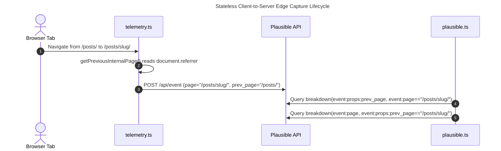
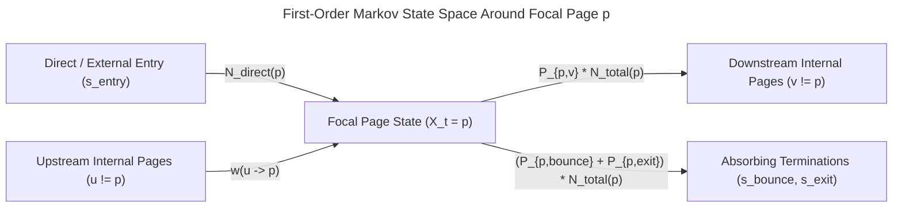

Consent-free visitor flow reconstruction is a stateless web telemetry architecture that captures multi-step internal navigation paths without cookies, `localStorage`, `sessionStorage`, or persistent session identifiers. By combining ephemeral same-origin `document.referrer` step transitions (`prev_page`) with first-order Markov chain models and Hamilton Largest Remainder apportionment, engineering teams achieve 100% ePrivacy-compliant path analytics without consent banners.

| Architectural Dimension | Cookie / LocalStorage Session Tracking (GA4) | Client Ephemeral `flow_id` (`sessionStorage` / `window.name`) | Stateless Same-Origin `document.referrer` (`prev_page`) + 1st-Order Markov Flows (`hackenberg.tech`) |
| :--- | :--- | :--- | :--- |
| **Terminal Storage Write (`Art. 5(3) ePrivacy`)** | Writes persistent `_ga` cookies or `localStorage` tokens to user terminal equipment | Writes tab-scoped `sessionStorage` or `window.name` state into browser memory | **Zero client storage writes**; reads standard transient HTTP navigation metadata (`document.referrer`) |
| **Consent Banner Requirement** | Mandatory prior opt-in consent modal required across EU/EEA jurisdictions | Legally contested under EDPB Guidelines 2/2023 due to terminal storage write & read | **100% consent-free**; no privacy modal required, eliminating banner fatigue and UI clutter |
| **Telemetry Coverage Rate** | Typically 35%–60% (severe sampling bias from consent rejections and adblockers) | 40%–65% if gated behind opt-in; risks regulatory non-compliance if ungated | **100% server-observed traffic coverage** (respecting voluntary browser `GPC` and `DNT` signals) |
| **Cross-Page Path Reconstruction** | Deterministic multi-hop sequence joined via persistent client `session_id` | Deterministic tab-level sequence joined via generated `flow_id` UUID | **Dual-Engine**: Empirical 1-step `prev_page` transitions + **1st-order Markov chain** boundary synthesis |
| **Flow Conservation Invariant** | Native per-session event stream aggregation | Native per-tab sequence aggregation | Enforced deterministically via **Largest Remainder Method (Hamilton apportionment)** |

In our earlier architectural deep dive on the [Unified Analytics MCP Server for SEO, GEO, and AIO audits](/posts/2026_09_23_unified_analytics_mcp_server_seo_geo_aio/) and our subsequent [Agentic SEO, GEO, and AIO case study](/posts/2026_09_24_agentic_seo_geo_aio_mcp_praxisbericht/), we demonstrated how autonomous coding agents combine Google Search Console search intent with Plausible Analytics engagement metrics. However, reconstructing **multi-step visitor flows**—understanding exactly which upstream catalog or article led a reader to a target page, which high-intent actions they triggered on the page, and which internal page they navigated to next—traditionally created a painful architectural dilemma between regulatory compliance and analytical fidelity.

This article presents the mathematical and software engineering architecture behind our privacy-by-design refactoring in [`src/commons/client/telemetry.ts`](https://github.com/ghackenberg/ghackenberg.github.io/blob/main/src/commons/client/telemetry.ts) and [`src/commons/server/analytics/clients/plausible.ts`](https://github.com/ghackenberg/ghackenberg.github.io/blob/main/src/commons/server/analytics/clients/plausible.ts). We examine why we purged every trace of client-side `flow_id` generation and deleted our privacy consent modal, how we capture empirical first-order step transitions via canonicalized `document.referrer` properties, and how our server-side analytics client bridges empirical step data and historical aggregates using first-order Markov chains [@sarukkai-2000-markov-link-prediction] and integer apportionment [@balinski-1982-fair-representation].

## 1. Why Do Ephemeral `sessionStorage` and `window.name` Identifiers Trigger ePrivacy Art. 5(3)?

Under Article 5(3) of the EU ePrivacy Directive and EDPB Guidelines 2/2023, storing or gaining access to information already stored in a subscriber's terminal equipment requires prior informed consent unless strictly necessary for service delivery. Even ephemeral, tab-scoped identifiers in `sessionStorage` or `window.name` constitute regulated terminal equipment storage operations.

Many well-intentioned engineering teams assume that replacing persistent third-party cookies with short-lived random tokens stored in `window.sessionStorage` or `window.name` exempts their analytics pipeline from consent banners. In an earlier iteration of our own telemetry layer, we experimented with generating an ephemeral, tab-scoped `flow_id` token (`gh_flow:<random>`) coupled with a step counter (`step`) in `sessionStorage` to stitch multi-hop trajectories across page loads. Because the identifier was wiped as soon as the browser tab closed and never cross-referenced personal data, it felt privacy-friendly.

Yet a rigorous legal and technical audit against the **European Data Protection Board (EDPB) Guidelines 2/2023 on the Technical Scope of Art. 5(3) of the ePrivacy Directive** [@edpb-2023-art53-technical-scope] reveals why any client-stored flow token is a structural trap. Crucially, engineers must distinguish between the **General Data Protection Regulation (GDPR, Regulation (EU) 2016/679)**, which governs the processing of *personal data*, and **Article 5(3) of the ePrivacy Directive (2002/58/EC)**, which operates as *lex specialis* protecting the *private sphere and integrity of the user's terminal equipment itself*. Under Article 5(3), the consent requirement is triggered the moment non-essential information is stored on or read back from the client device—regardless of whether an ephemeral token like `gh_flow:<random>` qualifies as personal data under the GDPR:

1. **The Storage Medium Is Irrelevant (`Art. 5(3)` Neutrality):** Article 5(3) of Directive 2002/58/EC is technologically neutral. It does not regulate "cookies" specifically; it regulates *the storing of information, or the gaining of access to information already stored, in the terminal equipment of a subscriber or user*. Writing a 16-byte string to `window.sessionStorage`, `window.localStorage`, `IndexedDB`, or `window.name` inside the browser's RAM/DOM state is legally indistinguishable from setting an HTTP cookie when used for non-essential analytics.
2. **Ephemerality Does Not Override the "Strictly Necessary" Threshold:** Under the four cumulative applicability criteria (Criteria A–D: information, terminal equipment, public communications network, and storage or gaining access) formalized by the EDPB [@edpb-2023-art53-technical-scope], any instruction transmitted to the client browser that instructs it to store a state value (`sessionStorage.setItem('flow_id', ...)`) and subsequently read it back on the next pageview (`sessionStorage.getItem('flow_id')`) falls squarely within Art. 5(3). Unless that state is strictly necessary to provide an information society service explicitly requested by the user (such as a shopping cart or authentication session), it requires prior opt-in consent.
3. **The Analytics Sampling Catastrophe:** Maintaining an opt-in consent modal on a technical engineering publication destroys both user experience and statistical validity. When 50% to 70% of privacy-conscious developers dismiss or block a consent banner, the remaining 30% of tracked sessions exhibit severe selection bias. Worse, any visitor who navigates across two pages *before* interacting with the consent modal creates a fractured, unlinked trajectory.

### Purging Client State and Decommissioning the Consent Modal

By eliminating `flow_id`, `step`, `sessionStorage` writes, and `window.name` state persistence altogether, we achieved a clean architectural invariant: **our telemetry runtime writes zero bytes of tracking state to the visitor's terminal equipment**. As a consequence, we were able to completely delete the `PrivacyModal` component and its associated client-side consent state machine from our Astro layout tree.

Instead of gating telemetry behind a modal banner, our initialization routine in [`src/commons/client/telemetry.ts`](https://github.com/ghackenberg/ghackenberg.github.io/blob/main/src/commons/client/telemetry.ts) respects voluntary browser-level privacy signals (`navigator.globalPrivacyControl` and `navigator.doNotTrack`) and actively scrubs any legacy `window.name` flow prefixes left over from older browser sessions:

```typescript
// Excerpt from src/commons/client/telemetry.ts
export function initAnalytics(): void {
  if (typeof window === 'undefined' || isAnalyticsInitialized) return;
  isAnalyticsInitialized = true;

  // Respect Global Privacy Control (GPC) and Do-Not-Track (DNT)
  try {
    if (
      navigator.globalPrivacyControl === true ||
      navigator.doNotTrack === '1' ||
      (window as Window & { doNotTrack?: string }).doNotTrack === '1'
    ) {
      localStorage.setItem('plausible_ignore', 'true');
    }
  } catch {
    // Ignore localStorage access restrictions
  }

  try {
    if (typeof window.name === 'string' && window.name.startsWith('gh_flow:')) {
      window.name = '';
    }
  } catch {
    // Ignore window.name access restrictions
  }

  try {
    initPlausible({
      domain: 'hackenberg.tech',
      endpoint: 'https://analytics.mentawise.com/api/event',
      outboundLinks: true,
      fileDownloads: true,
      bindToWindow: true,
      customProperties: () => ({
        prev_page: getPreviousInternalPage(),
      }),
    });
  } catch (err) {
    console.debug('[Telemetry] Failed to initialize Plausible tracker:', err);
  }
}
```

Note why `localStorage.setItem('plausible_ignore', 'true')` on line 128 is fully compliant with Article 5(3): this flag is never written during normal visitor sessions and contains zero tracking identifiers. It is set exclusively when the visitor's browser actively broadcasts an explicit `Global Privacy Control (GPC)` or `Do-Not-Track (DNT)` opt-out signal, is never transmitted over the network, and is strictly necessary to execute the user's explicit browser-level instruction to suppress telemetry.

## 2. Stateless Single-Step Edge Capture via Same-Origin `document.referrer`

Stateless single-step edge capture extracts the immediate upstream internal page path from the browser's native `document.referrer` API during page initialization. By normalizing same-origin URLs into canonical pathnames and mapping external referrers, direct entries, and page reloads to `'(entry)'`, every Plausible event records its exact first-order transition edge without client storage.

When a user clicks an internal link on a standard **Multi-Page Application (MPA)** website (such as Astro's static site generation on `hackenberg.tech`, where each route transition triggers a full browser document navigation), the browser navigates from the source URL $u_{t-1}$ to the destination URL $u_t$. Under the W3C Referrer Policy specification [@w3c-2017-referrer-policy] (where modern browsers enforce `strict-origin-when-cross-origin` by default), the browser automatically populates `document.referrer` with the full URL of $u_{t-1}$ for all same-origin navigations over HTTPS. (By contrast, Single-Page Application (SPA) routers that mutate URLs via `history.pushState` without reloading the document do not update `document.referrer` natively and would require an in-memory route transition listener.)

Crucially, `document.referrer` is an intrinsic, transient property of the HTTP/HTML navigation lifecycle itself—not an application-controlled storage slot written into terminal equipment. By inspecting `document.referrer` at event dispatch time inside [`src/commons/client/telemetry.ts`](https://github.com/ghackenberg/ghackenberg.github.io/blob/main/src/commons/client/telemetry.ts), we can deterministically classify the immediate predecessor state $S_{t-1}$ of any pageview on state $S_t = u_t$ into one of two disjoint categories:

1. **Boundary Entry State (`(entry)`):** If `document.referrer` is empty (direct URL entry, bookmark, or `noreferrer` link), if its origin `refUrl.origin` differs from `window.location.origin` (external search engine or social referral), or if its normalized pathname equals the current pathname `refNorm === curNorm` (same-page reload or hash jump), the transition originated outside the internal state graph or represents a self-loop reload. We map all such cases to the canonical boundary symbol `'(entry)'`.
2. **Internal Upstream State (`refNorm`):** If `refUrl.origin === window.location.origin` and `refNorm !== curNorm`, the visitor executed a genuine internal state transition $S_{t-1} \to S_t$. We strip query parameters (`?`) and fragment identifiers (`#`), enforce leading and trailing slashes, and return the canonical internal pathname (e.g., `'/posts/'` or `'/services/'`).

```typescript
// Excerpt from src/commons/client/telemetry.ts
function normalizeInternalPathname(rawPathname: string): string {
  const clean = (rawPathname || '/').split('?')[0].split('#')[0].trim() || '/';
  const withLeading = clean.startsWith('/') ? clean : `/${clean}`;
  if (withLeading === '/') return '/';
  return withLeading.endsWith('/') ? withLeading : `${withLeading}/`;
}

export function getPreviousInternalPage(): string {
  if (typeof window === 'undefined' || typeof document === 'undefined' || !document.referrer) {
    return '(entry)';
  }
  try {
    const refUrl = new URL(document.referrer);
    if (refUrl.origin !== window.location.origin) {
      return '(entry)';
    }
    const refNorm = normalizeInternalPathname(refUrl.pathname || '/');
    const curNorm = normalizeInternalPathname(window.location.pathname || '/');
    if (refNorm === curNorm) {
      return '(entry)';
    }
    return refNorm;
  } catch {
    return '(entry)';
  }
}
```

By passing `customProperties: () => ({ prev_page: getPreviousInternalPage() })` to `initPlausible` from `@plausible-analytics/tracker` (which injects `props.prev_page` into the request payload of every automatic `pageview`, `Outbound Link: Click`, `File Download`, and custom `trackEvent` call), every event stored in Plausible [@plausible-2024-stats-api] carries a stateless first-order link to its immediate predecessor.



## 3. Empirical Step-Transition Aggregation in `getPlausibleVisitorFlow()`

Empirical step-transition aggregation reconstructs centered 3-stage visitor flows (`Upstream -> Current Page -> Downstream`) by querying Plausible breakdown endpoints concurrently. Filtering by `event:page==p` grouped on `event:props:prev_page` yields exact inbound internal edges, while inverting the filter to `event:props:prev_page==p` grouped on `event:page` captures all outbound internal transitions.

Once events are ingested with `prev_page` properties, how do we reconstruct the complete bidirectional traffic flow centered on a specific target page $p$ (for example, $p = \text{\texttt{/posts/2026\_09\_23\_unified\_analytics\_mcp\_server\_seo\_geo\_aio/}}$)?

In graph-theoretic terms, let $G = (V, E)$ be the directed navigation graph where vertices $V$ represent normalized internal URL paths augmented with an external source boundary state $s_{\text{entry}}$ and termination states $\{s_{\text{bounce}}, s_{\text{exit}}\}$. For any focal vertex $p \in V$, our server-side function `getPlausibleVisitorFlow()` in [`src/commons/server/analytics/clients/plausible.ts`](https://github.com/ghackenberg/ghackenberg.github.io/blob/main/src/commons/server/analytics/clients/plausible.ts) executes six concurrent HTTP breakdown queries via `Promise.all` against the Plausible Stats API [@plausible-2024-stats-api]:

```typescript
// Excerpt from src/commons/server/analytics/clients/plausible.ts
const [
  prevPagesRaw,
  nextPagesRaw,
  inboundSourcesRaw,
  fileDownloadUrlsRaw,
  highIntentPdfNamesRaw,
  outboundLinkUrlsRaw,
] = await Promise.all([
  fetchWithAlt('event:props:prev_page', (p) => `event:page==${p}`, 25, 'visitors,events'),
  fetchWithAlt('event:page', (p) => `event:props:prev_page==${p}`, 25, 'visitors,events'),
  fetchWithAlt(
    'visit:source',
    (p) => `event:page==${p};event:props:prev_page!=(none)`,
    12
  ),
  fetchWithAlt(
    'event:props:url',
    (p) => `event:name==File Download;event:page==${p};event:props:prev_page!=(none)`,
    15
  ),
  fetchWithAlt(
    'event:props:file',
    (p) => `event:name==High Intent: PDF Download;event:page==${p};event:props:prev_page!=(none)`,
    15
  ),
  fetchWithAlt(
    'event:props:url',
    (p) => `event:name==Outbound Link: Click;event:page==${p};event:props:prev_page!=(none)`,
    15
  ),
]);
```

Look closely at the symmetry and query mechanics across these six concurrent requests:

1. **Trailing-Slash Resilience (`fetchWithAlt`):** Historical Plausible records or external links occasionally record URLs without a trailing slash (`altPath`). Our wrapper `fetchWithAlt` queries the canonical trailing-slash path `normPath` first and transparently retries with `altPath` only if the primary breakdown returns zero rows.
2. **Inbound Edge Distribution ($u \to p$):** Querying property `event:props:prev_page` with filter `event:page==p` and `metrics = 'visitors,events'` partitions all pageviews on $p$ by their immediate predecessor. Using `row.events || row.visitors` ensures we count total step-transition edge traversals rather than deduplicating repeat navigations within the same visit. Rows where `prev_page === '(entry)'` (or self-referential reloads where `pNorm === normPath`) accumulate into $N_{\text{direct}}(p)$ (`directEntries`). Rows where `prev_page` is a distinct internal path $u \neq p$ populate the upstream map $w(u \to p)$ (sorted descending and capped at the top 10 edges via `.slice(0, 10)`), yielding the total internal upstream volume:
   $$N_{\text{upstream}}(p) = \sum_{u \in V \setminus \{p\}} w(u \to p)$$
   The total empirical flow through vertex $p$ is therefore strictly defined by its inbound conservation sum:
   $$N_{\text{total}}(p) = N_{\text{direct}}(p) + N_{\text{upstream}}(p)$$
3. **Outbound Edge Distribution ($p \to v$):** By inverting the query—requesting property `event:page` filtered by `event:props:prev_page==p` with `metrics = 'visitors,events'`—we ask Plausible: *"Across the entire site, which pageviews declared $p$ as their immediate `prev_page`?"* This yields the raw downstream transition counts $w_{\text{raw}}(p \to v)$ (capped at the top 10 destinations via `.slice(0, 10)`) for every internal destination page $v \neq p$ without ever needing a session ID to link the two pageviews.
4. **Cohort-Scoped Sources and Orthogonal Micro-Conversions (`stepActions`):** The remaining four queries append `;event:props:prev_page!=(none)` so that external acquisition sources (`visit:source`) and in-page micro-conversions (`File Download`, `High Intent: PDF Download`, and `Outbound Link: Click`) are strictly scoped to the post-upgrade telemetry cohort where `prev_page` is active. Crucially, `stepActions[normPath]` models **orthogonal in-page engagement overlays** rather than absorbing graph terminations: a visitor who downloads a PDF lecture handout or clicks an external GitHub citation frequently continues reading and subsequently transitions to a downstream internal page $v$.

What happens when a single visitor on page $p$ opens multiple downstream articles in separate tabs, causing the raw outbound sum $\sum_v w_{\text{raw}}(p \to v)$ to exceed the inbound pageview count $N_{\text{total}}(p)$? And how do we partition visitors who do *not* continue to another internal page between single-page **Bounces** ($N_{\text{bounce}}$) and multi-page **Exits** ($N_{\text{exit}}$)?

In `getPlausibleVisitorFlow()`, if the raw downstream sum exceeds $N_{\text{total}}(p)$, we proportionally scale the downstream vector back to $N_{\text{total}}(p)$ via Largest Remainder apportionment (detailed in Section 5). The remaining non-continuing visits $N_{\text{term}}(p) = \max(0, N_{\text{total}}(p) - N_{\text{next}}(p))$ are then split between bounces (which by definition can only arise from `directEntries`) and multi-page exits:

$$N_{\text{bounce}}(p) = \min\!\Big(N_{\text{term}}(p),\; \min\!\big(N_{\text{direct}}(p),\; \operatorname{round}(r_{\text{bounce}}(p) \cdot N_{\text{direct}}(p))\big)\Big)$$

$$N_{\text{exit}}(p) = \max\!\big(0,\; N_{\text{term}}(p) - N_{\text{bounce}}(p)\big)$$

where $r_{\text{bounce}}(p) = \text{baseBounceRate} / 100 \in [0, 1]$ is the normalized empirical page bounce rate converted from Plausible's percentage metric (with a proportional fallback $N_{\text{bounce}}(p) = \min\!\big(N_{\text{term}}(p), \operatorname{round}(N_{\text{term}}(p) \cdot N_{\text{direct}}(p) / N_{\text{total}}(p))\big)$ if `baseBounceRate` is `null`).

## 4. How Does First-Order Markov Chain Modeling Reconstruct Historical Visitor Flows?

When granular `prev_page` custom properties are absent in historical datasets, first-order Markov chain modeling reconstructs probable navigation flows from aggregate boundary distributions (`visit:entry_page`, `visit:exit_page`, and `bounce_rate`). Under the memoryless Markov property, transition probabilities depend solely on the current page state, enabling stateless flow synthesis across arbitrary time windows.

Empirical `prev_page` step tracking solves the problem for all traffic recorded after our telemetry upgrade. However, two structural analytical needs remain:
1. **Historical Continuity:** When analyzing 90-day, 6-month, or year-over-year cohorts that include pageviews recorded *before* the `prev_page` custom property was deployed, filtering by `event:props:prev_page!=(none)` omits historical traffic.
2. **Macro-Boundary Flow Synthesis:** Even in current windows, comparing one-step empirical transitions (`?scope=step`) against session-boundary transition models (`?scope=markov`) reveals whether visitors traverse directly between two pages or arrive via intermediate hubs.

In web usage mining literature, modeling user navigation as a discrete-time **first-order Markov chain** is a foundational technique established by Sarukkai [@sarukkai-2000-markov-link-prediction], Borges and Levene [@borges-2000-navigation-patterns], and Deshpande and Karypis [@deshpande-2004-selective-markov]. Formally, let $\{X_t\}_{t \ge 0}$ be a stochastic process over the finite state space of website pages and boundary states:

$$\mathcal{S} = \{s_{\text{entry}}\} \cup V \cup \{s_{\text{bounce}}, s_{\text{exit}}\}$$

The **first-order Markov property** states that the conditional probability distribution of the next navigation state $X_{t+1}$ given the entire historical trajectory $X_0, X_1, \dots, X_t$ depends exclusively on the current state $X_t = p$ [@sarukkai-2000-markov-link-prediction] [@deshpande-2004-selective-markov]:

$$P(X_{t+1} = v \mid X_t = p, X_{t-1} = u, \dots, X_0 = s_{\text{entry}}) = P(X_{t+1} = v \mid X_t = p) = P_{p,v}$$

where the transition matrix $\mathbf{P} = [P_{p,v}]$ is row-stochastic, satisfying $P_{p,v} \ge 0$ for all $p, v \in \mathcal{S}$ and $\sum_{v \in \mathcal{S}} P_{p,v} = 1$ for every non-absorbing state $p \in V$ [@borges-2000-navigation-patterns].



### Deriving Transition Distributions from Aggregate Plausible Dimensions in `getPlausibleMarkovFlow()`

From a stochastic modeling standpoint, it is important to distinguish between the **exact 1-step Markov transition kernel** $P(X_{t+1} = v \mid X_t = p)$ measured directly via `prev_page` in Section 3 and the **collapsed 3-stage boundary Markov surrogate** ($X_0 \to X_t = p \to X_T$) synthesized when step-level edges are unavailable. When `prev_page` is absent in historical logs, Plausible still records native session-boundary dimensions for every page $p \in V$: specifically, `visit:entry_page` filtered by `event:page==p` (the distribution of initial session entry states $X_0 = u$ for visits passing through $X_t = p$) and `visit:exit_page` filtered by `event:page==p` (the distribution of final session exit states $X_T = v$ for visits passing through $X_t = p$), alongside aggregate `visitors`, `pageviews`, `entries` ($E_p$), and `bounce_rate` ($r_{\text{bounce}}(p)$) [@plausible-2024-stats-api].

In `getPlausibleMarkovFlow()` within [`src/commons/server/analytics/clients/plausible.ts`](https://github.com/ghackenberg/ghackenberg.github.io/blob/main/src/commons/server/analytics/clients/plausible.ts), we construct this collapsed first-order Markov boundary flow around focal page $p$ with total volume $N_{\text{total}}(p) = \max(\text{basePageviews}, \text{baseVisitors})$ in four deterministic steps:

1. **Candidate Upstream and Downstream Boundary Extraction:** We query `visit:entry_page` and `visit:exit_page` conditioned on `event:page==p`, excluding self-loops ($u = p$ and $v = p$). Let $\tilde{u}_i = \text{vis}(\text{entry\_page} = u_i \mid \text{page} = p)$ for $i \in \{1, \dots, k_{\text{up}}\}$ and $\tilde{v}_j = \text{vis}(\text{exit\_page} = v_j \mid \text{page} = p)$ for $j \in \{1, \dots, k_{\text{down}}\}$ denote the top-8 empirical boundary weights (capped via `.slice(0, 8)`).
2. **Inbound Partitioning ($N_{\text{direct}}$ vs. $N_{\text{upstream}}$):** If no non-self entry pages exist ($\sum_i \tilde{u}_i = 0$), all visits entered directly at $p$: $N_{\text{direct}}(p) = N_{\text{total}}(p)$ and $N_{\text{upstream}}(p) = 0$. Otherwise, using Plausible's native `baseEntries` count $E_p$ (or falling back to $\max(0, N_{\text{total}}(p) - \sum_i \tilde{u}_i)$ if `baseEntries === null`):
   $$N_{\text{direct}}(p) = \min\!\big(N_{\text{total}}(p),\; \max(0, E_p)\big), \qquad N_{\text{upstream}}(p) = \max\!\big(0,\; N_{\text{total}}(p) - N_{\text{direct}}(p)\big)$$
   Each upstream candidate $u_i$ is then assigned its conditional Markov inflow quota:
   $$q^{\text{up}}_i = \frac{\tilde{u}_i}{\sum_{m=1}^{k_{\text{up}}} \tilde{u}_m} \cdot N_{\text{upstream}}(p)$$
3. **Bounce Isolation ($N_{\text{bounce}}$):** Visitors who entered at $p$ and immediately left without triggering another pageview are bounded by `directEntries` and estimated via `baseBounceRate`:
   $$N_{\text{bounce}}(p) = \min\!\Big(N_{\text{direct}}(p),\; \operatorname{round}\!\big(r_{\text{bounce}}(p) \cdot N_{\text{direct}}(p)\big)\Big)$$
4. **Outbound Partitioning ($N_{\text{next}}$ vs. $N_{\text{exit}}$):** Non-bouncing visits available for downstream continuation are bounded by $N_{\text{total}}(p) - N_{\text{bounce}}(p)$. Thus:
   $$N_{\text{next}}(p) = \min\!\left(\max\!\big(0,\; N_{\text{total}}(p) - N_{\text{bounce}}(p)\big),\; \sum_{j=1}^{k_{\text{down}}} \tilde{v}_j\right)$$
   Each downstream state $v_j$ receives exact Markov outflow quota $q^{\text{down}}_j = \frac{\tilde{v}_j}{\sum_m \tilde{v}_m} \cdot N_{\text{next}}(p)$, and the residual multi-page terminations settle into absorbing exit state $s_{\text{exit}}$:
   $$N_{\text{exit}}(p) = \max\!\big(0,\; N_{\text{total}}(p) - N_{\text{bounce}}(p) - N_{\text{next}}(p)\big)$$

Here is the core implementation in [`src/commons/server/analytics/clients/plausible.ts`](https://github.com/ghackenberg/ghackenberg.github.io/blob/main/src/commons/server/analytics/clients/plausible.ts):

```typescript
// Excerpt from getPlausibleMarkovFlow() in src/commons/server/analytics/clients/plausible.ts
const sumUpstream = upstreamPages.reduce((acc, item) => acc + item.visitors, 0);
const sumDownstream = downstreamPages.reduce((acc, item) => acc + item.visitors, 0);

let directEntries: number;
let internalUpstreamVisitors: number;
if (upstreamPages.length === 0 || sumUpstream <= 0) {
  directEntries = totalViews;
  internalUpstreamVisitors = 0;
  upstreamPages = [];
} else {
  directEntries =
    baseEntries !== null
      ? Math.min(totalViews, Math.max(0, baseEntries))
      : Math.max(0, totalViews - sumUpstream);
  internalUpstreamVisitors = Math.max(0, totalViews - directEntries);
  upstreamPages = scaleItemsToTargetTotal(upstreamPages, internalUpstreamVisitors, denom);
}

const bounceVisitors =
  baseBounceRate !== null
    ? Math.min(directEntries, Math.round((baseBounceRate / 100) * directEntries))
    : 0;

let internalNextVisitors: number;
if (downstreamPages.length === 0 || sumDownstream <= 0) {
  internalNextVisitors = 0;
  downstreamPages = [];
} else {
  internalNextVisitors = Math.min(Math.max(0, totalViews - bounceVisitors), sumDownstream);
  downstreamPages = scaleItemsToTargetTotal(downstreamPages, internalNextVisitors, denom);
}

const exitVisitors = Math.max(0, totalViews - bounceVisitors - internalNextVisitors);
```

## 5. Enforcing Flow Conservation via Hamilton's Largest Remainder Method

Standard floating-point rounding (`Math.round`) violates flow conservation in Sankey diagrams because rounded branch counts rarely sum to the exact target total. Applying Hamilton's Largest Remainder apportionment (`scaleItemsToTargetTotal`) guarantees that integer visitor allocations across upstream and downstream edges sum exactly to $N_{\text{total}}$ with zero rounding drift.

In any multi-column flow visualization or conservation-checked MCP telemetry payload, **Kirchhoff's current law for visitor traffic** must hold strictly in integer visitor counts:

$$\underbrace{N_{\text{direct}}(p) + \sum_{i=1}^{k_{\text{up}}} n^{\text{up}}_i}_{\text{Total Inbound Flow}} \;=\; N_{\text{total}}(p) \;=\; \underbrace{\sum_{j=1}^{k_{\text{down}}} n^{\text{down}}_j + N_{\text{bounce}}(p) + N_{\text{exit}}(p)}_{\text{Total Outbound Flow}}$$

Suppose $N_{\text{upstream}}(p) = 10$ visitors are distributed equally across three upstream pages with raw weights $\tilde{u} = (1, 1, 1)$. Naive rounding of the exact rational quotas $q_i = \frac{10}{3} \approx 3.333$ produces $(3, 3, 3)$, whose sum is $9 \neq 10$—leaking 10% of the flow and causing visible Sankey node-height mismatches. Conversely, if three pages have quotas $(3.6, 3.6, 2.8)$, naive `Math.round` yields $(4, 4, 3) = 11 > 10$, inventing phantom traffic.

To eliminate rounding drift mathematically, `scaleItemsToTargetTotal` in [`src/commons/server/analytics/clients/plausible.ts`](https://github.com/ghackenberg/ghackenberg.github.io/blob/main/src/commons/server/analytics/clients/plausible.ts) implements **Alexander Hamilton's Largest Remainder Method** (1792), thoroughly axiomatized by Balinski and Young [@balinski-1982-fair-representation] in the theory of proportional apportionment:

1. **Exact Quota Calculation:** Given raw positive counts $v_1, \dots, v_k$ with sum $V = \sum_{i=1}^k v_i$ and an integer target total $T \in \mathbb{Z}_{\ge 0}$, compute each item's exact real quota:
   $$q_i = \frac{v_i}{V} \cdot T$$
2. **Integer Floor & Fractional Remainder Decomposition:** Decompose each quota $q_i$ into its lower quota (integer floor) and strictly bounded fractional remainder:
   $$n_i^{(0)} = \lfloor q_i \rfloor \in \mathbb{Z}_{\ge 0}, \qquad r_i = q_i - \lfloor q_i \rfloor \in [0, 1)$$
3. **Deficit Computation:** Because $0 \le r_i < 1$ for all $i \in \{1, \dots, k\}$ and $\sum_{i=1}^k q_i = T$, the integer deficit $D$ satisfies:
   $$D = T - \sum_{i=1}^k \lfloor q_i \rfloor = \sum_{i=1}^k r_i \in \{0, 1, \dots, k - 1\}$$
4. **Largest Remainder Allocation & Deterministic Tie-Breaking:** Sort the indices $\{1, \dots, k\}$ in descending order of their fractional remainders $r_{(1)} \ge r_{(2)} \ge \dots \ge r_{(k)}$, and award $+1$ visitor to the top $D$ items:
   $$n_{(i)} = \begin{cases} \lfloor q_{(i)} \rfloor + 1 & \text{if } 1 \le i \le D, \\ \lfloor q_{(i)} \rfloor & \text{if } D < i \le k. \end{cases}$$
   When two or more branches share identical fractional remainders ($r_i = r_j$, as in the equal-weight case $\tilde{u} = (1, 1, 1), T = 10$ where $r_1 = r_2 = r_3 = 1/3$ and $D = 1$), ECMAScript's guaranteed stable `Array.prototype.sort` preserves the initial index order `idx` (which is pre-sorted by descending raw visitor count), breaking ties deterministically without random jitter.

By construction, Hamilton's method satisfies the **Quota Rule** ($|n_i - q_i| < 1$ for every branch $i$) and guarantees exact conservation of flow ($\sum_{i=1}^k n_i = T$) in $O(k \log k)$ time [@balinski-1982-fair-representation]:

```typescript
// Excerpt from src/commons/server/analytics/clients/plausible.ts
const scaleItemsToTargetTotal = (
  items: VisitorFlowItem[],
  targetTotal: number,
  denomVal: number
): VisitorFlowItem[] => {
  if (items.length === 0 || targetTotal <= 0) return [];
  const sumRaw = items.reduce((s, x) => s + x.visitors, 0);
  if (sumRaw <= 0) return [];
  if (sumRaw === targetTotal) {
    return items.map((item) => ({
      ...item,
      percentage: Number(((item.visitors / denomVal) * 100).toFixed(1)),
    }));
  }

  const exactQuotas = items.map((item, idx) => {
    const exact = (item.visitors / sumRaw) * targetTotal;
    const floored = Math.floor(exact);
    return { idx, item, exact, floored, remainder: exact - floored };
  });

  const currentSum = exactQuotas.reduce((s, q) => s + q.floored, 0);
  let deficit = Math.max(0, Math.round(targetTotal - currentSum));

  const sortedByRemainder = [...exactQuotas].sort((a, b) => b.remainder - a.remainder);
  for (let i = 0; i < sortedByRemainder.length && deficit > 0; i++) {
    sortedByRemainder[i].floored += 1;
    deficit -= 1;
  }

  return exactQuotas
    .map((q) => ({
      ...q.item,
      visitors: q.floored,
      percentage: Number(((q.floored / denomVal) * 100).toFixed(1)),
    }))
    .filter((x) => x.visitors > 0);
};
```

## 6. Conclusion: Privacy by Design Without Analytical Blindness

Consent-free visitor flow reconstruction proves that strict EU privacy compliance and deep multi-step navigation analytics are mutually compatible. By combining stateless `document.referrer` edge capture with first-order Markov models and Hamilton apportionment, engineering teams achieve 100% telemetry coverage while eliminating third-party Consent Management Platform (CMP) overhead and banner-induced selection bias.

Privacy regulation and quantitative systems engineering were historically framed as a zero-sum trade-off: either deploy invasive session trackers behind disruptive cookie consent modals or settle for superficial pageview counters that cannot explain how readers traverse your architecture, evaluate technical artifacts, or convert across internal content hubs. By rethinking visitor flow telemetry from first principles in [`src/commons/client/telemetry.ts`](https://github.com/ghackenberg/ghackenberg.github.io/blob/main/src/commons/client/telemetry.ts) and [`src/commons/server/analytics/clients/plausible.ts`](https://github.com/ghackenberg/ghackenberg.github.io/blob/main/src/commons/server/analytics/clients/plausible.ts), we proved that both extremes are unnecessary:

- **Zero Terminal Storage & Zero Consent Banners:** Eliminating `flow_id`, `sessionStorage`, and cookies in favor of stateless same-origin `document.referrer` (`prev_page`) normalization aligns 100% with EU ePrivacy Directive Art. 5(3) and EDPB Guidelines 2/2023 [@edpb-2023-art53-technical-scope].
- **Dual-Mode Flow Reconstruction:** Combining empirical first-order step queries (`getPlausibleVisitorFlow`) with first-order Markov boundary synthesis (`getPlausibleMarkovFlow`) [@sarukkai-2000-markov-link-prediction] [@deshpande-2004-selective-markov] gives both human engineers and our [Unified Analytics MCP Server](/posts/2026_09_23_unified_analytics_mcp_server_seo_geo_aio/) complete visibility across real-time and historical navigation cohorts.
- **Exact Conservation Invariants:** Enforcing Hamilton's Largest Remainder apportionment [@balinski-1982-fair-representation] ensures that every reconstructed flow graph obeys strict integer conservation from entry source to exit termination.
