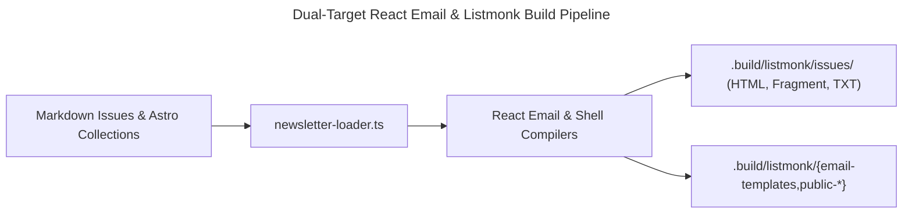
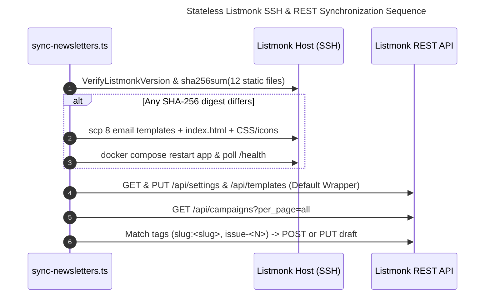

Sovereign Newsletter-as-Code replaces third-party email platforms and fragile database-bound WYSIWYG editors with a deterministic Git-to-SMTP pipeline. By combining Astro Content Collections, dual-target React Email compilation, an upgrade-safe Listmonk v6.2.0 shell, stateless REST/SSH synchronization, and a zero-allocation `Int32Array` SHA-256 Proof-of-Work Web Worker, `hackenberg.tech` achieves complete editorial sovereignty and cookie-free spam defense.

The following architectural comparison contrasts cloud SaaS newsletter providers, raw self-hosted Listmonk setups with manual WYSIWYG editing, and our Git-driven Newsletter-as-Code architecture:

| Architectural Dimension | SaaS Newsletter Platforms (Substack / Mailchimp) | Raw Self-Hosted Listmonk (Manual WYSIWYG Editing) | Sovereign Newsletter-as-Code (`hackenberg.tech`) |
| :--- | :--- | :--- | :--- |
| **Source of Truth & Versioning** | Proprietary cloud database; no Git history, branch previews, or atomic rollbacks. | Mutable PostgreSQL rows edited in browser forms; template changes bypass code review. | **100% Git-native** Markdown issues (`src/content/newsletters/`) and typed TSX email templates. |
| **Cross-Domain Card Curation** | Manual copy-pasting of titles, summaries, dates, and URLs into visual blocks. | Manual HTML or Rich-Text duplication; prone to broken links and stale metadata. | **Automatic build-time resolution** across all six Astro Content Collections via `newsletter-loader.ts`. |
| **Template & Shell Upgrade Safety** | Managed by vendor with rigid layout constraints and mandatory platform branding. | Customizing `static/public/templates/` forks all 12 Go files and breaks on upstream upgrades. | **Shell-only override** (`index.html` + `style.css`); all 11 upstream functional Go templates stay untouched. |
| **Campaign & Static Synchronization** | Manual web dashboard scheduling or stateful webhook scripts. | Manual copy-paste into Admin UI or stateful scripts storing DB IDs in frontmatter. | **Stateless REST tag reconciliation** (`slug:<slug>`, `issue-<N>`) + **idempotent SSH SHA-256 diffing**. |
| **Bot & Spam Protection** | Cloud CAPTCHAs (reCAPTCHA / Turnstile) injecting third-party scripts and telemetry cookies. | Default ALTCHA widget loading external script bundles or allocating heap strings per hash. | **Zero-allocation `Int32Array` SHA-256 Web Worker** solving FIPS 180-4 PoW in ~35–90 ms with zero cookies. |

> [!TIP]
> **Production Source Code on GitHub:**  
> All modules discussed in this article are open-source on `main`: the content loader [`newsletter-loader.ts`](https://github.com/ghackenberg/ghackenberg.github.io/blob/main/src/commons/server/email/newsletter-loader.ts), the React Email compilers [`NewsletterIssueEmail.tsx`](https://github.com/ghackenberg/ghackenberg.github.io/blob/main/src/commons/server/email/NewsletterIssueEmail.tsx), [`ListmonkCampaignTemplate.tsx`](https://github.com/ghackenberg/ghackenberg.github.io/blob/main/src/commons/server/email/ListmonkCampaignTemplate.tsx), and [`ListmonkTransactionalEmail.tsx`](https://github.com/ghackenberg/ghackenberg.github.io/blob/main/src/commons/server/email/ListmonkTransactionalEmail.tsx), the public web shell builder [`ListmonkPublicShell.ts`](https://github.com/ghackenberg/ghackenberg.github.io/blob/main/src/commons/server/email/ListmonkPublicShell.ts), the CLI entrypoints [`build-newsletters.ts`](https://github.com/ghackenberg/ghackenberg.github.io/blob/main/src/scripts/build-newsletters.ts) and [`sync-newsletters.ts`](https://github.com/ghackenberg/ghackenberg.github.io/blob/main/src/scripts/sync-newsletters.ts), and the client-side PoW solver [`newsletter.ts`](https://github.com/ghackenberg/ghackenberg.github.io/blob/main/src/commons/client/newsletter.ts).

## Why Replace SaaS Newsletter Platforms and WYSIWYG Editors with a Git-Native Pipeline?

Traditional SaaS newsletter platforms enforce vendor lock-in, third-party tracking scripts, and manual metadata duplication, while raw self-hosted mailing list managers trap templates inside mutable database rows. A Git-native Newsletter-as-Code architecture treats every issue and transactional email as version-controlled source code, resolving cross-collection metadata and content-hashed cover images automatically at build time.

When operating a technical publication and academic portfolio, email dispatches are not isolated marketing blasts—they synthesize newly published deep-dive articles, Slide-as-Code lecture decks, peer-reviewed papers, university courses, software projects, and interactive WebGL visualizations. Authoring these dispatches inside a browser-based WYSIWYG editor introduces three systemic engineering failure modes:

1. **Metadata Drift and Manual Duplication:** Copying titles, publication dates, canonical URLs, and 160-character abstracts from Markdown files into an external email editor violates the Single Source of Truth principle. If a post title or summary is refined before release, the email draft silently diverges.
2. **Opaque Database State:** Self-hosting an open-source mailing list manager like Listmonk [@nadh-2024-listmonk-docs] solves data residency and GDPR compliance, but configuring campaign wrappers and transactional opt-in emails directly inside the PostgreSQL database decouples the email design system from the repository's TypeScript and CSS verification gates.
3. **Stateful Frontmatter Pollution:** Naive automation scripts often write database primary keys (such as `listmonkCampaignId: 42` or `draft: false`) back into the Markdown frontmatter after API creation. In a CI/CD pipeline, mutating tracked repository files during deployment triggers dirty working trees and recursive commit loops.

### Declarative Issue Schema and Zero-Duplication Content Resolution

In our architecture, every newsletter issue resides in `src/content/newsletters/<slug>/index.md` using the canonical `YYYY_MM_DD_<topic_slug>` directory convention. The YAML frontmatter declares the issue metadata alongside six typed slug arrays referencing items across the repository's primary content collections:

```yaml
issueNumber: 1
title: "Sovereign Agentic Workflows, Slide-as-Code & Real-Time Web Geometry"
subtitle: "Architecture notes and recent deep-dives from hackenberg.tech"
description: "Inaugural engineering dispatch covering reliable multi-agent control planes, Slide-as-Code lecture engines with neural voiceovers, and line-exact 2D Signed Distance Field hero typography."
pubDate: 2026-10-19
icon:
  src: ./preview.jpg
  title: "Issue #1 Cover — Sovereign Agentic Workflows, Slide-as-Code & Real-Time Web Geometry"
  description: "Editorial magazine cover illustration depicting a central multi-agent orchestrator hub, a Slide-as-Code presentation deck with neural audio waves, and a 2D Signed Distance Field geometric contour grid."
featuredPosts:
  - 2026_10_14_treewalker_text_geometrie_sdf_hero_grid
featuredPresentations:
  - 2026_10_05_wie_promptet_man_richtig
featuredPublications: []
featuredCourses: []
featuredProjects: []
featuredVisualizations: []
```

Notice what is intentionally absent from this schema: there are no `draft` flags, no `listmonkCampaignId` fields, and no hardcoded card descriptions. Publication state is governed strictly by Git branch topology—feature and `dev` branches compile local previews, while merging to `main` publishes the static web archive page at `/newsletters/<slug>/` and synchronizes the campaign draft.

During compilation, [`src/commons/server/email/newsletter-loader.ts`](https://github.com/ghackenberg/ghackenberg.github.io/blob/main/src/commons/server/email/newsletter-loader.ts) iterates through `DOMAIN_COLLECTION_CONFIG` and resolves each referenced slug directly from `src/content/<collection>/<slug>/index.md`:

```typescript
function resolveFeaturedItem(
  contentRootDir: string,
  collectionDir: string,
  routePrefix: string,
  domainLabel: NewsletterFeaturedItem['domain'],
  itemSlug: string
): NewsletterFeaturedItem {
  const itemFilePath = path.join(contentRootDir, collectionDir, itemSlug, 'index.md');
  if (!fs.existsSync(itemFilePath)) {
    throw new Error(
      `Referenced ${collectionDir} item "${itemSlug}" not found at ${itemFilePath}`
    );
  }

  const rawItem = fs.readFileSync(itemFilePath, 'utf-8');
  const { yamlBlock } = splitMarkdownFrontmatter(rawItem);
  const parsed = YAML.parse(yamlBlock) as RawContentFrontmatter;

  return {
    domain: domainLabel,
    title: parsed.title || itemSlug,
    description: parsed.description || '',
    url: `https://hackenberg.tech/${routePrefix}/${itemSlug}/`,
    dateFormatted: formatDateEn(parsed.pubDate),
  };
}
```

If any referenced slug does not exist on disk, the build fails immediately with a deterministic path error before a broken link can ever reach a subscriber inbox. Furthermore, `resolveIssueHeroImageUrl()` computes a deterministic content hash via `getFileContentHash(absImgPath)` (or matches the emitted `dist/newsletters/<slug>/preview-<hash>.jpg` asset), ensuring that email clients never cache stale cover illustrations when an artwork revision is committed.

## Dual-Target React Email Compilation for Campaigns and Transactional Templates

Our dual-target React Email compiler transforms shared TypeScript design tokens and TSX components into three synchronized output streams: standalone HTML documents for web preview, stripped inner HTML fragments injected into Listmonk's `{{ template "content" . }}` campaign wrapper, and eight static Go-templated transactional system emails written to `.build/listmonk/`.



All compiled email artifacts are emitted to `.build/listmonk/` rather than `dist/` via [`src/scripts/build-newsletters.ts`](https://github.com/ghackenberg/ghackenberg.github.io/blob/main/src/scripts/build-newsletters.ts). Keeping `.build/listmonk/` outside the Astro static site output directory guarantees that `dist/` contains exclusively public website pages while providing a clean staging tree for API and SSH synchronization.

### Single Source of Design Tokens (`email-theme.ts` & `EmailShell.tsx`)

HTML email rendering across desktop, webmail, and mobile clients remains notoriously hostile to modern CSS stylesheets, flexbox layouts, and CSS custom properties. To guarantee pixel-consistent typography and spacing without external stylesheets, [`src/commons/server/email/email-theme.ts`](https://github.com/ghackenberg/ghackenberg.github.io/blob/main/src/commons/server/email/email-theme.ts) centralizes all inline `CSSProperties` objects (`emailStyles`, `emailMarkdownStyles`, and `EMAIL_BUTTON_INLINE_STYLE`).

On top of these tokens, [`src/commons/server/email/EmailShell.tsx`](https://github.com/ghackenberg/ghackenberg.github.io/blob/main/src/commons/server/email/EmailShell.tsx) implements the shared document chrome with two structural variants (`variant="campaign"` at `640px` max-width and `variant="transactional"` at `600px` max-width):
- **Brand Header Table:** A presentation table (`role="presentation"`) rendering the square blue `GH` badge (`#eff6ff` background, `#bfdbfe` border, `#2563eb` bold text) next to `Dr. Georg Hackenberg — Professor for Industrial Informatics @ UAP`.
- **Compliant Campaign & Transactional Footers:** While transactional emails link to the site homepage, privacy policy, and legal imprint, campaign emails additionally inject the mandatory unsubscribe link (`{{ UnsubscribeURL }}`)—complementing Listmonk's native IETF RFC 8058 `List-Unsubscribe-Post` one-click email headers [@rfc-8058-one-click-unsubscribe]—and the web archive permalink.

### Solving the Double-Wrapper Problem in Listmonk Campaigns

In Listmonk's template architecture [@nadh-2024-listmonk-docs], a regular campaign consists of two layers:
1. **A Default Campaign Template** stored in Listmonk (`campaign-default.html`), which provides the outer `<html>`, `<head>`, `<body>`, brand header, and unsubscribe footer around the Go template placeholder `{{ template "content" . }}`. In [`src/commons/server/email/ListmonkCampaignTemplate.tsx`](https://github.com/ghackenberg/ghackenberg.github.io/blob/main/src/commons/server/email/ListmonkCampaignTemplate.tsx), `renderListmonkCampaignTemplate()` renders `CAMPAIGN_CONTENT_TOKEN` inside `<EmailShell variant="campaign">` and replaces placeholder tokens with `{{ template "content" . }}`, `{{ UnsubscribeURL }}`, and `{{ TrackLink "https://hackenberg.tech" }}`.
2. **The Campaign Body** uploaded per issue via `POST /api/campaigns`, which Listmonk injects into `{{ template "content" . }}` at dispatch time.

If an engineering team renders a full React Email `<Html>` document for each newsletter issue and uploads that full document as the campaign `body`, Listmonk nests a second `<!DOCTYPE html><html><body>` tree—along with a duplicate header and footer—inside the outer campaign template. Conversely, if one only compiles an inner fragment, developers cannot preview the standalone email locally or generate an accurate plain-text `altbody` fallback.

[`src/commons/server/email/NewsletterIssueEmail.tsx`](https://github.com/ghackenberg/ghackenberg.github.io/blob/main/src/commons/server/email/NewsletterIssueEmail.tsx) resolves this cleanly by decomposing the issue into two composable React components:
- **`NewsletterIssueContent`:** Renders only the inner editorial sections—the top metadata bar (`Date • Issue #N` on the left, `View in browser ↗` pill on the right), the `<h1>` title and subtitle, the `576px` `16:9` cover illustration, the `<Markdown>` prose body, and the automatically grouped domain cards (`Featured Posts`, `Featured Presentations`, etc.).
- **`NewsletterIssueEmail`:** Wraps `<NewsletterIssueContent {...props} />` inside `<EmailShell variant="campaign">`.

During `renderNewsletterIssueEmail()`, all three representations are compiled concurrently via `Promise.all`:

```typescript
function stripOuterDocumentWrapper(rawHtml: string): string {
  return rawHtml
    .replace(/<!DOCTYPE[^>]*>/gi, '')
    .replace(/<html[^>]*>/gi, '')
    .replace(/<\/html>/gi, '')
    .replace(/<head[^>]*>[\s\S]*?<\/head>/gi, '')
    .replace(/<body[^>]*>/gi, '')
    .replace(/<\/body>/gi, '')
    .trim();
}

export async function renderNewsletterIssueEmail(
  props: NewsletterIssueEmailProps
): Promise<{ html: string; campaignBodyHtml: string; plainText: string }> {
  const [rawHtml, rawCampaignBody, rawPlainText] = await Promise.all([
    render(<NewsletterIssueEmail {...props} />),
    render(<NewsletterIssueContent {...props} />),
    render(<NewsletterIssueEmail {...props} />, { plainText: true }),
  ]);

  return {
    html: rawHtml.replaceAll(UNSUBSCRIBE_URL_TOKEN, '{{ UnsubscribeURL }}'),
    campaignBodyHtml: stripOuterDocumentWrapper(rawCampaignBody).replaceAll(
      UNSUBSCRIBE_URL_TOKEN,
      '{{ UnsubscribeURL }}'
    ),
    plainText: rawPlainText.replaceAll(UNSUBSCRIBE_URL_TOKEN, '{{ UnsubscribeURL }}'),
  };
}
```

### Token Substitution for Go `html/template` Syntax in Transactional Emails

Compiling Listmonk's eight static system and transactional email templates (`base.html`, `subscriber-optin.html`, `subscriber-optin-campaign.html`, `subscriber-data.html`, `campaign-status.html`, `import-status.html`, `forgot-password.html`, and `smtp-test.html`) in [`src/commons/server/email/ListmonkTransactionalEmail.tsx`](https://github.com/ghackenberg/ghackenberg.github.io/blob/main/src/commons/server/email/ListmonkTransactionalEmail.tsx) requires bridging JSX serialization and Go's `html/template` syntax. Specifically, `renderListmonkBaseTemplate()` renders `<EmailShell variant="transactional">{BASE_CONTENT_TOKEN}</EmailShell>` and splits the resulting HTML on `BASE_CONTENT_TOKEN` to emit `{{ define "header" }}`, `{{ define "footer" }}`, and `{{ define "base" }}` in `base.html`, while the seven leaf templates wrap their extracted body fragments via `wrapInTransactionalBase()` (`{{ define "<name>" }}{{ template "header" . }}...{{ template "footer" . }}{{ end }}`).

When `@react-email/render` serializes JSX `<Link>` or `<Button>` components, it URL-encodes or HTML-escapes characters inside `href` attributes and text nodes. If we pass a raw Go template expression such as `{{ .OptinURL }}` or `{{ index . "Name" }}` directly into JSX attributes, React escapes the quotes into `&quot;`, causing Listmonk's Go template parser to fail at startup.

We prevent escaping collisions using two deterministic post-processing passes:
1. **Valid URL Placeholder Tokens:** For `href` attributes, we pass syntactically valid URL constants during JSX rendering—such as `OPTIN_URL_TOKEN = 'https://hackenberg.tech/__LISTMONK_OPTIN_URL__'` and `RESET_URL_TOKEN = 'https://hackenberg.tech/__LISTMONK_RESET_URL__'`. After React Email finishes rendering, `.replaceAll(OPTIN_URL_TOKEN, '{{ .OptinURL }}')` substitutes the exact Go action token.
2. **Mustache Entity Unescaping:** In `extractInnerFragment()`, a targeted regular expression `/\{\{[\s\S]*?\}\}/g` unescapes `&quot;`, `&#x27;`, `&#39;`, and `&amp;` exclusively inside `{{ ... }}` blocks while keeping surrounding HTML entities intact:

```typescript
function extractInnerFragment(rawHtml: string): string {
  const withoutDoctype = rawHtml.replace(/<!DOCTYPE[^>]*>/i, '');
  const bodyMatch = withoutDoctype.match(/<body[^>]*>([\s\S]*?)<\/body>/i);
  const fragment = (bodyMatch ? bodyMatch[1] : withoutDoctype)
    .replace(/<html[^>]*>/gi, '')
    .replace(/<\/html>/gi, '')
    .replace(/<head[^>]*>[\s\S]*?<\/head>/gi, '')
    .trim();

  return fragment.replace(/\{\{[\s\S]*?\}\}/g, (match) =>
    match
      .replaceAll('&quot;', '"')
      .replaceAll('&#x27;', "'")
      .replaceAll('&#39;', "'")
      .replaceAll('&amp;', '&')
  );
}
```

Additionally, `renderListmonkOptinTemplate()` replaces Listmonk's default greeting (which awkwardly addresses subscribers by their email prefix when no name field is collected) with a clean, neutral `'Hello,'` greeting and zero third-party `listmonk.app` branding.

## Engineering an Upgrade-Safe Listmonk v6.2.0 Public Web Shell

Overriding all public HTML templates in a self-hosted Listmonk instance causes silent rendering breakages whenever upstream releases introduce new Go template variables or authentication views. By overriding only the outer `index.html` layout (`{{ define "header" }}` and `{{ define "footer" }}`) and static CSS assets, all eleven upstream functional templates remain untouched.

When subscribers click double opt-in confirmation links, export their personal GDPR data, or manage their subscription preferences on `https://news.hackenberg.tech`, Listmonk renders its public web pages from `static/public/templates/` using Go's `html/template` engine [@nadh-2024-listmonk-docs].

### The Fragility of Full-Directory Template Overrides

Listmonk supports a `--static-dir=/listmonk/static` CLI flag that instructs the binary to load templates from a host-mounted directory instead of its embedded Go `embed.FS` filesystem. However, a naive customization that forks and edits all 12 files in `static/public/templates/` creates a severe maintenance trap:
- In recent Listmonk v6.x upgrades (such as v6.2.0), upstream introduced new authentication and multi-factor templates (`login.html`, `login-setup.html`, `forgot-password.html`, `reset-password.html`, `twofa.html`) alongside updated data bindings in `subscription-form.html` and `optin.html`.
- If a host directory contains stale copies of those functional templates from an older release, upgrading the Docker image breaks admin login or form rendering immediately.

### Decoupling Layout Chrome from Functional Views

Inspecting Listmonk's Go template hierarchy reveals a clean architectural seam: every one of the 11 functional templates (`optin.html`, `message.html`, `subscription.html`, `subscription-form.html`, `archive.html`, `home.html`, `login.html`, `login-setup.html`, `forgot-password.html`, `reset-password.html`, and `twofa.html`) begins with `{{ template "header" . }}` and ends with `{{ template "footer" . }}`. Both of those named blocks are defined solely inside `static/public/templates/index.html`.

Therefore, [`src/commons/server/email/ListmonkPublicShell.ts`](https://github.com/ghackenberg/ghackenberg.github.io/blob/main/src/commons/server/email/ListmonkPublicShell.ts) compiles only four shell files into `.build/listmonk/`:
1. **`.build/listmonk/public-templates/index.html`** (copied from [`src/layouts/listmonk.html`](https://github.com/ghackenberg/ghackenberg.github.io/blob/main/src/layouts/listmonk.html)), which defines `{{ define "header" }}` and `{{ define "footer" }}` with the `GH` brand lockup (`Dr. Georg Hackenberg — Professor for Industrial Informatics @ UAP`) and footer links (`hackenberg.tech`, `Newsletters`, `Privacy Policy`, `Imprint`).
2. **`.build/listmonk/public-static/style.css`** (copied from [`src/styles/listmonk.css`](https://github.com/ghackenberg/ghackenberg.github.io/blob/main/src/styles/listmonk.css)), which styles Listmonk's native `.container`, `.wrap`, `.box`, and button classes to match the exact Slate and Brand Blue palette of `hackenberg.tech`.
3. **`.build/listmonk/public-static/logo.svg`** and **`favicon.png`** (copied from `public/favicon.svg` and `public/favicon-32x32.png`).

When [`src/scripts/sync-newsletters.ts`](https://github.com/ghackenberg/ghackenberg.github.io/blob/main/src/scripts/sync-newsletters.ts) connects to the production server via SSH, it queries the running container's exact semantic version (`docker exec listmonk_hackenberg_app ./listmonk --version`), compares it against `static/.listmonk-version`, and automatically extracts the official upstream `static/` tree for that exact release tag (`https://github.com/knadh/listmonk/archive/refs/tags/${VER}.tar.gz`) before overlaying our `index.html` and `style.css`. All 11 functional Go templates are guaranteed to match the running Listmonk binary version 100% of the time.

## Stateless Idempotent CI/CD Synchronization via REST API and Remote SHA-256 Diffing

Storing mutable database IDs inside Markdown frontmatter pollutes Git history with automated commit loops during continuous integration. Instead, `sync-newsletters.ts` implements stateless idempotency: it reconciles draft campaigns via deterministic Listmonk tags (`slug:<slug>` and `issue-<N>`) over REST and deploys twelve static template files over SSH only when remote SHA-256 digests diverge.



### Phase 1: Zero-Downtime Remote SHA-256 Diffing over SSH

Restarting the Listmonk Docker container on every `git push` when no template files have changed wastes CI time and briefly interrupts active connections. In [`src/scripts/sync-newsletters.ts`](https://github.com/ghackenberg/ghackenberg.github.io/blob/main/src/scripts/sync-newsletters.ts), `syncStaticTemplatesViaSsh()` computes the local SHA-256 digest of all 12 managed static files (the 8 transactional email templates, `public/templates/index.html`, and `public/static/{style.css,logo.svg,favicon.png}`):

```typescript
function computeFileSha256(filePath: string): string {
  const content = fs.readFileSync(filePath);
  return crypto.createHash('sha256').update(content).digest('hex');
}
```

A single batched SSH command inspects the remote container version, outputs `HASH_<key>=$(sha256sum ...)` for all 12 remote files, and verifies whether `--static-dir=/listmonk/static` is active in `docker-compose.yml`. If every remote SHA-256 hash matches `item.localSha256` and `HAS_STATIC_FLAG=yes`, `syncStaticTemplatesViaSsh()` logs a zero-diff match and skips `scp` and container restart entirely. Only when at least one byte has changed does it copy the updated files, restart the `app` service, and poll `http://127.0.0.1:9002/health` until the server reports ready.

### Phase 2: Stateless Tag-Based Campaign Reconciliation over REST

After auditing general settings (`app.site_name`, `app.root_url`, `app.favicon_url` via `GET/PUT /api/settings`) and updating the default campaign template (`PUT /api/templates/:id`), `syncIssueRecord()` synchronizes each newsletter issue from `src/content/newsletters/` without storing any state in Git.

Each issue is assigned three deterministic Listmonk tags:

$$\text{tags} = \left[\texttt{"newsletter"},\; \texttt{"issue-"} \mathbin{\Vert} N,\; \texttt{"slug:"} \mathbin{\Vert} \text{slug}\right]$$

By fetching `GET /api/campaigns?per_page=all` and matching `c.tags?.includes(slugTag) || c.tags?.includes(issueTag)`, the synchronizer executes a strict three-branch state machine:
1. **No Existing Campaign Found:** Issues a `POST /api/campaigns` request creating a new `draft` campaign with `body: campaignBodyHtml` (the stripped inner React Email fragment) and `altbody: plainText`.
2. **Existing Campaign in `draft` Status:** Issues an idempotent `PUT /api/campaigns/:id` request updating the subject, HTML body, plain-text fallback, and tag array in place.
3. **Existing Campaign Already Dispatched (`status !== 'draft'`):** Logs a safety skip (`skipping mutation`). Once a campaign has transitioned to `running`, `scheduled`, or `finished`, CI/CD is strictly prohibited from mutating historical dispatches or auto-starting new campaigns without human verification in the Listmonk UI.

## How Does a Zero-Allocation Int32Array SHA-256 Web Worker Solve ALTCHA Proof-of-Work Challenges?

To protect public subscription endpoints without invasive CAPTCHAs or third-party tracking cookies, `newsletter.ts` executes an inline Web Worker that solves ALTCHA SHA-256 Proof-of-Work challenges in pure 32-bit integer arithmetic. Pre-parsing the target digest into eight signed 32-bit registers (`t0..t7`) and reusing a 128-byte `Uint8Array` block eliminates all per-iteration heap allocations.

### Cryptographic Pricing via Processing vs. Visual CAPTCHAs

Public newsletter subscription forms (`/subscription/form`) are prime targets for automated botnets that abuse double opt-in endpoints to flood third-party inboxes (*subscription bombing*). Traditional defenses rely on visual Turing tests (reCAPTCHA, hCaptcha) or cloud behavioral proxies that inject external JavaScript bundles, set cross-site cookies, and degrade user privacy.

Instead, we build on the foundational *Pricing via Processing* paradigm introduced by Dwork and Naor [@dwork-1992-pricing-via-processing] to combat junk mail and later operationalized as SHA-based partial hash inversion in Adam Back's *Hashcash* [@back-2002-hashcash]. In the ALTCHA Proof-of-Work protocol [@altcha-2024-pow-mechanism] integrated into Listmonk (`GET /api/public/captcha/altcha`), the server generates a cryptographically random `salt`, selects a secret integer $n^* \in [0, M]$ (where $M = \text{maxNumber}$, typically $50{,}000$ to $300{,}000$), and returns the SHA-256 target digest $C$ along with an HMAC signature:

$$C = \operatorname{hex}\!\Big(\operatorname{SHA-256}\big(\operatorname{UTF8}(\text{salt} \mathbin{\Vert} \operatorname{str}(n^*))\big)\Big)$$

To subscribe, the client browser must perform an exhaustive search over $n \in \{0, 1, \dots, M\}$ until it discovers the preimage $n$ satisfying:

$$\operatorname{SHA-256}\big(\operatorname{UTF8}(\text{salt} \mathbin{\Vert} \operatorname{str}(n))\big) = C$$

Assuming a uniform random draw of $n^* \sim \mathcal{U}(0, M)$, the expected number of SHA-256 evaluations per legitimate subscriber is:

$$\mathbb{E}[N_{\text{hashes}}] = \frac{M + 1}{2}$$

For a single user browser, evaluating $75{,}000$ to $150{,}000$ SHA-256 hashes takes less than $80\text{ ms}$ on a background thread—completely imperceptible when pre-warmed on `focus` of the email input field (`ALTCHA_TOKEN_TTL_MS = 4 * 60 * 1000`). For a spam botnet attempting $100{,}000$ fraudulent form submissions, the cumulative CPU cost scales linearly to $\sim 1.5 \times 10^{10}$ SHA-256 evaluations.

### Why Standard WebCrypto and Hex-String Loops Bottleneck in JavaScript

A naive JavaScript Proof-of-Work solver suffers from two severe performance bottlenecks:
1. **Asynchronous WebCrypto Bridge Overhead:** Calling `await crypto.subtle.digest('SHA-256', data)` inside a `for` loop crosses the asynchronous Promise microtask and C++/JS binding boundary on every single candidate $n$. Across $150{,}000$ iterations, Promise scheduling overhead dominates actual hashing time by an order of magnitude.
2. **Garbage Collection Thrashing from Hex String Formatting:** Converting a 32-byte digest into a 64-character hexadecimal string via `Array.from(bytes).map(b => b.toString(16).padStart(2, '0')).join('')` allocates multiple temporary arrays and short-lived string objects per iteration—generating millions of heap allocations and triggering frequent V8 garbage collection pauses.

### Zero-Allocation 32-Bit Word Comparison & FIPS 180-4 Message Padding

In [`src/commons/client/newsletter.ts`](https://github.com/ghackenberg/ghackenberg.github.io/blob/main/src/commons/client/newsletter.ts), we embed a self-contained Web Worker script (`WORKER_SCRIPT`, instantiated via an inline `Blob` URL with zero external network requests) that implements the NIST FIPS PUB 180-4 Secure Hash Standard [@nist-2015-fips-180-4] directly over pre-allocated typed arrays.

First, instead of formatting each candidate's output state $(h_0, \dots, h_7)$ into a 64-character hex string on every iteration, `solvePoW()` parses the 64-character target `challengeHex` string **once** before the loop into eight signed 32-bit integer target registers $(t_0, \dots, t_7)$:

$$t_k = \operatorname{Int32}\!\big(\text{challengeHex}[8k : 8k + 8]_{16}\big), \qquad k \in \{0, \dots, 7\}$$

Second, outside the candidate loop, the worker pre-allocates a single 64-word message schedule `W = new Int32Array(64)`, a reusable 128-byte padding buffer `block = new Uint8Array(128)`, and a `DataView` over `block.buffer`—eliminating all per-iteration digest buffer, word-schedule, and 64-character hex string allocations. Sizing `block` to 128 bytes (two 64-byte SHA-256 blocks) accommodates any `salt + n` payload up to 119 bytes plus the mandatory `0x80` padding byte and 8-byte length suffix. Because `block.fill(0, 0, totalBytes)` zeroes the entire active buffer—including the upper 32 bits of the 64-bit length field at `totalBytes - 8`—calling `view.setUint32(totalBytes - 4, bitLen, false)` writes an exact 64-bit big-endian bit length $\ell = 8 \cdot \text{len} < 2^{32}$, while the total number of 512-bit (64-byte) blocks is computed via bitwise shifts:

$$\text{totalBlocks} = (\text{len} + 9 + 63) \gg 6, \qquad \text{totalBytes} = \text{totalBlocks} \ll 6$$

```javascript
function solvePoW(salt, challengeHex, maxNumber) {
  const t0 = parseInt(challengeHex.slice(0, 8), 16) | 0;
  const t1 = parseInt(challengeHex.slice(8, 16), 16) | 0;
  const t2 = parseInt(challengeHex.slice(16, 24), 16) | 0;
  const t3 = parseInt(challengeHex.slice(24, 32), 16) | 0;
  const t4 = parseInt(challengeHex.slice(32, 40), 16) | 0;
  const t5 = parseInt(challengeHex.slice(40, 48), 16) | 0;
  const t6 = parseInt(challengeHex.slice(48, 56), 16) | 0;
  const t7 = parseInt(challengeHex.slice(56, 64), 16) | 0;

  const encoder = new TextEncoder();
  const W = new Int32Array(64);
  const block = new Uint8Array(128);
  const view = new DataView(block.buffer);

  for (let n = 0; n <= maxNumber; n++) {
    const bytes = encoder.encode(salt + n);
    const len = bytes.length;
    const bitLen = len * 8;
    const totalBlocks = ((len + 9 + 63) >> 6);
    const totalBytes = totalBlocks << 6;

    block.fill(0, 0, totalBytes);
    block.set(bytes, 0);
    block[len] = 0x80;
    view.setUint32(totalBytes - 4, bitLen, false);
```

### Bitwise SHA-256 Message Schedule and Compression Rounds

Within each 64-byte chunk, the first 16 words $W_0, \dots, W_{15}$ are read in big-endian byte order via `view.getInt32(offset + (i << 2), false)`, and words $W_{16}, \dots, W_{63}$ are expanded using the FIPS 180-4 small sigma functions $\sigma_0$ and $\sigma_1$ [@nist-2015-fips-180-4] via unsigned right shifts (`>>>`) and bitwise shifts (`<<`):

$$\sigma_0(x) = \operatorname{ROTR}^7(x) \oplus \operatorname{ROTR}^{18}(x) \oplus \operatorname{SHR}^3(x)$$

$$\sigma_1(x) = \operatorname{ROTR}^{17}(x) \oplus \operatorname{ROTR}^{19}(x) \oplus \operatorname{SHR}^{10}(x)$$

$$W_i = \left(W_{i-16} + \sigma_0(W_{i-15}) + W_{i-7} + \sigma_1(W_{i-2})\right) \bmod 2^{32}$$

Next, the 64 compression rounds update the working registers $(a, b, c, d, e, f, g, h)$ from the initial fractional square-root constants $(h_0, \dots, h_7)$ and the 64 cube-root round constants $K_i \in \texttt{Int32Array(64)}$ using the big sigma rotations $\Sigma_0, \Sigma_1$, the Choose function $\operatorname{Ch}(e, f, g)$, and the Majority function $\operatorname{Maj}(a, b, c)$:

$$\Sigma_1(e) = \operatorname{ROTR}^6(e) \oplus \operatorname{ROTR}^{11}(e) \oplus \operatorname{ROTR}^{25}(e), \qquad \operatorname{Ch}(e, f, g) = (e \land f) \oplus (\neg e \land g)$$

$$\Sigma_0(a) = \operatorname{ROTR}^2(a) \oplus \operatorname{ROTR}^{13}(a) \oplus \operatorname{ROTR}^{22}(a), \qquad \operatorname{Maj}(a, b, c) = (a \land b) \oplus (a \land c) \oplus (b \land c)$$

```javascript
      for (let i = 0; i < 64; i++) {
        const S1 = ((e >>> 6) | (e << 26)) ^ ((e >>> 11) | (e << 21)) ^ ((e >>> 25) | (e << 7));
        const ch = (e & f) ^ (~e & g);
        const temp1 = (h + S1 + ch + K[i] + W[i]) | 0;
        const S0 = ((a >>> 2) | (a << 30)) ^ ((a >>> 13) | (a << 19)) ^ ((a >>> 22) | (a << 10));
        const maj = (a & b) ^ (a & c) ^ (b & c);
        const temp2 = (S0 + maj) | 0;

        h = g;
        g = f;
        f = e;
        e = (d + temp1) | 0;
        d = c;
        c = b;
        b = a;
        a = (temp1 + temp2) | 0;
      }

      h0 = (h0 + a) | 0;
      h1 = (h1 + b) | 0;
      h2 = (h2 + c) | 0;
      h3 = (h3 + d) | 0;
      h4 = (h4 + e) | 0;
      h5 = (h5 + f) | 0;
      h6 = (h6 + g) | 0;
      h7 = (h7 + h) | 0;
    }

    if (
      h0 === t0 && h1 === t1 && h2 === t2 && h3 === t3 &&
      h4 === t4 && h5 === t5 && h6 === t6 && h7 === t7
    ) {
      return n;
    }
```

Because JavaScript's bitwise OR-zero coercion (`| 0`) keeps every intermediate addition in unboxed 32-bit signed integer CPU registers inside the JIT compiler, the final check `h0 === t0 && ... && h7 === t7` short-circuits on the very first 32-bit word (`h0 === t0`) in $1 - 2^{-32}$ of all non-matching candidates without ever allocating a hex string. Once solved, the worker terminates immediately, revokes its object URL (`URL.revokeObjectURL(url)`), and caches the Base64-encoded solution payload for 4 minutes (`ALTCHA_TOKEN_TTL_MS`) so clicking *Subscribe* submits instantaneously with `credentials: 'omit'` (with a main-thread `crypto.subtle.digest` fallback in `solveChallengeInWorker()` if a strict Content Security Policy blocks `blob:` workers).

## Conclusion: Five Architectural Invariants for Sovereign Newsletter Engineering

Building a resilient, privacy-first newsletter pipeline requires decoupling content authoring from delivery state while eliminating runtime overhead across both server and browser. These five architectural invariants unify static Astro content collections, React Email compilation, upgrade-safe Listmonk shell overrides, stateless synchronization, and zero-allocation client-side Proof-of-Work into a cohesive engineering system.

1. **Git Branches as the Sole Publication State Machine:** Eliminate `draft` flags and database IDs from Markdown frontmatter. Author issues in `src/content/newsletters/<slug>/index.md` and resolve featured cross-collection cards (`featuredPosts`, `featuredPresentations`, `featuredPublications`, `featuredCourses`, `featuredProjects`, `featuredVisualizations`) automatically at build time.
2. **Dual-Target React Email Compilation to `.build/listmonk/`:** Share a single TypeScript styling schema (`email-theme.ts` and `EmailShell.tsx`) across standalone preview HTML, stripped inner `{{ template "content" . }}` campaign fragments, plain-text `altbody` fallbacks, and all 8 static Listmonk system templates.
3. **Shell-Only Public Web Overrides:** Override only `static/public/templates/index.html` (`{{ define "header" }}` and `{{ define "footer" }}`) and `static/public/static/style.css`, leaving all 11 upstream Listmonk Go functional templates untouched and automatically synchronized to the running container release tag.
4. **Stateless Tag Matching & Remote SHA-256 Diffing:** Reconcile draft campaigns via deterministic REST tags (`slug:<slug>` and `issue-<N>`) and guard SSH static asset deployments + container restarts behind a 12-file SHA-256 equality check.
5. **Zero-Allocation `Int32Array` SHA-256 Proof-of-Work:** Pre-warm ALTCHA challenges in an inline Web Worker that compares eight 32-bit digest registers (`h0 === t0 ... h7 === t7`) over a reusable 128-byte buffer, delivering fast, cookie-free spam protection on the open web.
