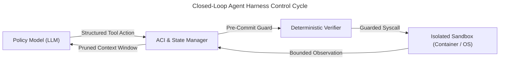

An **agent harness** is the deterministic runtime execution loop, environment abstraction, state and context manager, tool protocol bus, and verification scaffolding that wraps a foundation model to transform probabilistic token predictions into bounded, reproducible system actions across operating systems, codebases, and external interfaces.

The following taxonomy classifies the four architectural generations of agent harnesses across their interface abstraction, state and context lifecycle, verification mechanism, and representative frameworks:

| Harness Generation & Archetype | Interface Abstraction | State & Context Management | Verification Mechanism | Representative Systems & Benchmarks |
| :--- | :--- | :--- | :--- | :--- |
| **1. Classical Test & RL Environment Harnesses** | Discrete numeric or symbolic action spaces (`env.step(action)`) and deterministic test drivers/stubs. | Markovian state vectors $s_t \in \mathcal{S}$ or isolated per-test fixture memory resets. | Exact assertion comparators (`assertEquals`) and scalar reward signals $r_t \in \mathbb{R}$. | xUnit Test Harnesses, OpenAI Gym [@brockman-2016-openai-gym] |
| **2. Text-Stream Prompt Loops** | Stop-token text interception (`Thought:` / `Action:` / `Observation:`) and inline API tokens. | Append-only raw prompt concatenation inside a single sliding context window. | Unstructured string parsing with high vulnerability to syntax hallucinations and infinite loops. | Toolformer [@schick-2023-toolformer], ReAct [@yao-2023-react] |
| **3. Agent-Computer Interfaces (ACIs) & Sandboxes** | Purpose-built model-ergonomic file viewers, line-targeted editors, and multimodal OS desktop streams. | Windowed observation pruning, history folding, and ephemeral Docker or VM snapshots. | Pre-commit syntax/linter guards (rejecting malformed edits) + reproducible container test suites. | SWE-bench [@jimenez-2024-swebench], SWE-agent [@yang-2024-sweagent], OSWorld [@xie-2024-osworld], OpenHands [@wang-2025-openhands] |
| **4. Protocol-Driven & Orchestrated Harnesses** | JSON-RPC 2.0 capability negotiation (`tools`, `resources`, `prompts`) + scoped subagent dispatch. | Hierarchical control/data plane isolation and progressive on-demand context disclosure. | Deterministic workflow gates [@schluntz-2024-effective-agents], schema validation, and localization pipelines [@xia-2024-agentless]. | Model Context Protocol (MCP) [@mcp-specification-2024], Agentless [@xia-2024-agentless] |

## What Is an Agent Harness and How Did It Evolve Historically?

Agent harnesses evolved from classical software test drivers and reinforcement learning environment loops into structured runtime controllers for large language models. When early text-stream wrappers around raw POSIX shells collapsed on repository-scale benchmarks, engineering shifted toward dedicated execution scaffolding that mediates state, observations, and tool invocation.

In systems engineering, a *harness* is never the component under test or the learned policy itself; it is the deterministic machinery surrounding that component. Historically, the term entered computing through two distinct lineages that have now converged in modern agentic systems:

1. **Software Verification Test Harnesses:** In classical software verification, a test harness comprises the *test driver* (which initializes environment fixtures and invokes the System Under Test), *stubs/mocks* (which simulate unavailable downstream dependencies), and the *comparator* (which evaluates post-execution state against formal assertions). Crucially, the test harness guarantees isolation and repeatability: regardless of whether the target binary crashes, leaks memory, or enters a livelock, the harness bounds execution via wall-clock timeouts and restores a clean initial state before the next run.
2. **Reinforcement Learning Environment Harnesses:** In reinforcement learning, formalized widely by OpenAI Gym [@brockman-2016-openai-gym], the harness separates the *agent policy* $\pi_\theta(a_t \mid s_t)$ from the *environment dynamics* $\mathcal{T}(s_{t+1}, r_t \mid s_t, a_t)$. Through a standardized execution contract—`reset()` to initialize an episode and `step(action)` returning `(observation, reward, terminated, truncated, info)`—the RL harness abstracts physics engines, Atari emulators, and robotic control loops behind a uniform state-transition boundary [@brockman-2016-openai-gym].



### The First Wave of LLM Loops: Text Interleaving and Raw Shell Wrappers

When pretrained autoregressive language models demonstrated zero-shot and few-shot reasoning, researchers adapted the RL `step(action)` loop to operate over natural language token streams. Two foundational paradigms defined this early generation:
- **Self-Supervised API Call Insertion (Toolformer):** Schick et al. [@schick-2023-toolformer] demonstrated that language models could be trained to emit inline API call tokens (such as `<API>Calculator(400 / 1400)</API>`) mid-generation. When the decoding loop encountered the closing API token, the surrounding runtime paused generation, executed the external calculator, search engine, or translation service, spliced the returned string into the token prefix, and resumed autoregressive decoding [@schick-2023-toolformer].
- **Interleaved Reasoning and Acting (ReAct):** Yao et al. [@yao-2023-react] introduced an explicit prompt-level control loop alternating between internal verbal reasoning traces (`Thought:`), external environment commands (`Action:`), and environment feedback (`Observation:`). Stopping generation whenever the model emitted `Action:` allowed a thin host script to regex-extract the command, query an external knowledge base like Wikipedia, and append the `Observation:` back into the prompt history [@yao-2023-react].

While stop-token text loops succeeded on multi-hop question answering (HotpotQA) and constrained text games (ALFWorld), they exhibited severe structural fragility when applied to real-world software engineering. To evaluate repository-level problem solving, Jimenez et al. constructed **SWE-bench** [@jimenez-2024-swebench], a benchmark of 2,294 real GitHub issues and corresponding pull requests across 12 popular Python repositories (`django`, `sympy`, `scikit-learn`, `matplotlib`, etc.), graded inside reproducible Docker containers using fail-to-pass (`F2P`) and pass-to-pass (`P2P`) test suites.

On the full 2,294-task SWE-bench evaluation set, non-interactive retrieval-augmented generation baselines resolved only **1.31%** of issues with `GPT-4` and **3.79%** with `Claude 3 Opus` [@jimenez-2024-swebench; @yang-2024-sweagent]. Even when researchers connected `GPT-4 Turbo` to an interactive `shell-only` harness exposing a standard Linux `bash` session on SWE-bench Lite, resolution rates reached only **7.33%** (zero-shot) to **11.00%** (with demonstrations) [@yang-2024-sweagent].

### Why Thin Wrappers Around Raw Shells Collapse

Analyzing the failure trajectories of raw shell harnesses reveals four fundamental mismatches between human operating system interfaces and transformer context windows:
1. **Unbounded Observation Floods:** Executing `cat` on a 4,000-line source file or running `pytest` without output filtering dumps tens of thousands of tokens into the prompt history. In an append-only ReAct loop, a single verbose command exhausts the effective attention horizon and displaces the original problem specification.
2. **Non-Ergonomic Edit Primitives:** Linux CLI utilities were designed either for interactive human terminal sessions (`vim`, `nano`, which trap non-interactive subprocesses) or for fragile stream manipulation (`sed`, `awk`, multi-line `cat << 'EOF'` heredocs, or `diff -u` patches). Autoregressive models frequently hallucinate line numbers in unified diffs or mis-escape nested quotes in `sed` expressions, corrupting target files.
3. **Silent State Corruption:** When a raw shell harness applies a syntactically broken edit, the filesystem silently accepts the malformed file. The model only discovers the syntax error several turns later when test execution fails with an opaque traceback, burning multiple reasoning steps simply trying to undo its own indentation mistake.
4. **Lack of State Checkpointing and Loop Detection:** Without harness-level cycle detection, models trapped in failing edit-test loops repeatedly issue identical commands until hitting the hard token budget.

## How Do Agent-Computer Interfaces Reshape State of the Art Performance?

Agent-Computer Interfaces (ACIs) reshape model performance by replacing human-centric POSIX shells and unscoped file dumps with compact, high-signal action spaces and guarded feedback loops. Coupled with ephemeral container sandboxes, context compaction, and standardized tool buses, ACIs prevent context overflow and catch syntax errors before state mutation.

In a landmark NeurIPS 2024 study, Yang et al. introduced **SWE-agent** and formalized the concept of the **Agent-Computer Interface (ACI)** [@yang-2024-sweagent]. Just as Human-Computer Interaction (HCI) adapts software ergonomics to human visual perception and motor control, ACI engineering adapts command syntax, observation formatting, and error diagnostics specifically to the statistical properties and context constraints of language models [@yang-2024-sweagent].

The empirical impact of the harness alone—holding the underlying foundation model (`GPT-4 Turbo`) strictly constant—was decisive:
- In a direct interactive ablation on SWE-bench Lite (`GPT-4 Turbo`), replacing a raw `bash` `shell-only` harness (**7.33%** zero-shot / **11.00%** with demonstrations) with SWE-agent's purpose-built ACI jumped resolution to **18.00% pass@1** (a **64% relative gain** over the strongest shell-only baseline derived purely from harness architecture) [@yang-2024-sweagent]. On the full 2,294-task SWE-bench test set, SWE-agent achieved **12.47% pass@1** (compared to **1.31%** for `GPT-4` RAG and **3.79%** for `Claude 3 Opus` RAG) and reached **87.7% pass@1** on HumanEvalFix [@jimenez-2024-swebench; @yang-2024-sweagent].
- Ablation experiments in the SWE-agent study proved that removing the pre-commit syntax linter guard, removing the 100-line windowed file viewer, or reverting to raw `bash` file editing caused immediate, steep collapses in issue resolution and multiplied wasted turns [@yang-2024-sweagent].

Concurrently, the harness paradigm expanded beyond command-line repositories to full graphical operating systems and general-purpose developer platforms:
- **OSWorld** [@xie-2024-osworld] established a unified virtual machine execution harness across Ubuntu, Windows, and macOS, exposing multimodal observations (high-resolution screenshots paired with accessibility (a11y) trees) and low-level `pyautogui` mouse/keyboard action primitives across 369 real desktop tasks. Even the strongest multimodal models achieved only **12.24% success** compared to **72.36% for humans**, demonstrating how sensitive GUI agents are to harness observation grounding (coordinate resolution vs. accessibility DOM nodes) [@xie-2024-osworld].
- **OpenHands** (formerly OpenDevin) [@wang-2025-openhands] generalized the software engineering harness into an event-sourced architecture where an agent interacts with a sandboxed Docker runtime, a headless Chromium browser, and an IPython kernel over a typed event stream (`Action` $\rightarrow$ `EventStream` $\rightarrow$ `Runtime Sandbox` $\rightarrow$ `Observation`).

### The Four Core Subsystems of a Modern Agent Harness

Synthesizing the architectures of SWE-agent [@yang-2024-sweagent], OSWorld [@xie-2024-osworld], OpenHands [@wang-2025-openhands], and the Model Context Protocol [@mcp-specification-2024] reveals that a state-of-the-art agent harness is decomposed into four distinct engineering subsystems:

#### 1. Purpose-Built Agent-Computer Interface (ACI) Primitives
Instead of exposing unconstrained shell streams, the ACI provides deterministic, bounded primitives:
- **Windowed File Viewing (`open`, `scroll_down`, `scroll_up`, `goto`):** Displays a fixed viewport (e.g., 100 lines) annotated with explicit 1-based line numbers and the current cursor span, preventing accidental multi-megabyte file reads [@yang-2024-sweagent].
- **Capped Search (`search_dir`, `search_file`, `find_file`):** Returns only file paths and line numbers or suppresses detailed output when a query matches more than a threshold (e.g., $>50$ hits), instructing the model to narrow its search term rather than flooding the context window [@yang-2024-sweagent].
- **Guarded Edit with Immediate Linter Rollback (`edit start:end`):** When the model proposes replacing lines $a$ through $b$, the harness stages the change in memory and immediately runs a fast syntax checker (such as `flake8`, `tree-sitter`, or `tsc --noEmit`). If the edit introduces a syntax error, the harness **automatically rejects the write**, leaves the file on disk untouched, and returns the exact compiler diagnostic around the affected lines [@yang-2024-sweagent].

#### 2. Ephemeral Container and VM Sandboxes
Because an agent executing arbitrary code or shell commands can corrupt host state, delete files, or exfiltrate secrets, the harness isolates execution inside a disposable container (Docker/OCI), microVM (Firecracker), or full QEMU/KVM virtual machine [@jimenez-2024-swebench; @xie-2024-osworld; @wang-2025-openhands]. The harness communicates with a lightweight daemon inside the sandbox over a local socket or HTTP bridge, enforcing strict per-command wall-clock timeouts (e.g., 25–30 seconds) and tracking working directory and environment variable state across turns [@wang-2025-openhands].

#### 3. Context Window Lifecycle and Observation Compaction
Every turn $t$ adds an action $a_t$ and observation $o_t$ to the trajectory history $H_t = \{(a_1, o_1), \dots, (a_t, o_t)\}$. If the harness naively appends full observations, token cost per turn grows linearly and cumulative trajectory cost scales quadratically $\mathcal{O}(T^2)$ in turn count $T$. Modern harnesses apply deterministic **history folding** [@yang-2024-sweagent]: while the most recent $k$ observations are rendered in full, older observations $o_i$ ($i \le t - k$) are collapsed into single-line placeholders (`[Observation folded: 100 lines of src/parser.ts viewed]`), keeping the active prompt window near-constant in size while preserving the causal action trace.

#### 4. Standardized Tool and Resource Buses (Model Context Protocol)
Historically, every agent framework defined bespoke JSON schemas and transport glue for filesystem, git, database, and browser tools—creating an $M \times N$ integration matrix between $M$ agent harnesses and $N$ tool providers. Introduced in late 2024, the **Model Context Protocol (MCP)** [@mcp-specification-2024] standardizes this boundary using a stateful **JSON-RPC 2.0** client-host-server architecture over `stdio` or HTTP with Server-Sent Events (SSE). An MCP host harness negotiates capabilities with isolated MCP servers across three canonical primitives:
- **Resources (`resources/list`, `resources/read`):** Application-controlled contextual data (files, database schemas, log streams) identified by canonical URIs.
- **Tools (`tools/list`, `tools/call`):** Model-controlled executable functions validated by JSON Schema with explicit human-in-the-loop approval annotations.
- **Prompts (`prompts/list`, `prompts/get`):** User-controlled interaction templates and slash-command workflows [@mcp-specification-2024].

### Reference Implementation: Core ACI Execution Harness in TypeScript

The following self-contained TypeScript example illustrates the core control loop of a modern agent harness—combining history folding, bounded observation truncation, and a pre-commit syntax guard that rejects broken edits before they mutate workspace state:

```typescript
export interface ToolCall {
  readonly name: 'view_file' | 'edit_lines' | 'run_tests';
  readonly args: Record<string, string | number>;
}

export interface TurnRecord {
  readonly step: number;
  readonly thought: string;
  readonly action: ToolCall;
  readonly rawObservation: string;
  readonly foldedSummary: string;
}

export interface SandboxRuntime {
  readFileLines(filePath: string): Promise<string[]>;
  writeFileLines(filePath: string, lines: string[]): Promise<void>;
  checkSyntax(filePath: string, candidateContent: string): Promise<{ ok: boolean; diagnostics: string }>;
  execTestCommand(cmd: string, timeoutMs: number): Promise<{ exitCode: number; output: string }>;
}

export class AgentHarness {
  private readonly history: TurnRecord[] = [];
  private readonly viewportLines = 100;
  private readonly maxOutputChars = 4000;
  private readonly activeObservationHorizon = 3;

  constructor(private readonly sandbox: SandboxRuntime) {}

  /**
   * Executes a single guarded ACI tool call and records a foldable trajectory turn.
   */
  public async step(thought: string, action: ToolCall): Promise<TurnRecord> {
    const stepIndex = this.history.length + 1;
    let rawObservation = '';
    let foldedSummary = '';

    if (action.name === 'view_file') {
      const filePath = String(action.args.path);
      const startLine = Math.max(1, Number(action.args.startLine ?? 1));
      const allLines = await this.sandbox.readFileLines(filePath);
      const endLine = Math.min(allLines.length, startLine + this.viewportLines - 1);

      const numberedSlice = allLines
        .slice(startLine - 1, endLine)
        .map((line, idx) => `${String(startLine + idx).padStart(4, ' ')} | ${line}`)
        .join('\n');

      rawObservation = `[File: ${filePath} (${allLines.length} lines total) — showing lines ${startLine}–${endLine}]\n${numberedSlice}`;
      foldedSummary = `[Folded observation: viewed ${filePath} lines ${startLine}–${endLine}]`;
    } else if (action.name === 'edit_lines') {
      const filePath = String(action.args.path);
      const startLine = Number(action.args.startLine);
      const endLine = Number(action.args.endLine);
      const rawReplacement = String(action.args.replacement ?? '');

      const currentLines = await this.sandbox.readFileLines(filePath);
      if (
        !Number.isInteger(startLine) ||
        !Number.isInteger(endLine) ||
        startLine < 1 ||
        endLine < startLine ||
        endLine > currentLines.length
      ) {
        rawObservation = `[ACI EDIT REJECTED] Invalid line range ${startLine}–${endLine} for ${filePath} (1–${currentLines.length}).`;
        foldedSummary = `[Folded observation: rejected out-of-bounds edit on ${filePath}]`;
      } else {
        const replacementLines = rawReplacement.length === 0 ? [] : rawReplacement.split('\n');
        const candidateLines = [
          ...currentLines.slice(0, startLine - 1),
          ...replacementLines,
          ...currentLines.slice(endLine),
        ];
        const candidateSource = candidateLines.join('\n');

        // Pre-commit ACI syntax guard: validate before mutating disk state
        const lintResult = await this.sandbox.checkSyntax(filePath, candidateSource);
        if (!lintResult.ok) {
          rawObservation = [
            `[ACI EDIT REJECTED] Syntax error detected in ${filePath}. Disk state was NOT modified.`,
            `Diagnostics:\n${this.truncate(lintResult.diagnostics)}`,
            `Please fix the syntax in your replacement block and retry.`,
          ].join('\n');
          foldedSummary = `[Folded observation: rejected malformed edit on ${filePath}]`;
        } else {
          await this.sandbox.writeFileLines(filePath, candidateLines);
          rawObservation = `[ACI EDIT APPLIED] Updated ${filePath} (replaced lines ${startLine}–${endLine} with ${replacementLines.length} lines). Syntax check passed.`;
          foldedSummary = `[Folded observation: edited ${filePath} lines ${startLine}–${endLine}]`;
        }
      }
    } else if (action.name === 'run_tests') {
      const cmd = String(action.args.command ?? 'npm test');
      const res = await this.sandbox.execTestCommand(cmd, 30_000);
      rawObservation = `[Exit Code: ${res.exitCode}]\n${this.truncate(res.output)}`;
      foldedSummary = `[Folded observation: executed "${cmd}" -> exit code ${res.exitCode}]`;
    }

    const record: TurnRecord = {
      step: stepIndex,
      thought,
      action,
      rawObservation,
      foldedSummary,
    };
    this.history.push(record);
    return record;
  }

  /**
   * Builds a bounded context window by folding observations older than k turns.
   */
  public renderHistoryWindow(): string {
    const cutoff = this.history.length - this.activeObservationHorizon;
    return this.history
      .map((turn, idx) => {
        const observationText = idx < cutoff ? turn.foldedSummary : turn.rawObservation;
        return `--- Step ${turn.step} ---\nThought: ${turn.thought}\nAction: ${JSON.stringify(turn.action)}\nObservation:\n${observationText}`;
      })
      .join('\n\n');
  }

  private truncate(text: string): string {
    if (text.length <= this.maxOutputChars) return text;
    const half = Math.floor(this.maxOutputChars / 2);
    const omitted = text.length - this.maxOutputChars;
    return `${text.slice(0, half)}\n... [${omitted} characters truncated by harness] ...\n${text.slice(-half)}`;
  }
}
```

## When Do Autonomous Harnesses Outperform Fixed Workflows?

Autonomous agent harnesses outperform fixed workflows only when task topology, fault localization, and recovery paths cannot be specified statically ahead of execution. For bounded transformations with predictable stages, deterministic pipelines achieve comparable resolution rates at a fraction of the token cost, latency variance, and operational risk.

As enthusiasm for autonomous software engineering agents surged in 2024, a critical scientific counter-position emerged: how much of an agent system's performance actually derives from open-ended multi-turn autonomy versus structured context retrieval and test-filtered repair?

### The Empirical Counter-Position: `Agentless` and Deterministic Workflows

In July 2024, Xia et al. published **Agentless** [@xia-2024-agentless], a rigorous ablation study challenging the necessity of complex autonomous tool loops for standard repository bug fixing. Instead of letting a model autonomously navigate a container via 30–50 shell turns, `Agentless` executes a fixed, three-stage pipeline without any autonomous tool selection:
1. **Hierarchical Localization:** The pipeline first compresses the repository directory tree into a structural skeleton and prompts the model to rank suspicious files, then narrows down to specific classes/functions via Abstract Syntax Tree (AST) signatures, and finally extracts the target edit line ranges [@xia-2024-agentless].
2. **Candidate Patch Generation:** Given only the localized code windows, the model generates multiple candidate patches in a simple search-and-replace diff format rather than issuing interactive editor commands [@xia-2024-agentless].
3. **Reproduction Test Filtering and Reranking:** The pipeline automatically synthesizes a reproduction test from the issue description, filters out candidate patches that fail existing regression tests or syntax checks, and selects the majority-voted patch [@xia-2024-agentless].

The empirical results on **SWE-bench Lite** (300 issues) forced a reassessment across the field: `Agentless` resolved **27.33% to 32.00%** of issues at an average API cost of **$0.34 to $0.70 per issue**—outperforming numerous open-ended autonomous agent harnesses that consumed $2.00 to $6.00+ per issue across dozens of multi-turn container steps [@xia-2024-agentless].

This empirical finding aligns directly with the architectural taxonomy articulated by Schluntz and Zhang at Anthropic [@schluntz-2024-effective-agents], who distinguish two fundamentally different execution paradigms often conflated under the label "agentic":
- **Workflows (Deterministic Orchestration):** Systems where LLMs and tools are orchestrated through predefined code paths—such as *Prompt Chaining*, *Routing*, *Parallelization (Sectioning/Voting)*, and *Orchestrator-Workers* [@schluntz-2024-effective-agents]. Workflows provide predictable latency, bounded cost, and explicit failure attribution.
- **Autonomous Agents (Model-Driven Control Loops):** Systems where the LLM dynamically directs its own control flow, selects tools across an open-ended horizon, and decides when termination criteria are met [@schluntz-2024-effective-agents].

Consequently, deploying an open-ended autonomous harness is an engineering trade-off, not a universal upgrade. Fixed workflows dominate when the transformation stages (e.g., localize $\rightarrow$ patch $\rightarrow$ verify) are invariant across inputs. Autonomous harnesses become necessary only when the environment requires interactive hypothesis testing—such as inspecting live runtime state, diagnosing cross-service build failures, or navigating unfamiliar GUI state machines [@xie-2024-osworld; @schluntz-2024-effective-agents].

### Benchmark Evaluation Harnesses vs. Production Execution Harnesses

A second critical distinction separates **benchmark evaluation harnesses** (such as the official evaluation runners in SWE-bench [@jimenez-2024-swebench] and OSWorld [@xie-2024-osworld]) from **production execution harnesses** deployed in live engineering workflows:

| Architectural Property | Benchmark Evaluation Harness (`SWE-bench` / `OSWorld`) | Production Execution Harness (Enterprise / IDE / CI Runtime) |
| :--- | :--- | :--- |
| **Primary Objective** | Reproducible scientific grading ($F2P \land P2P$ test pass rates) across frozen repository commits. | Safe, auditable task completion on live, evolving repositories and external production APIs. |
| **Oracle Availability** | Possesses a hidden **gold test patch** evaluated *post-hoc* after the agent submits its final diff. | **Zero ground-truth oracle** at runtime; the harness must rely on pre-commit linters, typecheckers, and existing CI gates. |
| **Security & Side Effects** | Ephemeral offline Docker container destroyed immediately after grading; network access often disabled. | Least-privilege capability boundaries, secret redaction, read/write path allowlists, and human-in-the-loop approval gates. |
| **Cost & Latency Constraints** | Optimized for maximum `pass@1` or `pass@k` accuracy under generous step caps (e.g., 30–100 turns). | Strictly bounded by interactive developer latency budgets and token expenditure ceilings. |

## Which Near-Term Developments Are Reshaping Harness Architecture?

Four concrete engineering developments are currently reshaping agent harness design: cross-vendor tool and resource standardization via the Model Context Protocol, hierarchical subagent context isolation, machine-actionable compiler and verifier feedback loops, and native trajectory telemetry that bounds token expenditure, latency, and multi-step execution drift.

Looking at current systems engineering practice and recent peer-reviewed literature, four non-speculative architectural shifts are consolidating across production agent harnesses:

### 1. Cross-Vendor Protocol Standardization via MCP
Rather than embedding custom tool adapters inside every agent loop, harnesses are rapidly converging on the **Model Context Protocol (MCP)** [@mcp-specification-2024] as an universal peripheral bus. Because MCP cleanly separates the **Host** (the outer agent harness managing permissions, context lifecycle, and model routing) from isolated **MCP Servers** (exposing domain-specific `tools`, `resources`, and `prompts` over JSON-RPC 2.0), engineering teams can attach a single verified database, Git, or browser server to any compliant harness without rewriting tool schemas or sandboxing logic [@mcp-specification-2024].

### 2. Progressive Context Disclosure and Hierarchical Subagent Isolation
Even as foundation models advertise context windows of $128\text{K}$ to $1\text{M}+$ tokens, filling the prompt with raw search results, full tool schemas, and multi-turn exploration traces degrades instruction adherence and inflates per-turn prefill costs. Modern harnesses address this through two complementary mechanisms:
- **Progressive Disclosure of Capabilities and Resources:** Instead of injecting 80 complete tool JSON schemas and full documentation files into the initial system prompt, the harness exposes a compact index of capability descriptors and loads detailed schemas or reference sub-documents on demand only when the task requires them [@mcp-specification-2024].
- **Control Plane vs. Data Plane Context Isolation:** When a task requires noisy multi-step exploration (such as searching 50 files to trace a call graph or running iterative test diagnostics), a parent *Control Plane* harness dispatches an isolated *Data Plane* worker subagent with a clean, task-scoped context window [@schluntz-2024-effective-agents]. The worker executes the 15-turn exploration loop inside its own ephemeral context and returns only a distilled, structured synthesis to the parent orchestrator—preventing intermediate search noise from polluting the primary reasoning state.

```typescript
export interface WorkerBriefing {
  readonly role: string;
  readonly objective: string;
  readonly allowedTools: readonly string[];
  readonly maxTurns: number;
  readonly tokenBudget: number;
}

export interface WorkerSynthesis {
  readonly status: 'COMPLETED' | 'BUDGET_EXCEEDED' | 'VERIFICATION_FAILED';
  readonly summary: string;
  readonly verifiedArtifacts: readonly string[];
  readonly tokensConsumed: number;
}

export class HierarchicalHarnessOrchestrator {
  private readonly parentContextLog: string[] = [];

  /**
   * Dispatches an isolated subagent worker so multi-turn exploration noise
   * never pollutes the parent Control Plane context window.
   */
  public async delegateScopedTask(
    briefing: WorkerBriefing,
    executeIsolatedWorkerLoop: (briefing: WorkerBriefing) => Promise<WorkerSynthesis>
  ): Promise<WorkerSynthesis> {
    const synthesis = await executeIsolatedWorkerLoop(briefing);

    // Only the distilled synthesis enters the parent Control Plane history
    this.parentContextLog.push(
      `[Worker "${briefing.role}" -> ${synthesis.status} (${synthesis.tokensConsumed} tokens)]: ${synthesis.summary}`
    );

    return synthesis;
  }
}
```

### 3. Machine-Actionable Compiler and Verifier Feedback Loops
Following SWE-agent's demonstration that immediate linter feedback dramatically improves repair trajectories [@yang-2024-sweagent], modern harnesses increasingly treat compilers, static typecheckers (`tsc`, `pyright`, `cargo check`), and domain-specific validators as synchronous **in-loop verifiers**. Rather than streaming 500 lines of raw stack traces back to the model, the harness parses compiler diagnostics into structured, line-anchored repair hints—stating the exact violated invariant, the offending symbol, and the permitted fix schema—turning open-loop generation into a closed-loop verify-and-repair controller.

### 4. Native Trajectory Telemetry and Loop Circuit Breakers
Finally, production harnesses are incorporating deterministic circuit breakers and trajectory telemetry directly into the `step()` loop. By hashing consecutive `(action, observation)` pairs to detect semantic oscillation, enforcing per-subtask token budgets, and logging structured OpenTelemetry spans across every model call, MCP tool invocation, and sandbox test execution, modern agent harnesses transform probabilistic language models into observable, auditable software systems [@wang-2025-openhands; @schluntz-2024-effective-agents].
