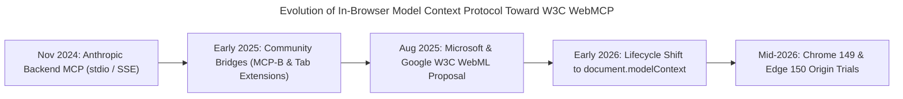
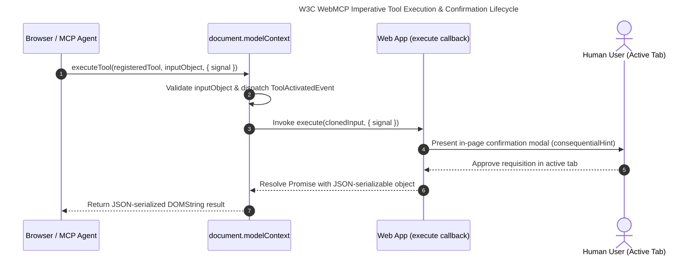

**WebMCP** is a W3C Web Machine Learning Community Group specification [@walderman-2026-webmcp] that exposes structured, JSON-Schema-validated Model Context Protocol tools directly inside live browser documents via `document.modelContext` and declarative HTML forms. It enables AI agents to execute deterministic functions within an authenticated user's active tab without fragile DOM scraping.

The following architectural comparison contrasts vision and DOM-scraping browser agents, backend or `stdio` Model Context Protocol servers, and in-page W3C WebMCP across their execution substrate, state and authentication sharing, token efficiency, and failure modes:

| Architectural Dimension | 1. Vision & DOM-Scraping Browser Agents | 2. Backend / `stdio` MCP Servers | 3. In-Page W3C WebMCP (`document.modelContext`) |
| :--- | :--- | :--- | :--- |
| **Primary Interface & Transport** | Multimodal viewport screenshots, accessibility (a11y) trees, and synthetic XPath/CSS mouse/keyboard events [@deng-2023-mind2web; @zhou-2024-webarena]. | Out-of-process JSON-RPC 2.0 over `stdio` or HTTP/SSE (e.g., [`src/tools/unified-analytics.ts`](https://github.com/ghackenberg/ghackenberg.github.io/blob/main/src/tools/unified-analytics.ts)) [@mcp-specification-2024]. | Browser-native `document.modelContext` WebIDL API and declarative `<form toolname="...">` attributes [@walderman-2026-webmcp]. |
| **Authentication & Session Context** | Inherits browser cookies if attached to an active profile, but frequently triggers bot/CAPTCHA challenges via synthetic input timing. | Completely isolated from the user's browser; requires separate OAuth2 tokens, API keys, or service-account credentials. | Executes directly inside the active `Document` JavaScript realm, inheriting live `HttpOnly` cookies, SSO sessions, and CSRF tokens. |
| **Client-Side Application State** | Blind to internal memory; must infer state from rendered pixels or mutated DOM nodes across multi-step UI animations. | Disconnected from the active browser tab; backend mutations do not automatically update local React, Vue, or WebGL viewports. | Shares the exact in-memory JavaScript heap, state stores, and undo stacks of the human user's open web application. |
| **Token Cost & Latency Profile** | Extremely high: $3,000+$ DOM elements or high-resolution image tiles per step across $10\text{--}30$ sequential UI turns [@deng-2023-mind2web]. | Low and predictable: single-turn JSON Schema 2020-12 payload and structured JSON response [@mcp-specification-2024; @patil-2024-gorilla]. | Low and predictable: single-turn JSON Schema 2020-12 tool invocation (`executeTool`) with synchronous UI state synchronization [@walderman-2026-webmcp]. |
| **Dominant Failure Mode** | Exponential multi-step trajectory decay ($P = p^k$), brittle CSS selectors, dynamic layout shifts, and modal race conditions [@zhou-2024-webarena]. | **UI Disintermediation**: backend changes occur "behind the user's back," leaving the visible browser tab stale or desynchronized. | Requires an active open browser tab; exposes ambient-authority and indirect prompt injection surfaces if unguarded [@walderman-2026-webmcp; @greshake-2023-indirect-prompt-injection]. |

## Why Did Backend Model Context Protocol Need an In-Browser Counterpart?

Backend Model Context Protocol servers excel at headless service integration but operate outside the user's browser process, creating severe authentication duplication and user-interface disintermediation. WebMCP emerged to bridge this gap, allowing web applications to expose structured tools directly within the authenticated client-side `Document` realm where human users actively work.

When Anthropic introduced the **Model Context Protocol (MCP)** in November 2024 [@mcp-specification-2024], it solved a critical fragmentation problem in AI systems engineering: instead of writing custom tool wrappers for every combination of foundation model and data source, engineering teams could expose `tools`, `resources`, and `prompts` over a standardized JSON-RPC 2.0 wire protocol using `stdio` or HTTP with Server-Sent Events (SSE). On this platform, for example, our own [`src/tools/unified-analytics.ts`](https://github.com/ghackenberg/ghackenberg.github.io/blob/main/src/tools/unified-analytics.ts) server uses `@modelcontextprotocol/sdk` over `StdioServerTransport` to give coding agents deterministic access to Google Search Console and Plausible telemetry.

However, as soon as engineering teams attempted to apply backend MCP servers to interactive, stateful web applications—such as collaborative graphic design studios, corporate code-review portals, or complex e-commerce configurators—two fundamental architectural bottlenecks surfaced:

1. **The Authentication & Session Isolation Bottleneck:** A backend MCP server runs in an isolated OS subprocess or remote container. It has zero access to the user's browser cookie jar (`HttpOnly` session cookies), hardware-backed WebAuthn/Passkey assertions, enterprise SAML/OIDC Single Sign-On (SSO) sessions, or ephemeral Cross-Site Request Forgery (CSRF) tokens. Exposing a web application via a backend MCP server forces the developer to build, host, and secure a parallel OAuth2 API infrastructure—even when the web application already has a fully authenticated client-side session running in the user's browser tab.
2. **The UI Disintermediation Bottleneck:** Even when a backend MCP server is provisioned with separate API credentials, any mutation it performs happens *out-of-band* on the remote server. If a human user is staring at an open browser tab containing a client-side React, Vue, or WebGL state tree (such as an unsaved vector canvas or an interactive filter grid), a backend API call cannot update the in-memory client state without building bespoke WebSocket push synchronization. Worse, the human user loses immediate visual situational awareness of what the agent is staging before committing a change.



### From Early Community Prototypes to the W3C Web Machine Learning Community Group

The realization that **the browser tab itself should act as an MCP server** crystallized independently across both open-source practitioner projects and browser engine teams during early 2025:

- **Client-Side MCP Bridges (`MCP-B` and Tab Prototypes):** In early 2025, engineers including Alex Nahas (creator of **MCP-B** at `mcp-b.ai`) and Jason McGhee demonstrated that JavaScript functions already bundled inside a web application's frontend code could be wrapped in MCP tool schemas and invoked via browser extensions or local WebSocket bridges—reusing the existing authenticated `fetch()` pipeline of the active tab rather than duplicating backend endpoints.
- **The August 2025 Joint Microsoft Edge & Google Chrome Proposal:** Recognizing that extension-only bridges lacked native browser permission prompts, cross-frame origin isolation, and lifecycle integration with the HTML DOM, browser engineers from Microsoft and Google joined forces inside the **W3C Web Machine Learning Community Group**. Edited by Brandon Walderman and Samuel Dallstream (Microsoft) alongside Khushal Sagar and Dominic Farolino (Google), the **WebMCP Draft Community Group Report** [@walderman-2026-webmcp] established a standard WebIDL and HTML specification for cooperative in-browser tool registration.
- **Architectural Migration from `navigator.modelContext` to `document.modelContext`:** Early 2025 incubations and initial Chrome Canary flags attached the registry to the `Navigator` interface (`navigator.modelContext`) alongside methods such as `provideContext()` and `clearContext()`. However, rigorous review inside the W3C WebML Community Group exposed a subtle lifecycle mismatch: `Navigator` is conceptually tied to the user agent environment, whereas web application tools, DOM forms, and SPA route state are strictly scoped to an active `Document` inside a browsing context. Consequently, the normative W3C specification relocated the entry point to **`document.modelContext`** on the `Document` interface [@walderman-2026-webmcp], ensuring that registered tools are automatically garbage-collected and aborted whenever a document navigates or unloads.
- **2026 Browser Engine Rollout:** Following early dev-trial flags (`chrome://flags/#enable-webmcp-testing`), Google Chrome 149 (shipping July 2026) and Microsoft Edge 150 initiated public **Origin Trials** for WebMCP, alongside native DevTools inspection support and experimental Chrome DevTools Protocol (CDP) domains.

## How Does the W3C WebMCP Specification Architect Imperative and Declarative Tools?

The W3C WebMCP specification defines a dual-surface architecture anchored on `document.modelContext` [@walderman-2026-webmcp]. Web applications can register imperative JavaScript tools via `registerTool()` with JSON Schema 2020-12 input validation, semantic safety annotations, and `AbortSignal` lifecycles, or expose existing HTML `<form>` elements declaratively using `toolname` and `tooldescription` attributes.

To understand how WebMCP operates under the hood, we must examine the normative WebIDL interfaces, lifecycle maps, and HTML extensions defined in the W3C Draft Community Group Report [@walderman-2026-webmcp]. Unlike backend MCP [@mcp-specification-2024], WebMCP deliberately omits `resources` and `prompts`—because the active DOM already supplies visual context and the user interacts directly with the browser UI—focusing exclusively on **deterministic, schema-validated `tools`**.

### 1. The Normative WebIDL Interfaces (`document.modelContext`)

The specification extends the standard DOM `Document` interface with a `[SameObject]` attribute `modelContext` of type `ModelContext`, accessible only within a `[SecureContext]` (HTTPS or `localhost`) on `Window` realms [@walderman-2026-webmcp]:

```webidl
// Normative WebIDL from W3C WebMCP Specification (Walderman et al., 2026, Sections 4.1–4.3)
partial interface Document {
  [SecureContext, SameObject] readonly attribute ModelContext modelContext;
};

[Exposed=Window, SecureContext]
interface ModelContext : EventTarget {
  Promise<undefined> registerTool(
    ModelContextTool tool,
    optional ModelContextRegisterToolOptions options = {}
  );
  Promise<sequence<RegisteredTool>> getTools(
    optional ModelContextGetToolOptions options = {}
  );
  Promise<DOMString> executeTool(
    RegisteredTool tool,
    optional object inputObject,
    optional ModelContextExecuteToolOptions options = {}
  );

  attribute EventHandler ontoolchange;
  attribute EventHandler ontoolactivated;
  attribute EventHandler ontoolcancel;
};

dictionary ModelContextTool {
  required DOMString name;
  DOMString title;
  required DOMString description;
  object inputSchema;
  required ToolExecuteCallback execute;
  ToolAnnotations annotations;
};

dictionary ToolAnnotations {
  boolean readOnlyHint;
  boolean untrustedContentHint;
  boolean consequentialHint;
  boolean debugging;
};

dictionary ModelContextRegisterToolOptions {
  sequence<USVString> exposedTo;
  AbortSignal signal;
};

dictionary ModelContextGetToolOptions {
  sequence<USVString> fromOrigins;
};

dictionary ModelContextExecuteToolOptions {
  AbortSignal signal;
};

dictionary ToolExecuteCallbackOptions {
  required AbortSignal signal;
};

callback ToolExecuteCallback = Promise<any> (
  object inputObject,
  ToolExecuteCallbackOptions options
);

dictionary RegisteredTool {
  required DOMString name;
  DOMString title;
  required DOMString description;
  object inputSchema;
  ToolAnnotations annotations;
};
```

*(Note on specification evolution: Early Chrome Dev Trial incubations and explainer prototypes under `navigator.modelContext` passed a `ModelContextClient` handle with `requestUserInteraction()` as the second argument to `execute`. In the normative W3C report [@walderman-2026-webmcp], `ModelContext` inherits from `EventTarget`, passes `ToolExecuteCallbackOptions` (`{ signal }`) to `execute`, and coordinates tool lifecycle notifications and human confirmation via `consequentialHint` alongside `ToolActivatedEvent` (`ontoolactivated`) and `ToolCancelEvent` (`ontoolcancel`).)*

Every field and method in this WebIDL contract enforces specific runtime invariants defined in Sections 3 and 4 of the W3C report [@walderman-2026-webmcp]:

- **Asynchronous Registration & JSON Schema 2020-12 Validation (`registerTool`):** `registerTool(tool, options)` operates asynchronously and returns a `Promise<undefined>` (rejecting the returned promise rather than throwing synchronously) [@walderman-2026-webmcp]:
  - Rejects with an `"InvalidStateError"` `DOMException` if the `Document` is not `fully active`, if `tool.name` already exists in the document's tool map, if `tool.name` is empty, exceeds $128$ characters, or contains characters outside ASCII alphanumeric plus `_`, `-`, and `.`, or if `tool.description` is empty.
  - Rejects with a `"NotAllowedError"` `DOMException` if the document is not allowed to use the `"tools"` policy-controlled feature (`Permissions-Policy: tools`).
  - Rejects with a `"SecurityError"` `DOMException` if any entry in `options.exposedTo` fails to parse as a valid, potentially trustworthy origin.
  - Rejects with a `TypeError` if `tool.inputSchema` is provided and cannot be serialized via `JSON.stringify()`. When `inputSchema` is omitted, the browser synthesizes the default JSON Schema Draft 2020-12 object `{"type": "object"}` (`https://json-schema.org/draft/2020-12/schema`).
- **Four-Dimensional Semantic `ToolAnnotations`:** WebMCP extends MCP's annotation model with four boolean hints that govern browser agent planning and security sandboxing [@walderman-2026-webmcp]:
  1. `readOnlyHint`: Indicates that the tool only queries state and does not mutate the application or trigger external side effects.
  2. `untrustedContentHint`: Warns the calling agent harness that the tool's return value contains untrusted third-party data (e.g., user-submitted comments, external emails, or public listings) that must be isolated against indirect prompt injection [@greshake-2023-indirect-prompt-injection; @hines-2024-spotlighting].
  3. `consequentialHint`: Signals a high-stakes state mutation (e.g., financial checkout, deleting records, or publishing code) requiring explicit human-in-the-loop confirmation before or during execution.
  4. `debugging`: Marks developer-facing diagnostic tools (e.g., dumping component state trees or performance counters) so consumer shopping assistants ignore them while coding agents (such as Google Antigravity or Claude Code) prioritize them.
- **SPA Lifecycle Management via `AbortSignal`:** Modern Single-Page Applications (React, Vue, Angular, Astro view transitions) mount and unmount UI views dynamically without reloading the `Document`. Instead of requiring manual `unregisterTool(name)` bookkeeping (which had existed only in early pre-standard polyfills), `registerTool(tool, { signal })` binds the tool's lifetime to a standard `AbortController.signal` [@walderman-2026-webmcp]. When a component unmounts and calls `controller.abort()`, the browser automatically purges the tool from the document's registered tool map, dispatches `ontoolchange`, and aborts any in-flight invocations.
- **Cross-Frame Origin Isolation (`options.exposedTo`, `fromOrigins` & `Permissions-Policy: tools`):** By default, a tool registered in a document is only discoverable and executable by the browsing context's native agent or same-origin callers. Wildcard `"*"` origins are explicitly rejected by Section 4.2 step 13 with a `"SecurityError"` `DOMException` [@walderman-2026-webmcp]. If an embedded `<iframe>` (such as a payment widget at `https://widget.example.com`) wants to expose tools to a parent document across origins, it must pass explicit potentially trustworthy origin strings in `registerTool(tool, { exposedTo: ["https://checkout.example.com"], signal })`, the embedding `<iframe>` must be granted `Permissions-Policy: tools`, and the parent frame discovers those tools via `await document.modelContext.getTools({ fromOrigins: ["https://widget.example.com"] })` [@walderman-2026-webmcp].
- **Realm-Agnostic `DOMException` Error Mapping:** Because `executeTool(tool, inputObject, options)` can cross browsing-context and `Window` realm boundaries (returning a `Promise<DOMString>` containing the JSON-serialized result), passing arbitrary custom JavaScript `Error` subclasses across realms breaks `instanceof` checks and leaks internal stack traces. Section 3 of the W3C WebMCP specification normalizes all five platform execution failures into realm-agnostic `DOMException` names [@walderman-2026-webmcp]:
  - `"NotFoundError"` (`tool not found`): The target `RegisteredTool` is no longer registered or its origin is not visible to the caller.
  - `"DataError"` (`invalid input`): The caller's `inputObject` failed JSON serialization or violated the tool's JSON Schema 2020-12 `inputSchema`.
  - `"OperationError"` (`tool rejected` / `unserializable result`): Either the tool's `execute` callback rejected its promise during runtime execution, or its resolved return value could not be serialized to a JSON string.
  - `"AbortError"` (`target document unloaded`): The target `Document` unloaded or navigated away, or the caller's/registration's `AbortSignal` aborted before completion.



### 2. Production TypeScript Implementation: Imperative `document.modelContext` Registration

The following self-contained TypeScript module demonstrates how a modern web application registers both a read-only query tool and a consequential mutation tool using the normative `await document.modelContext.registerTool(tool, options)` contract, complete with `AbortController` teardown, `exposedTo` origin allowlisting, and `ToolExecuteCallbackOptions` (`{ signal }`) propagation [@walderman-2026-webmcp]:

```typescript
// Ambient WebIDL type declarations aligned with W3C WebMCP (Walderman et al., 2026)
export interface ToolAnnotations {
  readonly readOnlyHint?: boolean;
  readonly untrustedContentHint?: boolean;
  readonly consequentialHint?: boolean;
  readonly debugging?: boolean;
}

export interface ToolExecuteCallbackOptions {
  readonly signal: AbortSignal;
}

export interface ModelContextTool<TInput = Record<string, unknown>, TOutput = unknown> {
  readonly name: string;
  readonly title?: string;
  readonly description: string;
  readonly inputSchema?: Record<string, unknown>;
  readonly annotations?: ToolAnnotations;
  execute(inputObject: TInput, options: ToolExecuteCallbackOptions): Promise<TOutput>;
}

export interface ModelContextRegisterToolOptions {
  readonly exposedTo?: readonly string[];
  readonly signal?: AbortSignal;
}

export interface ModelContextGetToolOptions {
  readonly fromOrigins?: readonly string[];
}

export interface ModelContextExecuteToolOptions {
  readonly signal?: AbortSignal;
}

export interface RegisteredTool {
  readonly name: string;
  readonly title?: string;
  readonly description: string;
  readonly inputSchema?: Record<string, unknown>;
  readonly annotations?: ToolAnnotations;
}

export interface ModelContext extends EventTarget {
  registerTool<TInput, TOutput>(
    tool: ModelContextTool<TInput, TOutput>,
    options?: ModelContextRegisterToolOptions
  ): Promise<undefined>;
  getTools(options?: ModelContextGetToolOptions): Promise<RegisteredTool[]>;
  executeTool(
    tool: RegisteredTool,
    inputObject?: Record<string, unknown>,
    options?: ModelContextExecuteToolOptions
  ): Promise<string>;
  ontoolchange: ((this: ModelContext, ev: Event) => unknown) | null;
  ontoolactivated: ((this: ModelContext, ev: Event) => unknown) | null;
  ontoolcancel: ((this: ModelContext, ev: Event) => unknown) | null;
}

declare global {
  interface Document {
    readonly modelContext?: ModelContext;
  }
}

export interface FilterProductsInput {
  readonly category: 'sensors' | 'actuators' | 'controllers';
  readonly maxPriceEur: number;
  readonly inStockOnly?: boolean;
}

export async function registerIndustrialCatalogTools(
  applyUiFilterState: (filter: FilterProductsInput) => Array<{ sku: string; name: string; priceEur: number }>,
  promptUserCheckoutModal: (sku: string, quantity: number, signal: AbortSignal) => Promise<boolean>
): Promise<AbortController> {
  const lifecycleController = new AbortController();

  if (typeof document === 'undefined' || !document.modelContext) {
    return lifecycleController;
  }

  // 1. Read-Only UI State & Catalog Query Tool
  await document.modelContext.registerTool<FilterProductsInput, unknown>(
    {
      name: 'filter_industrial_catalog',
      title: 'Filter Industrial Component Catalog',
      description:
        'Updates the live viewport catalog filter and returns matching industrial components.',
      inputSchema: {
        $schema: 'https://json-schema.org/draft/2020-12/schema',
        type: 'object',
        properties: {
          category: {
            type: 'string',
            enum: ['sensors', 'actuators', 'controllers'],
            description: 'Hardware subsystem category to display in the active grid.',
          },
          maxPriceEur: {
            type: 'number',
            minimum: 0,
            description: 'Maximum unit price in EUR.',
          },
          inStockOnly: {
            type: 'boolean',
            default: true,
            description: 'Restrict results to immediately shippable warehouse stock.',
          },
        },
        required: ['category', 'maxPriceEur'],
        additionalProperties: false,
      },
      annotations: {
        readOnlyHint: true,
        untrustedContentHint: false,
        consequentialHint: false,
      },
      async execute(inputObject, { signal }) {
        signal.throwIfAborted();
        const matches = applyUiFilterState(inputObject);
        return {
          appliedFilter: inputObject,
          matchCount: matches.length,
          items: matches,
        };
      },
    },
    {
      exposedTo: [window.location.origin],
      signal: lifecycleController.signal,
    }
  );

  // 2. Consequential Requisition Tool with Mandatory In-Page User Confirmation
  await document.modelContext.registerTool<{ sku: string; quantity: number }, unknown>(
    {
      name: 'submit_procurement_requisition',
      title: 'Submit Component Procurement Requisition',
      description:
        'Stages a binding procurement requisition for an industrial SKU after explicit user confirmation.',
      inputSchema: {
        $schema: 'https://json-schema.org/draft/2020-12/schema',
        type: 'object',
        properties: {
          sku: { type: 'string', pattern: '^[A-Z]{3}-[0-9]{4}$' },
          quantity: { type: 'integer', minimum: 1, maximum: 500 },
        },
        required: ['sku', 'quantity'],
        additionalProperties: false,
      },
      annotations: {
        readOnlyHint: false,
        consequentialHint: true,
      },
      async execute(inputObject, { signal }) {
        const approved = await promptUserCheckoutModal(
          inputObject.sku,
          inputObject.quantity,
          signal
        );
        if (!approved) {
          throw new Error(`User declined requisition for ${inputObject.quantity}x ${inputObject.sku}.`);
        }

        const response = await fetch('/api/v1/requisitions', {
          method: 'POST',
          credentials: 'same-origin', // Automatically attaches live HttpOnly SSO session cookie
          headers: { 'Content-Type': 'application/json' },
          body: JSON.stringify(inputObject),
          signal,
        });
        if (!response.ok) {
          throw new Error(`Requisition API failed with HTTP ${response.status}`);
        }
        return await response.json();
      },
    },
    { signal: lifecycleController.signal }
  );

  return lifecycleController;
}
```

### 3. The Declarative HTML Form API (`<form toolname="...">`)

What about millions of server-rendered or progressive-enhancement web pages that already expose functionality through standard HTML `<form>` elements? Alongside the core imperative `document.modelContext` specification [@walderman-2026-webmcp], the companion W3C/Chromium Declarative WebMCP proposal and Chrome Origin Trial implementation enable developers to turn existing HTML `<form>` elements into schema-validated MCP tools **with zero JavaScript registration boilerplate**:

- **Form-Level Attributes (`toolname`, `tooldescription`, `toolautosubmit`):** Adding `toolname` and `tooldescription` to a `<form>` instructs the browser parser to automatically synthesize a `ModelContextTool` whose `inputSchema` is derived from the form's child `<input>`, `<select>`, and `<textarea>` validation constraints (`type`, `required`, `min`, `max`, `pattern`, and `<option>` enums). By default, when an agent invokes a declarative form tool, the browser populates the form fields and highlights the submit button without submitting—allowing the human user to inspect the staged values and click submit manually. Only if the developer explicitly sets the boolean `toolautosubmit` attribute does the browser automatically dispatch the form submission.
- **Parameter Overrides (`toolparamtitle`, `toolparamdescription`):** Individual form controls can override their synthesized JSON Schema property descriptions using `toolparamtitle` and `toolparamdescription` (falling back to the associated `<label>` text or `aria-description` if omitted).
- **Agent-Active CSS Pseudo-Classes (`:tool-form-active` & `:tool-submit-active`):** While an agent is populating or awaiting confirmation on a declarative form, the browser applies `:tool-form-active` to the `<form>` element and `:tool-submit-active` to its active submit button, enabling clear visual styling (such as an amber or blue focus ring showing the human user where the agent is staging data).
- **`SubmitEvent.agentInvoked` and `SubmitEvent.respondWith(Promise)`:** When a form submission is triggered by an agent tool call rather than a human mouse click, the DOM `SubmitEvent` carries `event.agentInvoked === true`. If the page handles submission asynchronously via JavaScript (`event.preventDefault()`), it passes its result promise to `event.respondWith(promise)` so the resolved data is piped back to the calling agent as the tool's output:

```html
<!-- Declarative WebMCP HTML Form: Auto-synthesizes JSON Schema 2020-12 from HTML5 constraints -->
<form
  id="ci-bisect-form"
  action="/api/ci/bisect"
  method="POST"
  toolname="trigger_regression_bisect"
  tooldescription="Stages a Git regression bisect job between a known-good and known-bad commit SHA."
>
  <label for="good-sha">Last Known-Good Commit SHA</label>
  <input
    id="good-sha"
    name="goodCommit"
    type="text"
    required
    pattern="^[a-f0-9]{7,40}$"
    toolparamdescription="7-to-40 character hexadecimal Git SHA where the test suite passed."
  />

  <label for="bad-sha">First Known-Bad Commit SHA</label>
  <input
    id="bad-sha"
    name="badCommit"
    type="text"
    required
    pattern="^[a-f0-9]{7,40}$"
    toolparamdescription="7-to-40 character hexadecimal Git SHA where the regression appeared."
  />

  <label for="target-suite">Verification Target</label>
  <select
    id="target-suite"
    name="suite"
    required
    toolparamdescription="Test suite partition to run at each bisect step."
  >
    <option value="unit">Unit &amp; Schema Gates</option>
    <option value="integration">Full End-to-End Integration</option>
  </select>

  <button type="submit">Stage Bisect Job</button>
</form>

<script type="module">
  const form = document.getElementById('ci-bisect-form');
  form?.addEventListener('submit', (event) => {
    if (event.agentInvoked) {
      event.preventDefault();
      const formData = new FormData(form);
      const payload = Object.fromEntries(formData.entries());

      // Pipe structured JSON back to the WebMCP agent caller via SubmitEvent.respondWith()
      event.respondWith(
        fetch(form.action, {
          method: 'POST',
          credentials: 'same-origin',
          headers: { 'Content-Type': 'application/json' },
          body: JSON.stringify(payload),
        }).then((res) => res.json())
      );
    }
  });
</script>
```

## How Can Standard MCP Agents Like Antigravity and Claude Code Connect to WebMCP?

Because `document.modelContext` resides inside the browser's sandboxed `Window` renderer process while desktop coding agents communicate over `stdio` or HTTP JSON-RPC 2.0, connecting external agents requires a transport bridge. Four distinct bridging topologies link native browser assistants, in-page scripts, Chrome DevTools Protocol harnesses, and local WebSocket relays to WebMCP.

A frequent point of confusion among systems engineers is how a browser-resident JavaScript API (`document.modelContext`) interoperates with desktop and CLI agent harnesses—such as **Google Antigravity**, **Anthropic Claude Code**, **Cursor**, or **Windsurf**—which expect out-of-process MCP servers speaking JSON-RPC 2.0 over `stdio` [@mcp-specification-2024].

The W3C WebMCP specification intentionally decouples **in-page tool registration and execution** (`document.modelContext`) from the **outer agent transport layer** [@walderman-2026-webmcp]. Depending on where the AI agent's policy loop executes, four architectural bridging topologies connect the agent to `document.modelContext`:


### Topology A: Native Browser Agents via Privileged Browser IPC

When the AI assistant is built directly into the browser binary—such as **Gemini in Chrome**, **Microsoft Edge Copilot**, or **Brave Leo**—or connects via an OS-level browser companion channel, no external polyfill or network socket is needed.
- **Browser-to-Renderer IPC:** The privileged browser process inspects the active tab's `traversable navigable` [@walderman-2026-webmcp] over Chromium's internal Mojo IPC bus, enumerating all tools registered across the top-level `Document` and any opted-in child frames.
- **The Normative `pending tool executions map`:** Section 4.1 of the W3C specification [@walderman-2026-webmcp] defines a browser-level **`pending tool executions map`** attached to each `traversable navigable`. When a user asks the browser sidebar agent to perform a task that triggers a page navigation or multi-document transition, the `traversable navigable` tracks in-flight tool promises and cancellation signals (`AbortSignal`) across the browsing session.

### Topology B: In-Page & Cross-Frame JavaScript Agents (`getTools` / `executeTool`)

Unlike early drafts where web pages could only *register* tools (`provideContext`), the current W3C WebMCP draft exposes asynchronous consumer methods—`document.modelContext.getTools(options)` and `document.modelContext.executeTool(tool, inputObject, options)`—directly on the `ModelContext` interface [@walderman-2026-webmcp].
- **In-Browser WebGPU / WebLLM Agents & Enterprise Sidebars:** An in-page AI copilot widget or a parent enterprise portal frame can call `await document.modelContext.getTools({ fromOrigins: [...] })` to discover all `RegisteredTool` handles exposed by the host page and any cross-origin `<iframe>` micro-frontends that declared the caller's origin in `exposedTo` (with `Permissions-Policy: tools` enabled) [@walderman-2026-webmcp].
- **Polyfill Compatibility (`@mcp-b/webmcp-polyfill` & `webmcp-types`):** For browsers that have not yet enabled the native WebMCP flag, open-source packages such as `@mcp-b/webmcp-polyfill` provide a standards-compliant runtime implementation of `document.modelContext` in userland JavaScript.

### Topology C: CLI & IDE Coding Agents via `chrome-devtools-mcp` (CDP Bridge)

How do standalone engineering harnesses like **Google Antigravity** (the environment used to author and verify this repository), **Claude Code**, or **Cursor** invoke WebMCP tools inside a live development browser? They bridge `stdio` JSON-RPC 2.0 to the **Chrome DevTools Protocol (CDP)** via `chrome-devtools-mcp`:

1. **Dedicated Experimental WebMCP CDP Category (`--categoryExperimentalWebmcp=true`):** Starting with `chrome-devtools-mcp` v0.21+ paired with Chrome 149+, launching the MCP server with `--categoryExperimentalWebmcp=true` enables native CDP inspection of the browser's `WebMCP` domain. It automatically exposes two first-class MCP tools to the coding agent:
   - `list_webmcp_tools`: Queries the active browser tab's `document.modelContext` registry and returns all tool names, descriptions, `ToolAnnotations` (`debugging: true`, `readOnlyHint`, etc.), and JSON Schema 2020-12 `inputSchema` definitions.
   - `execute_webmcp_tool`: Dispatches a validated JSON payload over CDP into the target document's `document.modelContext.executeTool()` method and returns the serialized JSON result over `stdio` to the coding agent.
2. **Universal CDP `evaluate_script` Fallback:** Even on standard `chrome-devtools-mcp` configurations without experimental flags enabled, any agent with access to `evaluate_script` can discover and invoke WebMCP tools deterministically in a single round-trip:

```json
{
  "mcpServers": {
    "chrome-devtools": {
      "command": "npx",
      "args": [
        "-y",
        "chrome-devtools-mcp@latest",
        "--categoryExperimentalWebmcp=true"
      ]
    }
  }
}
```

And if a coding agent invokes `evaluate_script` directly via CDP, the discovery-and-invocation handshake resolves `getTools()`, locates the target `RegisteredTool` handle, and parses the JSON string returned by `executeTool()`:

```javascript
// Universal CDP evaluate_script bridge for Google Antigravity / Claude Code
async () => {
  if (!document.modelContext) return { supported: false, tools: [] };
  const tools = await document.modelContext.getTools();
  const targetTool = tools.find((t) => t.name === 'filter_industrial_catalog');
  if (!targetTool) return { supported: true, availableTools: tools.map((t) => t.name), result: null };

  const rawResult = await document.modelContext.executeTool(targetTool, {
    category: 'sensors',
    maxPriceEur: 250,
    inStockOnly: true,
  });
  return {
    supported: true,
    availableTools: tools.map((t) => t.name),
    result: JSON.parse(rawResult),
  };
}
```

### Topology D: Stdio-to-WebSocket Local Relay (`@mcp-b/webmcp-local-relay`)

When a desktop MCP host (such as Claude Desktop or a local Python/TypeScript orchestrator) needs to treat an open browser tab on Firefox, Safari, or stable Chromium as a persistent MCP server without attaching a full DevTools debugger session, the **Stdio-to-WebSocket Local Relay** pattern provides a lightweight bridge:
- The desktop agent spawns `npx @mcp-b/webmcp-local-relay` over standard `stdio`.
- The relay binds a loopback WebSocket server on `ws://127.0.0.1:9333`.
- A lightweight script or extension inside the target web page (`@mcp-b/global`) connects to `ws://127.0.0.1:9333`, synchronizes `await document.modelContext.getTools()` into standard MCP `tools/list` responses, and forwards incoming `tools/call` JSON-RPC 2.0 requests into `document.modelContext.executeTool()`.

## What Empirical Benchmarks and Reference Use Cases Validate In-Page Tool Calling?

Empirical benchmarks on autonomous web navigation reveal that pixel- and DOM-scraping agents suffer severe multi-step accuracy collapse across real-world websites. Replacing low-level GUI actuation with schema-validated in-page tool calls collapses twenty-step DOM interaction trajectories into single-turn function invocations across creative, e-commerce, and enterprise software engineering workflows.

Why did browser vendors invest in standardizing `document.modelContext` when multimodal language models can already view screenshots and click DOM elements? The answer lies in the empirical failure rates documented by primary peer-reviewed web-agent and tool-use benchmarks between 2023 and 2024.

### 1. The Empirical Failure Mode of DOM & GUI Scraping (`WebArena` and `Mind2Web`)

In **WebArena** (ICLR 2024) [@zhou-2024-webarena], Zhou et al. constructed a realistic, self-hosted benchmark environment spanning **812 long-horizon tasks** across four live web domains: e-commerce (Magento), social forum discussions (Reddit/Postmill), collaborative software development (GitLab), and content management (Wiki/CMS), supplemented by map and calculator utilities. Even with an observation space combining accessibility (a11y) trees and reasoning traces, **`GPT-4` (`gpt-4-0613`) achieved an end-to-end task success rate of only $14.41\%$**, compared to **$78.24\%$ for human users** [@zhou-2024-webarena].

Similarly, in **Mind2Web** (NeurIPS 2023) [@deng-2023-mind2web], Deng et al. collected **2,350 open-ended tasks across 137 real-world websites** spanning 31 domains. Their dataset analysis exposed two structural bottlenecks of raw HTML DOM interaction:
1. **Context Window Explosion ($>3,000$ HTML Elements per Page):** Real production web pages in Mind2Web averaged thousands of raw DOM nodes per snapshot—far exceeding what an LLM can attend to reliably without severe distraction or prohibitive token cost. Deng et al. had to engineer a two-stage pipeline (**MindAct**) that first used a fine-tuned `DeBERTa` small language model solely to rank and prune the raw DOM down to the top-50 candidate elements before the reasoning LLM could even select an action [@deng-2023-mind2web].
2. **Low Per-Step Grounding Accuracy:** Even after `DeBERTa` candidate pruning, `GPT-4` achieved only **$41.6\%$ Element Accuracy** and **$36.2\%$ Step Success Rate** on cross-task generalization, dropping to **$37.1\%$ Element Accuracy** and **$26.4\%$ Step Success Rate** on unseen cross-domain websites (while a specifically fine-tuned `Flan-T5-XL` model reached $55.1\% / 52.0\%$ cross-task and $42.1\% / 39.6\%$ cross-domain) [@deng-2023-mind2web].

Mathematically, as we formalized in our analysis of [Agent Harnesses](/posts/2026_10_21_agent_harnesses_architecture_taxonomy_evolution/) and [Emergent Control-Loop Failures](/posts/2026_10_22_emergent_properties_history_theory_ai_security_incidents/), a low-level GUI agent must chain $k$ sequential DOM actions—clicking a dropdown ($i=1$), waiting for an animation ($i=2$), typing into a search box ($i=3$), selecting a date-picker cell ($i=4$), scrolling a virtualized list ($i=5$), and clicking apply ($i=6, \dots, k$). If each individual GUI step succeeds with probability $p_{\text{DOM}} \in (0, 1)$, the end-to-end trajectory success probability decays exponentially:

$$P(\text{trajectory succeeds}) = \prod_{i=1}^{k} p_{\text{DOM}, i} \approx \big(p_{\text{DOM}}\big)^k$$

When $p_{\text{DOM}} = 0.52$ (the best fine-tuned cross-task step success rate in Mind2Web [@deng-2023-mind2web]) and a workflow requires $k = 8$ sequential UI interactions, end-to-end completion collapses to $0.52^8 \approx \mathbf{0.53\%}$. Even if a frontier multimodal model pushes per-step GUI grounding to $p_{\text{DOM}} = 0.85$, a $12$-step UI sequence still succeeds only $0.85^{12} \approx \mathbf{14.2\%}$ of the time—precisely matching the $14.41\%$ empirical ceiling observed in WebArena [@zhou-2024-webarena]!

### 2. The Schema-Guided Tool Calling Advantage (`Gorilla` and `ToolLLM`)

Contrast that $k$-step DOM actuation chain with **schema-guided API and tool invocation**, benchmarked in **Gorilla** (NeurIPS 2024) [@patil-2024-gorilla] and **ToolLLM / ToolBench** (ICLR 2024) [@qin-2024-toolllm]:
- Patil et al. (**Gorilla**) [@patil-2024-gorilla] demonstrated across 1,645 API calls (TorchHub, TensorFlow Hub, HuggingFace) that when a language model is provided with explicit, retrieval-grounded function signatures and parameter constraints, AST sub-tree matching accuracy jumps by over $+20.4\%$ compared to ungrounded generation while dramatically suppressing hallucinated arguments.
- Qin et al. (**ToolLLM**) [@qin-2024-toolllm] scaled schema-based tool execution across **16,464 real-world REST APIs** across 49 categories on RapidAPI, showing that structured API schemas paired with Depth-First Search Decision Trees (DFSDT) allow models to compose complex multi-tool workflows with high pass rates and zero pixel-grounding overhead.

In our four-generation taxonomy of [Agent Harnesses: Architecture, Taxonomy, and Evolution from Test Drivers to Protocol Buses](https://github.com/ghackenberg/ghackenberg.github.io/blob/main/src/content/posts/2026_10_21_agent_harnesses_architecture_taxonomy_evolution/index.md), WebMCP upgrades browser interaction from **Generation 3 (fragile GUI/OS coordinate and DOM actuation)** to **Generation 4 (protocol-driven JSON Schema capability negotiation)**—collapsing $k = 10\text{--}15$ brittle DOM clicks into $k = 1$ deterministic `document.modelContext.executeTool()` invocation where $P(\text{trajectory}) = p_{\text{schema}}^1$.

### 3. The Three W3C WebMCP Reference Use Cases

The W3C WebMCP specification and companion explainer use cases [@walderman-2026-webmcp] ground this architectural shift in three concrete human-in-the-loop web application domains:

1. **Creative Graphic Design & Collaborative Canvas Web Apps:** Suppose a user is editing a poster or wedding invitation inside a browser-based vector canvas (e.g., Figma, Canva, or an SVG schematic editor) that renders onto an HTML `<canvas>` or WebGL surface. A DOM-scraping agent sees only an opaque `<canvas width="1920" height="1080">` element with zero child nodes. By registering WebMCP tools such as `add_text_layer`, `apply_brand_palette`, and `align_selected_nodes` on `document.modelContext`, the web app lets the agent manipulate the live in-memory scene graph directly while the human user immediately sees the rendered result and retains full `Ctrl+Z` undo history [@walderman-2026-webmcp].
2. **Multimodal E-Commerce Dress Shopping & Catalog Filtering:** A shopper browsing an apparel store uploads a reference photo of a venue to their browser assistant and asks for matching dresses under a specific budget and delivery date. Instead of the agent clicking through 14 nested accordion filters, size checkboxes, and price sliders—causing the screen to flash and jump uncontrollably—the page exposes a single `filter_catalog` tool and a `get_visible_products` tool via `document.modelContext` [@walderman-2026-webmcp]. The agent applies all multi-dimensional filter criteria in one atomic call, updating the human's visual grid instantly.
3. **Enterprise Software Engineering: Gerrit Code Review & CI Failure Triage:** In corporate engineering environments (such as Chromium's **Gerrit** code review and Luci CI infrastructure cited directly by the W3C editors [@walderman-2026-webmcp]), developers authenticate via short-lived corporate SSO cookies and hardware security keys that cannot be exported to external cloud agents. When a build fails across 40 shards, a Gerrit page with WebMCP tools (`get_failed_build_logs`, `search_changelist_diff`, `draft_inline_review_comment`) enables the engineer's local coding agent to inspect failure logs and stage inline review comments directly inside the authenticated tab—leaving the final "Publish Review" click to the human engineer.

## What Is the Realistic Future Role of WebMCP on the Open Web?

WebMCP will not replace backend MCP servers or static `/llms.txt` documentation feeds; instead, it occupies the cooperative human-in-the-loop tier of the agentic web stack. Its long-term adoption depends on enforcing deterministic control-loop boundaries against ambient-authority abuse, indirect prompt injection, semantic misrepresentation, and schema-based privacy exfiltration.

Whenever a new browser standard enters Origin Trial, industry commentary tends to swing between two unhelpful extremes: either declaring that every REST API and backend MCP server is obsolete, or dismissing in-browser tools as a passing novelty. An objective systems-engineering evaluation points to a much clearer division of labor.

### 1. Why WebMCP Complements Rather Than Replaces Backend MCP and `/llms.txt`

WebMCP has deliberate architectural boundaries that make it unsuitable as a universal replacement for backend protocols [@walderman-2026-webmcp]:
- **Mandatory Foreground Browser Presence:** Because `document.modelContext` lives inside a `Document` in a `Window` realm, it requires a running browser renderer process and an open tab. Background cron pipelines, overnight CI/CD verification jobs, and server-to-server microservices will always rely on headless backend MCP servers (such as our [`src/tools/unified-analytics.ts`](https://github.com/ghackenberg/ghackenberg.github.io/blob/main/src/tools/unified-analytics.ts)) over `stdio` or HTTP/SSE [@mcp-specification-2024].
- **The Cooperative vs. Adversarial Web Incentive Split:** WebMCP is fundamentally a **cooperative** protocol: the website owner voluntarily writes `registerTool()` or `<form toolname="...">` because helping the user's agent succeeds in completing a workflow that benefits both the user and the site (e.g., purchasing components, configuring a SaaS workspace, or triaging a pull request). Conversely, on websites whose business model depends on human ad impressions or proprietary data lock-in, site operators have zero incentive to expose bulk-scraping tools via WebMCP.
- **Read-Only Knowledge Ingestion Belongs to `/llms.txt` and Semantic HTML:** For static technical articles, academic documentation, and marketing pages with no interactive state mutations, spinning up a browser renderer to call a JS tool is unnecessary overhead. Static Markdown feeds (`/llms.txt`), JSON-LD structured data, and Answer-First HTML remain the optimal layer for read-only knowledge extraction.

### 2. Security & Privacy Analysis: Mapping W3C Section 6 to STAMP / STPA-Sec Control Boundaries

In Section 6 (*Security and Privacy Considerations*) of the W3C WebMCP specification [@walderman-2026-webmcp], the editors detail four critical threat vectors that arise when probabilistic language models are granted tool execution capabilities inside an authenticated browser session.

As we proved in our systems-theoretic analysis of [Emergent Properties and Nancy Leveson's STAMP / STPA-Sec Control Loops](https://github.com/ghackenberg/ghackenberg.github.io/blob/main/src/content/posts/2026_10_22_emergent_properties_history_theory_ai_security_incidents/index.md), security in an agentic browser is an emergent property of the coupled feedback loop (`Controller -> Actuator -> Controlled Process -> Sensor`). Every one of the four W3C WebMCP threat vectors maps directly onto a specific **STPA-Sec Unsafe Control Action (UCA)** or corrupted sensor path:

1. **Ambient Authority & Cross-Tab "CSRF-for-Agents" (Unconstrained Actuator Hazard):** Because tools registered on `document.modelContext` execute with the full ambient authority of the user's logged-in browser session (`HttpOnly` cookies, active enterprise SSO tokens), an agent orchestrating across multiple open tabs can be tricked into invoking a high-privilege tool on Tab B (`bank.example.com` or `admin.internal`) based on instructions read from Tab A (`attacker-blog.example`).
   - *Control Boundary:* Browser agent harnesses must treat each origin's `document.modelContext` as an isolated security principal, enforcing strict cross-origin taint tracking and requiring explicit human confirmation via in-page confirmation modals, `ToolActivatedEvent` listeners, or browser-level permission gates whenever a tool carries `consequentialHint: true` [@walderman-2026-webmcp].
2. **Tool Poisoning & Indirect Prompt Injection (Corrupted Sensor Feedback):** As established by Greshake et al. [@greshake-2023-indirect-prompt-injection], when an agent ingests untrusted external content—either inside a web page's tool `description` metadata (*Tool Poisoning*) or inside the payload returned by a tool that reads user-generated comments, issues, or emails—adversarial instructions embedded in that data can hijack the LLM Controller's Process Model.
   - *Control Boundary:* WebMCP introduces `annotations.untrustedContentHint: true` [@walderman-2026-webmcp] specifically so the browser harness knows to apply deterministic **Spotlighting** transformations (datamarking, explicit delimiter encoding, or provenance-isolated subagent summarization as formalized by Hines et al. [@hines-2024-spotlighting]) and to block tainted sessions from invoking consequential actuators without human intervention.
3. **Semantic Misrepresentation of Intent (Controller Process-Model Mismatch):** A deceptive or compromised website can register a tool whose natural-language `description` claims *"Check shipping availability and calculate tax"* while its underlying `execute` callback or `<form toolautosubmit>` actually submits a binding purchase (`finalizeCart`). Because the LLM Controller relies on `tool.description` to construct its internal Process Model, a lie in the metadata induces an unsafe control action [@walderman-2026-webmcp].
   - *Control Boundary:* Declarative forms default to **staging without auto-submission** (highlighting the form via `:tool-form-active` so the human user sees the actual DOM button and fields before clicking), and imperative tools that trigger network mutations or payments must surface origin-attributed confirmation UI outside the page's spoofable DOM tree [@walderman-2026-webmcp].
4. **Privacy Exfiltration via Over-Parameterized `inputSchema` (Covert Egress Channel):** Suppose an agent holds sensitive personal context in its conversation memory (such as the user's full address, medical query, or financial budget). A malicious shopping widget could register a seemingly innocuous `search_items` tool whose `inputSchema` includes optional properties like `userFullBiographicalContext` or `conversationSummary`. An over-helpful LLM will dutifully populate those schema fields and hand the user's private context directly to the third-party script [@walderman-2026-webmcp].
   - *Control Boundary:* Production browser harnesses must audit `inputSchema` fields against minimal task necessity, strip or redact high-entropy personal context before populating third-party tool calls, and display transparent parameter summaries in the agent activity log.

### 3. Architectural Decision Matrix: Selecting the Right Agent Integration Tier

To synthesize these empirical and security trade-offs into an actionable engineering blueprint, the following decision matrix defines when software architects should deploy `/llms.txt`, Backend MCP, In-Page W3C WebMCP, or Headless DOM/CDP Actuation:

| Integration Tier | Target Workload & Use Case | Auth & State Boundary | Recommended Protocol & Implementation |
| :--- | :--- | :--- | :--- |
| **Tier 1: Read-Only Knowledge & Docs** | Technical blog posts, API documentation, academic catalogs, and static marketing pages. | Public, stateless, cacheable at the CDN edge. | Semantic HTML5, JSON-LD, Answer-First GEO blocks, and static `/llms.txt` Markdown feeds. |
| **Tier 2: Headless Backend & CLI Automation** | CI/CD pipelines, database telemetry, repository indexing, and unattended cron workflows. | Service-account API keys, OAuth2 tokens, or local OS filesystem permissions. | **Backend MCP Server** over `stdio` or Streamable HTTP/SSE (e.g., [`src/tools/unified-analytics.ts`](https://github.com/ghackenberg/ghackenberg.github.io/blob/main/src/tools/unified-analytics.ts)) [@mcp-specification-2024]. |
| **Tier 3: Cooperative Human-in-the-Loop Web Apps** | Interactive SaaS dashboards, canvas editors, e-commerce filters, and SSO-protected code review. | Shared live browser tab (`HttpOnly` SSO cookies, client-side React/WebGL state, human confirmation). | **W3C WebMCP (`document.modelContext`)** + declarative `<form toolname="...">` [@walderman-2026-webmcp]. |
| **Tier 4: Legacy & Uncooperative Third-Party Sites** | Legacy enterprise portals or external web pages that expose neither APIs nor WebMCP tools. | Ephemeral browser profile or isolated container sandbox. | **Headless CDP / Multimodal DOM Actuation** (`chrome-devtools-mcp`, Playwright, OSWorld/WebArena harnesses) [@zhou-2024-webarena]. |
