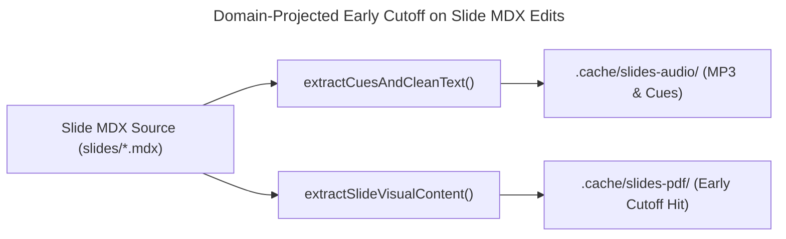

A **Zero-Artifact Git Repository** enforces a strict Hermetic Source-Only Invariant [@potvin-2016-google-monorepo; @dolstra-2004-nix-safe-deployment]: version control tracks exclusively human-authored source files while deterministic build pipelines synthesize, fingerprint, and cache derived binary artifacts (`MP3`, `PDF`, `PNG`, `WebP`) out-of-tree in content-addressable stores [@mokhov-2018-build-systems-a-la-carte] without polluting `.git/objects/pack` history [@korn-2002-rfc3284-vcdiff].

The following architectural trade-off matrix contrasts four common approaches to managing heavy derived media and build artifacts across static site generators, documentation platforms, and Slide-as-Code repositories:

| Architectural Dimension | 1. In-Tree Binary Commits (`git add *.mp3 *.pdf`) | 2. Git LFS Pointer Offloading (`git-lfs`) | 3. Naive Uncached CI Re-Generation | 4. Zero-Artifact Content-Addressable Cache (`.cache/*`) |
| :--- | :--- | :--- | :--- | :--- |
| **Git Object Store & Packfile Scaling** | Every edit mints a new immutable blob in Git's content-addressable DAG [@bird-2009-promises-perils-mining-git]; entropy-coded streams defeat VCDIFF delta windows [@korn-2002-rfc3284-vcdiff], causing monotonic $\mathcal{O}(N \cdot S)$ packfile bloat. | Keeps `.git/objects` small via SHA-256 pointer files, but couples clones to paid LFS bandwidth quotas and external storage servers. | Zero binary bloat in Git ($0\text{ B}$ tracked derived outputs), maintaining pure text diffs across all commits. | **Zero binary bloat in Git** ($-229.89\text{ MiB}$ / $-241.05\text{ MB}$ across $601$ purged files); Git tracks only declarative Markdown, MDX, TypeScript, and CSS. |
| **Diff & Merge Ergonomics** | PR reviews polluted by hundreds of opaque binary file diffs and merge conflicts on `.cache.json` / `.pdf` blobs. | Pointer SHA-256 conflicts still occur whenever two branches regenerate the same slide deck or audio track. | Clean source-only pull requests with zero binary merge conflicts. | **100% source-only pull requests**; derived assets never touch the working tree (`src/content/` or `public/`). |
| **CI/CD Build Latency & Determinism** | Instantaneous ($0\text{ s}$ build cost), but risks stale artifacts if a developer forgets to run local generators before committing. | Requires downloading hundreds of megabytes of LFS blobs on every runner checkout. | Prohibitive: re-synthesizing $189$ neural voiceovers and $10$ dual-theme Chromium PDFs adds $8\text{--}14\text{ min}$ per deploy and risks API throttling. | **Sub-second $\mathcal{O}(1)$ verification** on cache hits via constructive traces with early cutoff [@mokhov-2018-build-systems-a-la-carte] and split CI `restore`/`save`. |
| **Local Dev Server Ergonomics** | Serves static files directly from disk, but clutters working directories with generated noise. | Requires `git lfs pull` before local preview works; missing hooks serve broken text pointers. | Developers must run heavy full-site generators before starting `astro dev`. | **Zero-config on-demand middleware** (`astro:server:setup`) streaming `.cache/*` assets and redirecting PDF links (`302`) to live `/print/` routes. |

> [!TIP]
> **Production Source Code on GitHub:**  
> Every subsystem analyzed in this article runs in production on `main`: the domain-projected visual hash and early-cutoff engine [`slide-fingerprint.ts`](https://github.com/ghackenberg/ghackenberg.github.io/blob/main/src/commons/server/slide-fingerprint.ts), the zero-dependency Edge-TTS WebSocket client and `Sec-MS-GEC` v2 token generator [`edge-tts.ts`](https://github.com/ghackenberg/ghackenberg.github.io/blob/main/src/commons/server/edge-tts.ts), the deterministic branding and OG synthesizer [`branding-assets.ts`](https://github.com/ghackenberg/ghackenberg.github.io/blob/main/src/commons/server/branding-assets.ts), the MD5 asset fingerprinter [`content-hash.ts`](https://github.com/ghackenberg/ghackenberg.github.io/blob/main/src/commons/server/content-hash.ts), the CLI entrypoints [`generate-presentation-audio.ts`](https://github.com/ghackenberg/ghackenberg.github.io/blob/main/src/scripts/generate-presentation-audio.ts), [`export-slides-pdf.ts`](https://github.com/ghackenberg/ghackenberg.github.io/blob/main/src/scripts/export-slides-pdf.ts), and [`generate-assets.ts`](https://github.com/ghackenberg/ghackenberg.github.io/blob/main/src/scripts/generate-assets.ts), the Astro dev/build integration [`astro.config.ts`](https://github.com/ghackenberg/ghackenberg.github.io/blob/main/astro.config.ts), and the split-cache GitHub Actions pipeline [`deploy.yml`](https://github.com/ghackenberg/ghackenberg.github.io/blob/main/.github/workflows/deploy.yml).

## Why Do Derived Binary Artifacts Break Git Delta Compression and Monorepo Scalability?

Committing derived binary media into Git violates the core assumption of sliding-window delta compression [@korn-2002-rfc3284-vcdiff]. Because MP3 Huffman bit reservoirs, PDF `FlateDecode` streams, and PNG `IDAT` chunks apply entropy coding [@boutell-1997-rfc2083-png], a single-word source edit mints a new immutable blob in Git's content-addressable DAG [@bird-2009-promises-perils-mining-git] whose global byte shifts force packfiles to append full multi-megabyte copies.

In software systems engineering, it is tempting to treat a Git repository as both a source code version control system and a pre-compiled artifact CDN. When building interactive **Slide-as-Code** presentations with synchronized neural voiceover audio, dual-theme 16:9 lecture PDF handouts, and high-DPI OpenGraph branding cards, the path of least resistance is to run the synthesis scripts locally and commit the resulting `.mp3`, `.pdf`, `.webp`, and `.png` files directly alongside the `.mdx` sources.

As our platform scaled to **5 full-length university and industry slide decks** (spanning **189 individual MDX slides**: $10 + 21 + 68 + 42 + 48 = 189$), this seemingly convenient practice accumulated **601 derived files totaling 229.89 MiB (241.05 MB / 241,054,454 B)** directly inside the working tree:
- **184.70 MiB (`193,676,989 B`)** across 20 files in the PDF and visual audit tier (`10` dual-theme lecture handouts `slides-dark.pdf` and `slides-light.pdf` across 5 decks, `5` `.visual-cache.json` manifests, and `5` `.audit-cache-<platform>.json` reports).
- **42.40 MiB (`44,458,551 B`)** across 383 files in the neural audio tier (`189` voiceover tracks `<slideId>.mp3`, `189` word-boundary cue maps `<slideId>.cues.json`, and `5` `.cache.json` manifests).
- **2.13 MiB (`2,235,459 B`)** across 190 files in the legacy slide thumbnail tier (`189` raster thumbnails `thumbnails/*.webp` and the standalone generator script `src/scripts/generate-slide-thumbnails.ts`, purged in commit `85ded7c` after being superseded by build-time SVG wireframe previews).
- **0.65 MiB (`683,455 B`)** across 8 synthesized branding and PWA icon files (`public/favicon.svg`, `6` PNG icons `favicon-*.png`, `apple-touch-icon.png`, `icon-*.png`, and `src/assets/branding/og-share-preview.png`, alongside `default-icon.png` removed in commit `c56aa67`).

### The Information-Theoretic Breakdown of `LibXDiff` and RFC 3284 `VCDIFF` on Re-Encoded Streams

Why does tracking 229.89 MiB (241.05 MB) of derived binaries cripple a Git repository so rapidly when source text edits are tiny? As Bird et al. [@bird-2009-promises-perils-mining-git] formalized in their foundational analysis of Git's content-addressable object DAG, every modified file version is hashed into a distinct immutable `blob` object linked up the tree and commit graph. To keep disk and network footprints manageable during `git gc` and `git push`, Git packs loose blobs into `.git/objects/pack/pack-*.pack` files using a modified **`LibXDiff` / Rabin-Karp sliding-window delta encoder** modeled on **IETF RFC 3284 (`VCDIFF`)** [@korn-2002-rfc3284-vcdiff].

In RFC 3284 `VCDIFF` [@korn-2002-rfc3284-vcdiff], a target byte stream $T$ is encoded relative to a source window $S$ using three delta instruction primitives:
- `COPY(size, addr)`: Copies a contiguous matching substring of length `size` from offset `addr` in the source window $S$.
- `ADD(size, bytes)`: Inserts `size` literal new bytes that do not appear in $S$.
- `RUN(size, byte)`: Repeats a single byte `size` times.

When you edit a single word inside an uncompressed 10 KB Markdown file, $99.5\%$ of the byte sequence remains bit-identical; Git's 16-byte rolling Rabin fingerprint immediately locks onto the prefix and suffix via two compact `COPY` instructions and emits a 10-byte `ADD` instruction.

Now consider what happens when you fix a single typo in a slide's `voiceover:` YAML string or adjust a CSS margin on slide 2 of a 16-slide presentation:

1. **CBR MP3 Audio Bit-Reservoir Cascade:** Our neural voiceover pipeline synthesizes `audio-24khz-48kbitrate-mono-mp3` streams. An MPEG-2 Layer III bitstream partitions audio into 24 ms frames using a Modified Discrete Cosine Transform (MDCT), non-uniform quantization, and variable-length Huffman entropy coding with a cross-frame **bit reservoir** (`main_data_begin` back-pointers). Inserting or altering a single spoken syllable at $t = 2.0\text{ s}$ alters the prosodic duration and fundamental frequency ($F_0$) trajectory across the entire utterance, shifting every subsequent MDCT coefficient and Huffman codeword boundary.
2. **PDF `FlateDecode` Dictionary & `xref` Offset Cascade:** When Headless Chromium prints `slides-dark.pdf` and `slides-light.pdf` at `1920x1080` (`deviceScaleFactor: 2`), each page stream and embedded font subset is compressed with **DEFLATE (`LZ77` + Huffman coding)**. Even a minor change on page 2 shifts the byte length of object stream $k$, which shifts the byte offsets of all subsequent PDF indirect objects $(k+1, \dots, M)$ in the trailer's cross-reference (`xref`) table and alters the sliding `LZ77` back-reference pointers across compressed streams.
3. **PNG `IDAT` Scanline Predictor Cascade:** As specified in **IETF RFC 2083 (PNG Specification v1.0)** [@boutell-1997-rfc2083-png], PNG encoders apply per-scanline spatial filtering (`Sub`, `Up`, `Average`, or `Paeth` predictor in Section 6) before passing the filtered residual bytes into a single concatenated `zlib`/`DEFLATE` compressor across `IDAT` chunks. If an OpenGraph background starfield uses an unseeded `Math.random()` call at build time, every single scanline residual changes, producing a 100% uncorrelated DEFLATE bitstream.

Mathematically, if $S$ and $T$ are two entropy-coded binary blobs of byte length $L$ whose underlying compressor state diverged near the beginning of the stream, the probability that a 16-byte rolling hash window at offset $i$ in $T$ matches any 16-byte window in $S$ approaches the uniform random collision floor $2^{-128}$. Consequently, the `VCDIFF` / `LibXDiff` delta size $\lvert \Delta(S, T) \rvert$ degenerates to the full uncompressed blob size:

$$\lvert \Delta(S, T) \rvert \;\approx\; \lvert T \rvert \qquad \Longrightarrow \qquad \text{Packfile Size}(N\text{ commits}) \;=\; \sum_{k=1}^{N} \lvert T_k \rvert \;=\; \mathcal{O}(N \cdot \lvert T \rvert)$$

Every time an author fixes a typo and re-exports a 12 MB lecture PDF, Git rejects the delta candidate (because $\lvert \Delta(S, T) \rvert \ge \lvert T \rvert$) and appends another full 12 MB compressed blob permanently into `.git/objects/pack`!


### Constructive Traces and Early Cutoff (`Build Systems à la Carte`)

As Potvin and Levenberg [@potvin-2016-google-monorepo] documented for Google's Piper and Bazel infrastructure—and Dolstra et al. [@dolstra-2004-nix-safe-deployment] formalized in the **Nix** purely functional deployment model—the only scalable cure for repository bloat is the **Hermetic Source-Only Invariant**: *a version control repository must never store artifacts that can be deterministically derived from source inputs*.

To achieve this without incurring a 12-minute clean-build penalty on every commit, we modeled our build cache on the formal taxonomy introduced by Mokhov, Mitchell, and Peyton Jones in ***Build Systems à la Carte*** (ICFP 2018) [@mokhov-2018-build-systems-a-la-carte]. Mokhov et al. classify every build system along two orthogonal axes: its **scheduler** (topological, restarting, or suspending) and its **rebuilder** (dirty-bit `Make`, verifying traces `Shake`, or **constructive traces** `Bazel`/`Nix`).

A **constructive trace rebuilder** maintains a content-addressed store mapping the cryptographic digest of a task's transitive inputs $H_{\text{in}}(k)$ to the materialized output artifact $v_k$ stored in `.cache/`:

$$\mathcal{T}_{\text{constructive}}(k) \;:\; \operatorname{SHA-256}\!\big(\text{Deps}(k)\big) \;\longmapsto\; \text{CachedBlob}(v_k)$$

Crucially, Mokhov et al. [@mokhov-2018-build-systems-a-la-carte] highlight the power of **Early Cutoff**: when an upstream source file $F$ is edited, a naive build system invalidates every downstream task that depends on $F$. A build system with *early cutoff* first evaluates an intermediate projection or normalization step $P(F)$; if the hash of the projected intermediate value is unchanged ($H(P(F_{\text{new}})) = H(P(F_{\text{old}}))$), downstream rebuilding terminates immediately without executing the expensive compilation step!

## How Do Domain-Projected Constructive Traces Enable Early Cutoff Between Audio and PDF Pipelines?

In a Slide-as-Code MDX file, spoken voiceover text and visual slide markup coexist inside the same source file. By projecting each `.mdx` file into two orthogonal canonical representations—a narrative projection and a visual projection via `extractSlideVisualContent()`—our build system achieves deterministic early cutoff [@mokhov-2018-build-systems-a-la-carte] between Edge-TTS synthesis and Puppeteer PDF rendering.

Let us examine why a naive file-level SHA-256 hash (`sha256(slide.mdx)`) fails in a Slide-as-Code architecture. Every slide in `src/content/presentations/<deck>/slides/<slideId>.mdx` combines two distinct domains inside a single file:
1. **The Narrative Domain:** The YAML `voiceover:` block (containing spoken German or English narration and `{cue:id}...{/cue}` synchronization markers) plus optional speaker `notes:`.
2. **The Visual Domain:** Visual YAML frontmatter properties (`title`, `subtitle`, `layout`, ` references`) and the JSX/Markdown slide body rendered at `1920x1080` by Astro and Tailwind CSS.

If our PDF exporter hashed the raw bytes of `01_intro.mdx`, fixing a single pronunciation cue or comma inside `voiceover:` would alter the slide hash, invalidate the presentation's `deckHash`, and force Headless Chromium to re-render both the 10 MB `slides-dark.pdf` and 10 MB `slides-light.pdf` handouts—even though **not a single pixel on the visual slide changed**!



### Formalizing Orthogonal Domain Projections in `slide-fingerprint.ts`

Given a slide file $F \in \Sigma^*$ composed of frontmatter lines $(y_1, \dots, y_m)$ and body lines $B$, we define two orthogonal projection operators $\pi_{\text{audio}}(F)$ and $\pi_{\text{visual}}(F)$ implemented in [`src/commons/server/edge-tts.ts`](https://github.com/ghackenberg/ghackenberg.github.io/blob/main/src/commons/server/edge-tts.ts) and [`src/commons/server/slide-fingerprint.ts`](https://github.com/ghackenberg/ghackenberg.github.io/blob/main/src/commons/server/slide-fingerprint.ts):

$$\pi_{\text{audio}}(F) \;=\; \texttt{GENERATOR\_VERSION} \;\mathbin{\Vert}\; \operatorname{applyLexicon}\!\big(\operatorname{cleanText}(F_{\text{voiceover}})\big) \;\mathbin{\Vert}\; \operatorname{norm}(F_{\text{voiceover}})$$

$$\pi_{\text{visual}}(F) \;=\; F_{\text{YAML} \setminus \{\texttt{voiceover},\, \texttt{notes}\}} \;\mathbin{\Vert}\; \texttt{"\textbackslash n---\textbackslash n"} \;\mathbin{\Vert}\; \operatorname{norm}(B)$$

Hence, for any narrative-only perturbation $\delta_{\text{vo}}$ that modifies solely `voiceover` or `notes` while preserving visual frontmatter and body markup:

$$\pi_{\text{visual}}(F \oplus \delta_{\text{vo}}) \;=\; \pi_{\text{visual}}(F) \qquad \Longrightarrow \qquad H_{\text{visual}}(F \oplus \delta_{\text{vo}}) \;=\; H_{\text{visual}}(F)$$

In [`src/commons/server/slide-fingerprint.ts`](https://github.com/ghackenberg/ghackenberg.github.io/blob/main/src/commons/server/slide-fingerprint.ts) (lines 77–128), `extractSlideVisualContent()` and `computeSlideVisualHash()` implement this exact projection and combine it with a global `styleHash` (`computeSlideStyleHash()`, which hashes `ENGINE_VERSION = 'v1.2'`, `src/styles/theme.css` with non-slide `@import` lines stripped, `src/styles/slides.css`, [`src/pages/presentations/[slug]/print.astro`](https://github.com/ghackenberg/ghackenberg.github.io/blob/main/src/pages/presentations/%5Bslug%5D/print.astro), [`src/commons/shared/slide-cues.ts`](https://github.com/ghackenberg/ghackenberg.github.io/blob/main/src/commons/shared/slide-cues.ts), and all `.astro`/`.js`/`.ts`/`.css` files under `src/components/slides/layouts` and `src/components/slides/primitives`):

```typescript
export function extractSlideVisualContent(content: string): string {
  const frontmatterMatch = content.match(/^---\r?\n([\s\S]*?)\r?\n---/);
  let visualFrontmatter = '';
  let bodyContent = content;

  if (frontmatterMatch) {
    const yamlLines = frontmatterMatch[1].split(/\r?\n/);
    const filteredYaml: string[] = [];
    let skippingNarrative = false;

    for (const line of yamlLines) {
      // Check for voiceover or notes start
      if (/^(voiceover|notes)\s*:/.test(line)) {
        skippingNarrative = true;
        continue;
      }

      // Check if a new top-level YAML key begins
      if (/^[a-zA-Z0-9_-]+\s*:/.test(line)) {
        skippingNarrative = false;
      }

      if (!skippingNarrative) {
        filteredYaml.push(line);
      }
    }

    visualFrontmatter = filteredYaml.join('\n').trim();
    bodyContent = content.slice(frontmatterMatch[0].length);
  }

  // Normalize body whitespace and line breaks
  const normalizedBody = bodyContent.replace(/\r\n/g, '\n').trim();

  return `${visualFrontmatter}\n---\n${normalizedBody}`;
}

export function computeSlideVisualHash(slideFilePath: string, styleHash: string): string {
  if (!fs.existsSync(slideFilePath)) return '';
  const content = fs.readFileSync(slideFilePath, 'utf8');
  const visualContent = extractSlideVisualContent(content);

  return crypto
    .createHash('sha256')
    .update(styleHash)
    .update(':SLIDE:')
    .update(visualContent)
    .digest('hex');
}
```

At the deck level, `computePresentationDeckHash(presentationFolder, styleHash)` aggregates `styleHash`, every sorted `${slideId}:${sHash};` pair, the binary contents of all local images in `src/content/presentations/<deck>/images/`, and `index.md` into a single 256-bit SHA-256 `deckHash` [@nist-2015-fips180-4] stored in `.cache/slides-pdf/<deck>/.visual-cache.json` (alongside platform-specific typography and density audit reports in `.audit-cache-${process.platform}.json`).

### Local `--if-ci` Bypass vs. Incremental CI Prefix Cache Restoration

Even with early cutoff, how do we prevent local developer verification runs (`npm run verify`) from stalling on Chromium PDF rendering while ensuring GitHub Actions (`CI=true`) always publishes up-to-date PDFs without losing progress on partial cache misses?

1. **Zero-Second Local `--if-ci` Short-Circuit:** In `package.json`, `npm run build` invokes `tsx src/scripts/export-slides-pdf.ts --if-ci`. As implemented in [`src/scripts/export-slides-pdf.ts`](https://github.com/ghackenberg/ghackenberg.github.io/blob/main/src/scripts/export-slides-pdf.ts) (lines 102–113), when `--if-ci` is passed and `process.env.CI !== 'true'`, the script copies any already-cached `slides-dark.pdf` and `slides-light.pdf` files from `.cache/slides-pdf/<deck>/` into `dist/presentations/<deck>/` and exits in **$0\text{ ms}$** without launching Puppeteer.
2. **Split `actions/cache/restore@v4` + `always()` `save@v4` in GitHub Actions:** In [`.github/workflows/deploy.yml`](https://github.com/ghackenberg/ghackenberg.github.io/blob/main/.github/workflows/deploy.yml) (lines 40–93), we deliberately replace the monolithic `actions/cache@v4` action with decoupled `restore` and `save` steps across all three cache tiers (`.cache/branding`, `.cache/slides-audio`, and `.cache/slides-pdf`). When a commit modifies 1 slide in 1 presentation, the primary key `slides-pdf-${{ hashFiles(...) }}` misses, but `restore-keys: slides-pdf-` restores the previous commit's 184.70 MiB `.cache/slides-pdf` directory. During `npm run build`, `export-slides-pdf.ts` verifies `cache.deckHash === deckHash` for the 4 unmodified decks in $<15\text{ ms}$ (`100% cache hit`) and launches Puppeteer solely for the 1 dirty deck. Finally, configuring `if: always() && steps.cache-pdf.outputs.cache-hit != 'true'` on `actions/cache/save@v4` guarantees that even if a massive batch build hits a runner timeout midway through, all newly synthesized audio tracks and PDFs already written to `.cache/` are persisted for the next run!

")

## How Does Our Zero-Dependency TypeScript Edge-TTS Client Synthesize Neural Audio and Sub-10ms Word Cues?

To eliminate fragile Python CLI wrappers and unmaintained third-party npm packages, [`src/commons/server/edge-tts.ts`](https://github.com/ghackenberg/ghackenberg.github.io/blob/main/src/commons/server/edge-tts.ts) implements the Microsoft Edge Read-Aloud protocol directly over Node.js native `node:https` and `node:crypto`. It computes `Sec-MS-GEC` v2 DRM tokens via pre-seeded SHA-256 [@nist-2015-fips180-4] and `cs64Digest` bijective mixing, frames RFC 6455 WebSockets [@fette-2011-rfc6455-websocket], and aligns W3C SSML 1.1 [@burnett-2010-w3c-ssml11] word boundaries.

Each of the 189 slides across our 5 lecture decks contains rich spoken narration (`de-DE-FlorianMultilingualNeural`) paired with inline visual highlight triggers (`{cue:arch-node}...{/cue}`). Previously, generating these voiceovers required either committing 42.40 MiB of MP3s and JSON files into Git or relying on external Python/npm wrappers around `speech.platform.bing.com` that frequently broke whenever Chromium updated its `Sec-MS-GEC` handshake specification or when CI container clocks drifted by a few minutes.

We engineered [`src/commons/server/edge-tts.ts`](https://github.com/ghackenberg/ghackenberg.github.io/blob/main/src/commons/server/edge-tts.ts) as a self-contained, zero-dependency TypeScript module using exclusively built-in Node.js primitives (`node:crypto`, `node:https`, `node:fs`, `node:stream`). Let us dissect its four core cryptographic and protocol mechanisms.

### 1. Mathematical Derivation of `Sec-MS-GEC` v2: Windows FileTime Quantization, Pre-Seeded SHA-256, and `cs64Digest`

To open a WebSocket upgrade connection to `wss://speech.platform.bing.com/consumer/speech/synthesize/readaloud/edge/v1`, the client must supply `TrustedClientToken=6A5AA1D4EAFF4E9FB37E23D68491D6F4`, `Sec-MS-GEC-Version=2-143.0.3650.75`, and a time-locked cryptographic token `Sec-MS-GEC` generated by `generateSecMsGecV2()` ([`src/commons/server/edge-tts.ts`](https://github.com/ghackenberg/ghackenberg.github.io/blob/main/src/commons/server/edge-tts.ts), lines 14–292).

#### Step A: Windows Epoch Conversion and 5-Minute (300 s) Quantization

First, the current Unix timestamp $t_{\text{unix}}$ (in seconds, compensated by `clockSkewSeconds` $\Delta t_{\text{skew}}$) is shifted to the **Windows NT FileTime epoch** (`1601-01-01T00:00:00Z`, which precedes the Unix epoch `1970-01-01T00:00:00Z` by $\Delta_{\text{win}} = 11{,}644{,}473{,}600\text{ s}$), quantized downward to the nearest 300-second (5-minute) boundary, and scaled to 100-nanosecond Windows ticks ($10^7\text{ ticks/s}$):

$$T_{\text{sec}} = (t_{\text{unix}} + \Delta t_{\text{skew}}) + 11{,}644{,}473{,}600, \qquad T_{\text{quant}} = T_{\text{sec}} - (T_{\text{sec}} \bmod 300), \qquad T_{\text{ticks}} = T_{\text{quant}} \times 10^7$$

Concatenating the decimal ASCII representation of $T_{\text{ticks}}$ with `TRUSTED_CLIENT_TOKEN` yields the 50-byte ASCII input message $M$:

$$M = \operatorname{ASCII}\!\big(\operatorname{str}(T_{\text{ticks}}) \;\mathbin{\Vert}\; \texttt{"6A5AA1D4EAFF4E9FB37E23D68491D6F4"}\big)$$

#### Step B: Keyed Pre-Seeded SHA-256 (`sha256Init` & `sha256Digest`)

In version 2 of `Sec-MS-GEC` (`2-143.0.3650.75`), $M$ is not hashed with a vanilla empty-prefix SHA-256 call. Instead, the protocol prepends a fixed 57-byte secret prefix before $M$, so the total message length is $L = 57 + \lvert M \rvert$ bytes. Because the first 57 bytes are invariant across all invocations, the first 14 big-endian 32-bit words $W_0, \dots, W_{13}$ of the first 64-byte FIPS 180-4 message block [@nist-2015-fips180-4]—along with the first 14 compression rounds—are **mathematically constant**!

Instead of storing the raw 57-byte prefix and running rounds $0\text{--}13$ at runtime, `sha256Init(data7)` ([`src/commons/server/edge-tts.ts`](https://github.com/ghackenberg/ghackenberg.github.io/blob/main/src/commons/server/edge-tts.ts), lines 142–178) packs the first 7 bytes of $M$ (`data.subarray(0, 7)`) into the lower 24 bits of word $W_{14}$ (whose upper 8 bits hold the 57th prefix byte, pre-folded into `SHA256_ADJUSTMENT = 0xc9dc06a7`) and the 32 bits of word $W_{15}$, reconstructs message schedule words $W_{16}, \dots, W_{30}$ from the pre-computed schedule residuals `SHA256_SCHEDULE` and XOR masks (`SHA256_SIGMA0_ADJUSTMENT = 0x059c0b80`, `SHA256_SIGMA1_ADJUSTMENT = 0x000b92c0`), expands $W_{31}, \dots, W_{63}$ via standard FIPS 180-4 $\sigma_0, \sigma_1$ recurrences [@nist-2015-fips180-4], and resumes compression directly at **`firstRound = 14`** from the mid-block register state `SHA256_STATE` (with round 14 constant adjusted to `SHA256_ADJUSTMENT = 0xc9dc06a7`). The remaining tail bytes `M.subarray(7)` are then padded with `0x80` and the 64-bit big-endian bit length $8 \cdot (57 + \lvert M \rvert)$ to produce the 32-byte digest $D = \operatorname{sha256Digest}(M)$.

#### Step C: The 64-Bit Bijective Word Mixer (`cs64Digest`)

Finally, `cs64Digest(M, D)` ([`src/commons/server/edge-tts.ts`](https://github.com/ghackenberg/ghackenberg.github.io/blob/main/src/commons/server/edge-tts.ts), lines 220–274) extracts the first two little-endian 32-bit words of $D$, forces both to be odd integers so they are coprime to $2^{32}$:

$$k_A = \big(\operatorname{UInt32LE}(D[0..3]) \;\lor\; 1\big) \bmod 2^{32}, \qquad k_B = \big(\operatorname{UInt32LE}(D[4..7]) \;\lor\; 1\big) \bmod 2^{32}$$

and folds 14 pre-seeded coefficient pairs (`CS64_COEFFICIENTS` scaled by `CS64_FACTOR = 0x82893933`) together with the even-padded 32-bit little-endian words of `0x00 || M` through alternating 16-bit rotations ($\operatorname{ ROL }_{16}(x) = (x \ll 16) \lor (x \ggg 16)$) and modular 32-bit multiplications (`Math.imul(a, b) >>> 0`). Writing the resulting 32-bit pair $(\text{cs}_0, \text{cs}_1)$ as an 8-byte little-endian hex prefix produces the final 81-character `Sec-MS-GEC` v2 token:

$$\texttt{Sec-MS-GEC} \;=\; \operatorname{HEX}_{\text{upper}}\!\big(\operatorname{LE32}(\text{cs}_0) \mathbin{\Vert} \operatorname{LE32}(\text{cs}_1)\big) \;\mathbin{\Vert}\; \texttt{"-"} \;\mathbin{\Vert}\; \operatorname{HEX}_{\text{upper}}(D)$$

```typescript
export function generateSecMsGecV2(unixTimestampSec?: number): string {
  let ticks = unixTimestampSec !== undefined ? unixTimestampSec : Date.now() / 1000 + clockSkewSeconds;
  ticks += WIN_EPOCH;
  ticks -= ticks % 300;
  ticks *= S_TO_NS / 100;

  const strToHash = Buffer.from(`${ticks.toFixed(0)}${TRUSTED_CLIENT_TOKEN}`, 'ascii');
  const digest = sha256Digest(strToHash);
  const [cs0, cs1] = cs64Digest(strToHash, digest);
  const csBuf = Buffer.alloc(8);
  csBuf.writeUInt32LE(cs0, 0);
  csBuf.writeUInt32LE(cs1, 4);

  return `${csBuf.toString('hex').toUpperCase()}-${digest.toString('hex').toUpperCase()}`;
}
```

### 2. Self-Healing Clock-Skew Recovery on HTTP 403 Handshake Rejections

What happens if a developer workstation or ephemeral CI container has a local system clock that has drifted across a 300-second quantization boundary relative to Microsoft's edge servers? The WebSocket upgrade request returns `HTTP 403 Forbidden`.

In [`src/commons/server/edge-tts.ts`](https://github.com/ghackenberg/ghackenberg.github.io/blob/main/src/commons/server/edge-tts.ts) (lines 393–403 and 589–603), `openEdgeTtsTurn()` intercepts the `response` event on the rejected HTTP upgrade request, parses the authoritative server timestamp from `res.headers['date']`, updates the module-level `clockSkewSeconds` offset ($\Delta t_{\text{skew}} \leftarrow \Delta t_{\text{skew}} + (t_{\text{server}} - t_{\text{client}})$), and `EdgeTtsCommunicate.stream()` transparently retries the turn once with a newly quantized `Sec-MS-GEC` token:

```typescript
req.on('response', (res) => {
  const dateHeader = res.headers['date'];
  if (res.statusCode === 403 && typeof dateHeader === 'string') {
    const serverSec = new Date(dateHeader).getTime() / 1000;
    if (Number.isFinite(serverSec)) {
      const clientSec = Date.now() / 1000 + clockSkewSeconds;
      clockSkewSeconds += serverSec - clientSec;
    }
  }
  reject(new Error(`Edge TTS handshake HTTP ${res.statusCode}`));
});
```

### 3. Native RFC 6455 WebSocket Framing and Binary `Path:audio` Demultiplexing

Once the server responds with `HTTP 101 Switching Protocols`, `req.on('upgrade', (_res, socket, head) => ...)` takes ownership of the raw TLS `Duplex` socket and implements **IETF RFC 6455 (The WebSocket Protocol)** [@fette-2011-rfc6455-websocket] directly in memory:
- **Client-to-Server Masked Text Frames (RFC 6455 Section 5.3):** Per RFC 6455 [@fette-2011-rfc6455-websocket], all client-to-server frames must set the `MASK` bit (`0x80` in byte 1) and XOR each payload byte $p_i$ with a fresh 4-byte cryptographic mask key $m_{i \bmod 4}$ (`crypto.randomBytes(4)`). `encodeWsTextFrame()` encodes the 2-byte (`len < 126`), 4-byte (`126`, 16-bit big-endian length), or 10-byte (`127`, 64-bit big-endian length) header with `FIN | 0x01` (`0x81`) and dispatches two messages:
  1. `Path:speech.config`: Requests `"outputFormat":"audio-24khz-48kbitrate-mono-mp3"` with `"wordBoundaryEnabled":"true"`.
  2. `Path:ssml`: Wraps the XML-escaped voiceover chunk in a **W3C Speech Synthesis Markup Language (SSML) 1.1** `<speak version='1.0' xmlns='http://www.w3.org/2001/10/synthesis'>` envelope [@burnett-2010-w3c-ssml11] specifying `<voice>` and `<prosody pitch rate volume>`.
- **Server-to-Client Frame Demultiplexing (`processFrames`):** Incoming TLS chunks are accumulated into `rxBuffer` and parsed across four RFC 6455 opcodes [@fette-2011-rfc6455-websocket]:
  - **`opcode === 0x01` (Text Frame):** Splits on `\r\n\r\n`. If the header contains `Path:audio.metadata`, it extracts `WordBoundary` events (`Offset` and `Duration` in 100-ns ticks, divided by $10^7$ to yield seconds). If the header contains `Path:turn.end`, it closes the socket and computes multi-chunk offset compensation from the exact 48 kbps CBR byte count: $\Delta T_{\text{ticks}} = \lfloor (\text{chunkAudioBytes} \times 8 \times 10^7) / 48{,}000 \rfloor$.
  - **`opcode === 0x02` (Binary Frame):** Reads the 2-byte big-endian header length `headerLen = payload.readUInt16BE(0)`, verifies `Path:audio` in `payload.subarray(2, 2 + headerLen)`, and appends the raw MP3 frame bytes `payload.subarray(2 + headerLen)` to the audio buffer.
  - **`opcode === 0x08` (Close) & `opcode === 0x09` (Ping):** Automatically replies to server `Ping` frames with a `0x8A` (`FIN | Pong`) frame echoing the payload.

### 4. Phonetic Lexicon Normalization and Windowed Anchor-Word Cue Alignment

When an author writes a German lecture slide containing technical English terms or acronyms—such as `{cue:mcp}MCP-Server{/cue}` or `SQLite`—a neural TTS voice reading raw characters may mispronounce the acronym, and the phonetic replacement (`"MCP"` $\to$ `"M C P"`) changes the word count emitted by `WordBoundary` events!

In [`src/commons/server/edge-tts.ts`](https://github.com/ghackenberg/ghackenberg.github.io/blob/main/src/commons/server/edge-tts.ts) (lines 640–772), `extractCuesAndCleanText()` strips `{cue:id}` and `{/cue}` tags while recording each cue's `startWordIndex`, `endWordIndex`, `wordAfter`, and `wordBefore`. Next, `applyLexicon()` applies longest-key-first Unicode-boundary regex substitutions (`(?<![\p{L}\p{N}])${escaped}(?![\p{L}\p{N}])`) from [`src/content/presentations/tts-lexicon.json`](https://github.com/ghackenberg/ghackenberg.github.io/blob/main/src/content/presentations/tts-lexicon.json). Once synthesis completes, `findAnchorWordBoundary(targetWord, seedIndex, wordBoundaries)` searches an asymmetric window $[i_{\text{seed}} - 12,\, i_{\text{seed}} + 30)$ around the expected word index, finding the closest normalized word boundary (or prefix match) to lock every visual slide animation cue to within **$<10\text{ ms}$** of the spoken syllable—while `withSynthesisSemaphore()` caps concurrent WebSocket streams at 2 and deduplicates in-flight promises via `inFlightSlideSyntheses`.

## How Do We Guarantee Bit-Exact Determinism for Branding, Favicons, and OpenGraph Images?

Browser-rendered PNGs and SVGs frequently suffer from non-deterministic PRNG layouts, external font race conditions, and platform anti-aliasing drift. In [`src/commons/server/branding-assets.ts`](https://github.com/ghackenberg/ghackenberg.github.io/blob/main/src/commons/server/branding-assets.ts), we combine a Park-Miller Minimal Standard LCG (`seed = 42`) [@park-1988-random-number-generators], inline Base64 WOFF2 font embedding, an ephemeral loopback HTTP server, and byte-equality write guards to synthesize all 8 branding assets into `.cache/branding`.

Previously, the repository tracked 8 compiled branding files in Git: `public/favicon.svg`, six PNG icons (`favicon-16x16.png`, `favicon-32x32.png`, `apple-touch-icon.png`, `icon-192x192.png`, `icon-512x512.png`, `icon-512x512-maskable.png`), and the `1200x630` social share card `src/assets/branding/og-share-preview.png`. Moving these 8 files out of Git into `.cache/branding` exposed three subtle systems engineering challenges that [`src/commons/server/branding-assets.ts`](https://github.com/ghackenberg/ghackenberg.github.io/blob/main/src/commons/server/branding-assets.ts) resolves deterministically:

### 1. Eliminating Starfield Entropy with the Park-Miller Minimal Standard LCG (`seed = 42`)

Our OpenGraph preview template [`src/pages/_internal/og.astro`](https://github.com/ghackenberg/ghackenberg.github.io/blob/main/src/pages/_internal/og.astro) renders a `1200x630` deep-space canvas (`#030712`) populated with 140 twinkling stars (10 four-point Bezier hero stars where $i \bmod 14 = 0$ and 130 circular background stars). If those 140 coordinates $(x_i, y_i)$, radii $r_i$, and opacities $\alpha_i$ were generated with `Math.random()`, every single build would produce a different PNG `IDAT` bitstream [@boutell-1997-rfc2083-png] and a different MD5 filename (`og-share-preview-<hash>.png`), invalidating CDN caches on every deploy!

Instead, both [`src/pages/_internal/og.astro`](https://github.com/ghackenberg/ghackenberg.github.io/blob/main/src/pages/_internal/og.astro) and `generateDeterministicStarsSvgMarkup()` in [`src/commons/server/branding-assets.ts`](https://github.com/ghackenberg/ghackenberg.github.io/blob/main/src/commons/server/branding-assets.ts) (lines 91–121) implement the **Park-Miller Minimal Standard multiplicative linear congruential generator (LCG)** [@park-1988-random-number-generators] over the Mersenne prime modulus $m = 2^{31} - 1 = 2{,}147{,}483{,}647$ with primitive root multiplier $a = 7^5 = 16{,}807$ and initial seed $z_0 = 42$:

$$z_{k+1} \;=\; (16{,}807 \cdot z_k) \bmod 2{,}147{,}483{,}647, \qquad u_{k+1} \;=\; \frac{z_{k+1} - 1}{2{,}147{,}483{,}646} \;\in\; [0, 1)$$

Because $7^5$ is a primitive root modulo $2^{31}-1$ [@park-1988-random-number-generators], this recurrence has a full period of $2^{31}-2$ and produces the exact same floating-point sequence $(u_1, u_2, \dots, u_{430})$ across every OS, CPU architecture, and Node.js version:

```typescript
function generateDeterministicStarsSvgMarkup(starFill: string): string {
  let seed = 42;
  const random = (): number => {
    seed = (seed * 16807) % 2147483647;
    return (seed - 1) / 2147483646;
  };

  const parts: string[] = [];
  const numStars = 140;
  for (let i = 0; i < numStars; i++) {
    const x = random() * 1200;
    const y = random() * 630;
    const opacity = random() * 0.45 + 0.35;
    const isHero = i % 14 === 0;
```

### 2. Self-Contained `favicon.svg` via Inline Base64 WOFF2 Embedding

A subtle security restriction in modern browsers (Chromium, Firefox, and WebKit) is that when an `<svg>` file is loaded as a document favicon (`<link rel="icon" type="image/svg+xml" href="/favicon.svg">`) or inside an `` tag, the browser sandboxes the SVG in an isolated external-resource-blocked mode: **any `@font-face` rule referencing an external URL (`url('/fonts/outfit-800.woff2')`) is silently blocked**, causing the `GH` monogram in [`src/pages/_internal/icon.astro`](https://github.com/ghackenberg/ghackenberg.github.io/blob/main/src/pages/_internal/icon.astro) to fall back to a generic system Arial or Segoe UI glyph!

In [`src/commons/server/branding-assets.ts`](https://github.com/ghackenberg/ghackenberg.github.io/blob/main/src/commons/server/branding-assets.ts) (lines 145–187), `renderStandaloneFaviconSvg()` extracts the `<svg viewBox="0 0 128 128">` template from [`src/pages/_internal/icon.astro`](https://github.com/ghackenberg/ghackenberg.github.io/blob/main/src/pages/_internal/icon.astro), reads the exact `outfit-latin-800-normal.woff2` binary from `node_modules/@fontsource/outfit/files/`, encodes it as an inline `data:font/woff2;base64,...` URI directly inside the SVG's `<style>` block, and writes `.cache/branding/favicon.svg`. As a result, `favicon.svg` renders the exact `Outfit 800` extra-bold geometric `GH` gradient monogram in 100% of browsers with zero external network requests.

### 3. Ephemeral Port-0 Loopback Server, `document.fonts.ready` Synchronization, and `safeWriteIfChanged`

To rasterize the 6 PNG icons (`16x16` up to `512x512` across `transparent`, `app`, and `maskable` modes) and the `1200x630` `og-share-preview.png` without requiring a running `astro dev` instance:
1. **SHA-256 Input Manifest Guard:** `computeBrandingInputHash()` hashes the LF-normalized contents of [`src/pages/_internal/og.astro`](https://github.com/ghackenberg/ghackenberg.github.io/blob/main/src/pages/_internal/og.astro), [`src/pages/_internal/icon.astro`](https://github.com/ghackenberg/ghackenberg.github.io/blob/main/src/pages/_internal/icon.astro), and [`src/commons/server/branding-assets.ts`](https://github.com/ghackenberg/ghackenberg.github.io/blob/main/src/commons/server/branding-assets.ts). If `.cache/branding/.manifest.json` matches `inputHash` and `allCachedAssetsExist()` returns `true`, `ensureBrandingAssets()` returns immediately (`cacheHit: true`) in **$<2\text{ ms}$**.
2. **Ephemeral Loopback Server (`127.0.0.1:0`):** On a cache miss, `runGeneration()` spins up an in-memory Node.js `http.createServer` bound to port `0` on `127.0.0.1` (allowing the OS kernel to assign a collision-free ephemeral port), serving `/_internal/og/`, `/_internal/icon/`, and the three local `@fontsource` `.woff2` files.
3. **Font-Ready Barrier & Byte-Equality Write Guard:** Headless Puppeteer navigates to each route with `waitUntil: 'networkidle0'`, awaits `await page.evaluateHandle(() => document.fonts.ready)` so no glyph is ever captured before WOFF2 rasterization finishes, and captures `page.screenshot({ omitBackground: true })`. Before touching the filesystem, `safeWriteIfChanged(destPath, buffer)` checks `existing.equals(buffer)`—preserving file `mtime` timestamps whenever the output bytes are unchanged.

### 4. Seamless Dev Server Middleware and Production SSG Content-Hashing

How do Astro pages reference these out-of-tree `.cache/*` assets during local development (`npm run dev`) versus production static builds (`npm run build`)?

In [`src/commons/server/content-hash.ts`](https://github.com/ghackenberg/ghackenberg.github.io/blob/main/src/commons/server/content-hash.ts), `getFileContentHash(filePath, 8)` computes an in-memory-cached 8-character hexadecimal MD5 content hash (`getHashedFilename('og-share-preview.png', ogHash)` $\to$ `og-share-preview-a1b2c3d4.png`). In [`astro.config.ts`](https://github.com/ghackenberg/ghackenberg.github.io/blob/main/astro.config.ts), the `copyContentAssets()` integration bridges both lifecycles cleanly:
- **During `astro:server:setup` (Local Dev Middleware, lines 75–152):** Vite's HTTP middleware intercepts requests on the fly without copying files into `public/`:
  - Requests matching `/^\/assets\/branding\/og-share-preview-[a-f0-9]{8}\.png$/`, `/favicon.svg`, or `/^(favicon-16x16|...|icon-512x512-maskable)\.png$/` stream directly from `.cache/branding/`.
  - Requests matching `/^\/presentations\/([^/]+)\/(audio)\/(.+)-([a-f0-9]{8})\.(mp3)$/` strip the 8-character MD5 suffix and stream `.cache/slides-audio/<presId>/<slideBase>.mp3`.
  - Requests for `/presentations/<presId>/slides-(dark|light).pdf` respond with an instant **`HTTP 302 Found` redirect** to `/presentations/<presId>/print/?theme=<theme>`, letting authors preview live print layouts in the browser without waiting for Puppeteer PDF compilation!
- **During `astro:build:done` (Production SSG Emission, lines 176–348):** After Astro finishes compiling HTML routes, the build hook copies `.cache/slides-audio/<id>/<slideId>.mp3` into `dist/presentations/<id>/audio/<slideId>-<hash>.mp3`, copies `.cache/branding/` assets into `dist/`, and deletes the temporary `dist/_internal/` scaffold directory (`fs.rmSync(internalOutDir, { recursive: true, force: true })`) so internal rendering templates are never exposed publicly.

## What Are the Empirical Storage, Packfile, and Build-Time Gains of Our Zero-Artifact Migration?

Migrating our repository to the three-tier content-addressable `.cache/` architecture eliminated **601 tracked derived files** and **229.89 MiB (241.05 MB)** of working-tree binary footprint. Combined with `--if-ci` local PDF bypass and early-cutoff visual hashing [@mokhov-2018-build-systems-a-la-carte], local verification dropped to sub-second cache checks while CI restores 99%+ of unchanged binary state.

The table below summarizes the exact file counts, byte footprints, hash algorithms, and cache hit behaviors measured across our production repository (`ghackenberg.github.io`) after completing the four-stage migration (`branding`, `slides-audio`, `slides-pdf`, and dead thumbnail removal):

| Subsystem / Artifact Tier | Tracked Files Removed from Git | Working-Tree Footprint Eliminated | Out-of-Tree Cache Location | Fingerprint & Early-Cutoff Mechanism | Warm Local `verify` Latency | Warm CI Cache Hit Latency |
| :--- | :--- | :--- | :--- | :--- | :--- | :--- |
| **Tier 1: Branding, Favicon & OG Cards** | $8\text{ files}$ (`favicon.svg`, $6\times$ `icon.png`, `og-share-preview.png`) | **$0.65\text{ MiB}$** ($683{,}455\text{ B}$) | `.cache/branding/` | `SHA-256` over `og.astro` + `icon.astro` + `branding-assets.ts` + Park-Miller LCG ($z_0 = 42$) [@park-1988-random-number-generators] | **$< 5\text{ ms}$** (`manifest.inputHash` match) | **$< 1\text{ s}$** (`actions/cache/restore`) |
| **Tier 2: Neural Slide Audio & Word Cues** | $383\text{ files}$ ($189\times$ `.mp3`, $189\times$ `.cues.json`, $5\times$ `.cache.json`) | **$42.40\text{ MiB}$** ($44{,}458{,}551\text{ B}$) | `.cache/slides-audio/<deck>/` | Per-slide `MD5` over `GENERATOR_VERSION` (`v5-florian-minimal`) + lexicon-expanded text + raw `voiceover` | **$< 40\text{ ms}$** (across all $189$ slides) | **$< 2\text{ s}$** ($0$ WebSocket calls on hit) |
| **Tier 3: Dual-Theme Lecture PDF Handouts** | $20\text{ files}$ ($10\times$ `slides-*.pdf`, $5\times$ `.visual-cache.json`, $5\times$ `.audit-cache-*.json`) | **$184.70\text{ MiB}$** ($193{,}676{,}989\text{ B}$) | `.cache/slides-pdf/<deck>/` | `SHA-256` `deckHash` with `extractSlideVisualContent()` early cutoff [@mokhov-2018-build-systems-a-la-carte] (ignores `voiceover`/`notes`) | **$0\text{ ms}$** (`--if-ci` skips Puppeteer locally) | **$< 2\text{ s}$** (renders only dirty decks) |
| **Legacy Slide Thumbnails (Purged)** | $190\text{ files}$ ($189\times$ `thumbnails/*.webp` + generator script) | **$2.13\text{ MiB}$** ($2{,}235{,}459\text{ B}$) | *Eliminated* (purged in `85ded7c`; replaced by SSG inline SVG wireframes) | Zero raster thumbnails; Astro renders deterministic SVG slide previews at build time | **$0\text{ ms}$** (subsystem removed) | **$0\text{ ms}$** (subsystem removed) |
| **Total Repository Impact** | **$601\text{ files}$ purged from Git** | **$-229.89\text{ MiB}$ ($-241{,}054{,}454\text{ B}$)** | **`.cache/{branding,slides-audio,slides-pdf}`** | **Content-addressable SHA-256 / MD5 constructive traces** | **$< 50\text{ ms}$ total cache check** | **Incremental $\mathcal{O}(\Delta)$ rebuilds** |

### Operational Trade-Offs, Failure Modes, and Mitigations

No architectural migration is free of engineering trade-offs. Replacing tracked binary blobs with an out-of-tree constructive trace cache shifts the failure surface from repository storage bloat to build-time cache availability, upstream API stability, and cross-platform rendering consistency:

1. **Cold-Cache Boot Latency & GitHub Actions 7-Day Cache Eviction:** GitHub Actions automatically evicts cache entries that have not been accessed for 7 days (or when total repository cache storage exceeds the 10 GB limit). On a completely cold CI cache or a fresh developer clone where all three `.cache/` tiers are empty, regenerating 189 neural voiceovers and 10 dual-theme Chromium PDFs from scratch requires $8\text{--}12\text{ minutes}$. We mitigate this on three fronts:
   - In local development and pre-commit verification (`npm run verify`), `--if-ci` bypasses Puppeteer PDF rendering completely ($0\text{ s}$), while `astro:server:setup` redirects PDF links (`302`) to live `/print/` HTML routes.
   - In CI ([`.github/workflows/deploy.yml`](https://github.com/ghackenberg/ghackenberg.github.io/blob/main/.github/workflows/deploy.yml)), prefix `restore-keys:` recover the closest historical `.cache/*` snapshot even when a commit modifies a slide, and `actions/cache/save@v4` with `if: always()` checkpoints partial synthesis progress if a cold run ever times out.
2. **Upstream `Sec-MS-GEC` v2 Protocol Fragility:** Because `wss://speech.platform.bing.com` is an undocumented consumer browser service rather than a versioned SLA contract, Microsoft can rotate the `TRUSTED_CLIENT_TOKEN`, bump `SEC_MS_GEC_VERSION`, or alter the pre-seeded SHA-256/`cs64Digest` constants in future Edge releases. Isolating the entire protocol implementation inside a single zero-dependency module ([`src/commons/server/edge-tts.ts`](https://github.com/ghackenberg/ghackenberg.github.io/blob/main/src/commons/server/edge-tts.ts))—backed by persistent `.cache/slides-audio` artifacts that never re-invoke the WebSocket endpoint on cache hits—ensures that existing lectures build offline while any future handshake update requires patching only one constant block.
3. **Cross-OS Font Metrics & Sub-Pixel Rasterization Drift:** Even when Chromium loads identical WOFF2 font binaries and evaluates a deterministic Park-Miller LCG (`seed = 42`), underlying OS font hinting and sub-pixel rasterizers (`DirectWrite`/`Skia` on Windows 11 vs. `FreeType`/`Fontconfig` on Ubuntu Linux CI runners) produce slightly different glyph bounding-box heights (`getBoundingClientRect()`) and anti-aliased PNG edge pixels. To prevent false cache invalidations when switching between Windows workstations and Linux CI containers, [`src/commons/server/slide-fingerprint.ts`](https://github.com/ghackenberg/ghackenberg.github.io/blob/main/src/commons/server/slide-fingerprint.ts) (lines 248–284) keys layout typography and density audit caches by OS platform (`.audit-cache-${process.platform}.json`), while canonical production PDFs and branding PNGs are emitted exclusively by the Ubuntu CI environment.

### Five Architectural Takeaways for Zero-Artifact Repository Engineering

1. **Enforce the Hermetic Source-Only Invariant:** Never commit entropy-coded binary outputs (`MP3`, `PDF`, `PNG`, `WebP`) or mutable build manifests (`.cache.json`, `.visual-cache.json`) to Git [@potvin-2016-google-monorepo; @dolstra-2004-nix-safe-deployment]. Every derived file belongs in an ignored `.cache/` tier and is emitted to `dist/` with an immutable content-hashed filename during the final build hook.
2. **Project Multi-Domain Sources for Early Cutoff:** When a single source file (such as an `.mdx` slide) drives multiple downstream compilers with vastly different execution costs (Edge-TTS audio vs. Chromium PDF printing), project the file into domain-specific canonical strings (`extractSlideVisualContent()`) before hashing [@mokhov-2018-build-systems-a-la-carte] so narrative edits never trigger visual rebuilds.
3. **Own Your Critical Wire Protocols with Zero External Dependencies:** Implementing the Edge-TTS WebSocket client (`Sec-MS-GEC` v2 pre-seeded SHA-256 + `cs64Digest`, RFC 6455 framing [@fette-2011-rfc6455-websocket], W3C SSML 1.1 envelopes [@burnett-2010-w3c-ssml11], and HTTP 403 `Date` clock-skew recovery) directly in [`src/commons/server/edge-tts.ts`](https://github.com/ghackenberg/ghackenberg.github.io/blob/main/src/commons/server/edge-tts.ts) eliminated flaky third-party CLI dependencies and sub-process overhead.
4. **Replace `Math.random()` and External SVG Fonts with Deterministic Primitives:** Seeding procedural graphics with a Park-Miller LCG ($z_{k+1} = 16807 z_k \bmod (2^{31}-1)$) [@park-1988-random-number-generators] and embedding WOFF2 font binaries as Base64 data URIs inside standalone SVGs guarantees bit-identical asset generation across local and CI environments.
5. **Decouple CI Cache Restoration from Failure-Safe Persistence:** Splitting GitHub Actions caching into `actions/cache/restore@v4` (with prefix `restore-keys:`) and `actions/cache/save@v4` (with `if: always()`) transforms worst-case cold builds into incremental $\mathcal{O}(\Delta)$ updates that never lose completed synthesis work.
