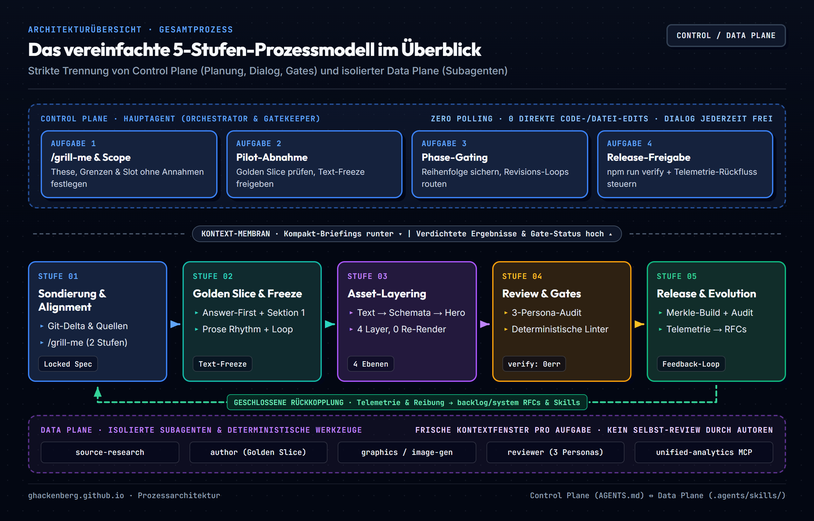
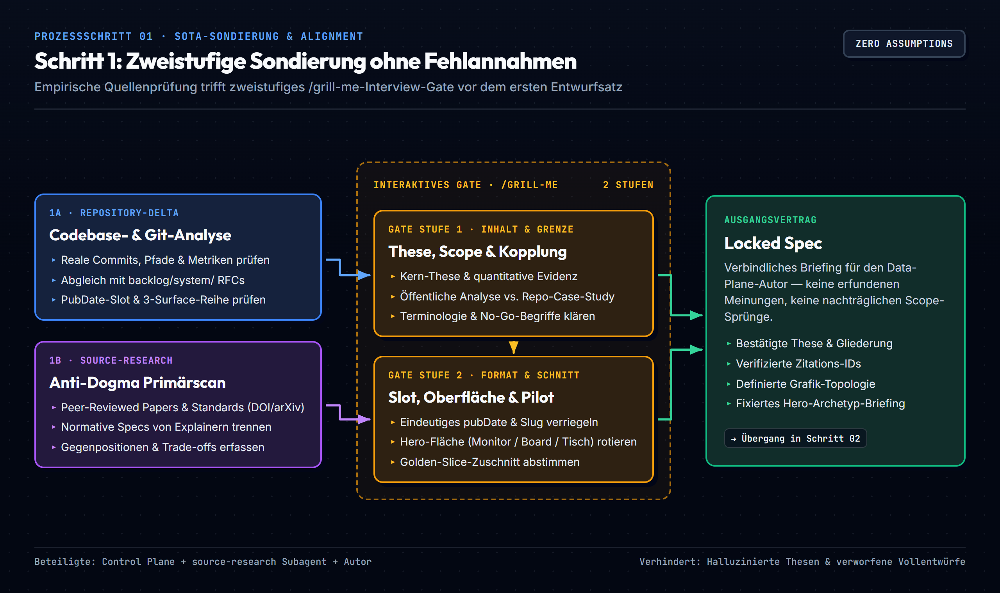
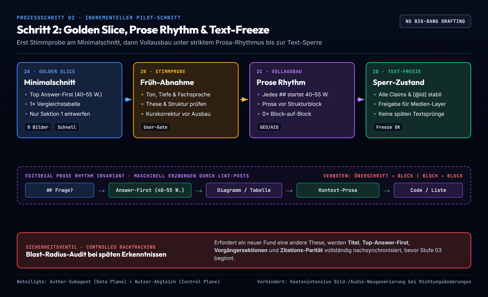
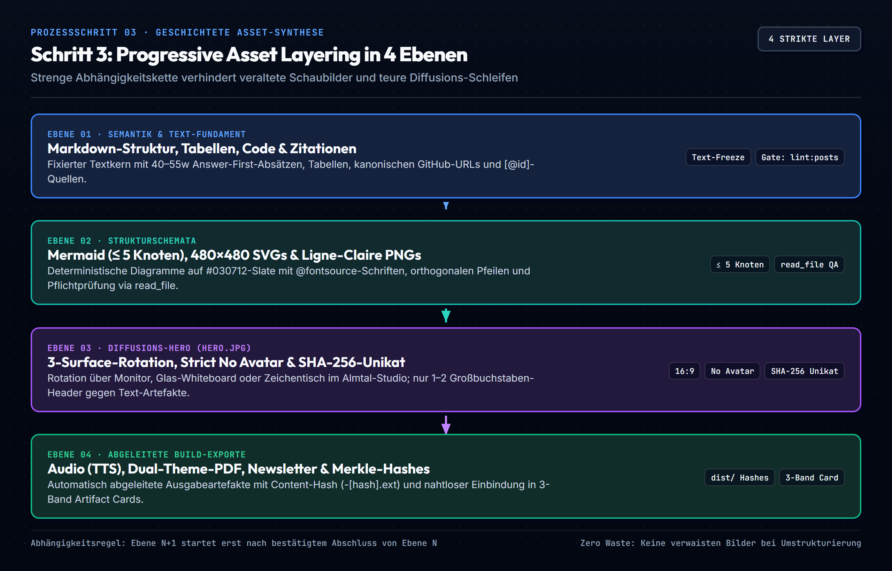
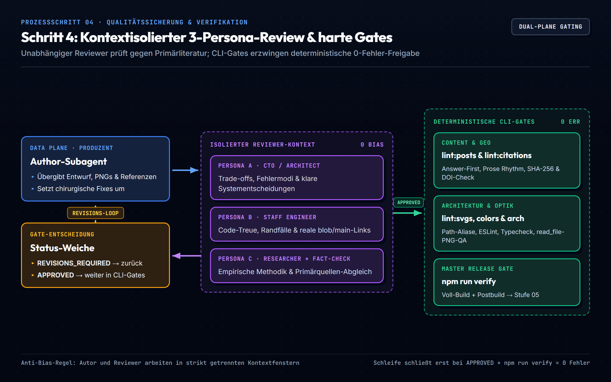
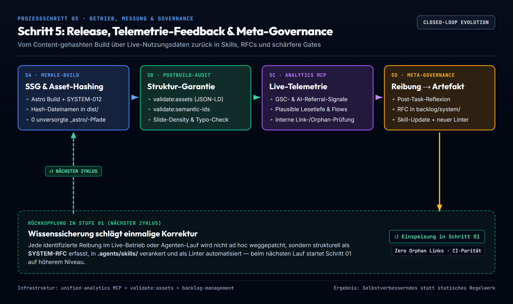
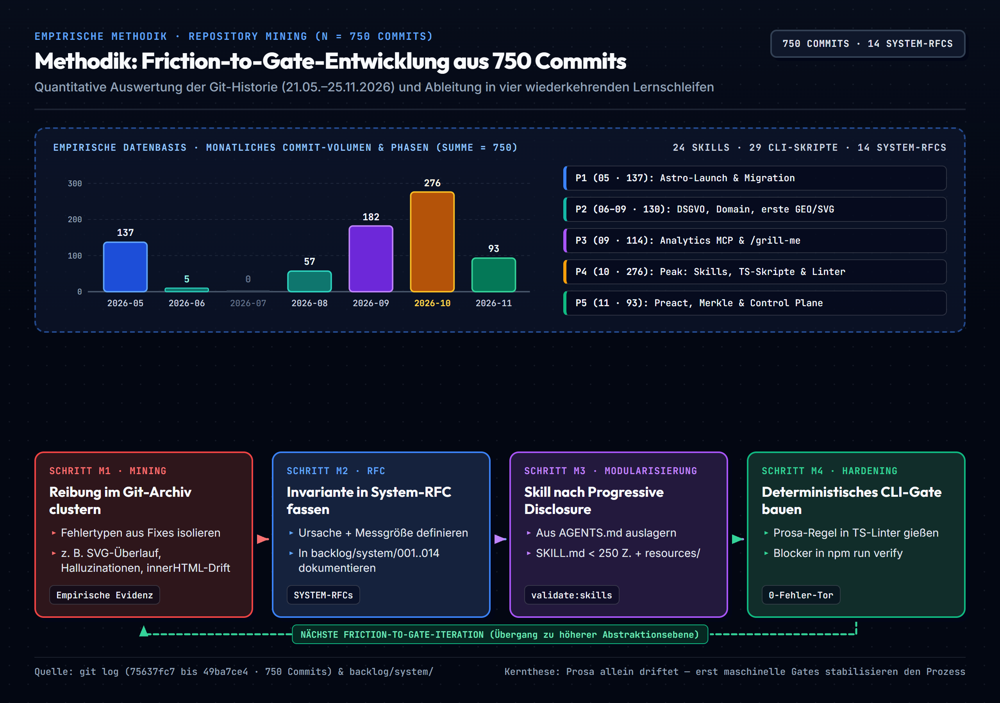

Das vereinfachte 5-Stufen-Prozessmodell trennt agentenbasierte Wissens- und Softwarearbeit strikt in eine steuernde Control Plane und eine isolierte Data Plane [@schluntz-2024-effective-agents]. Von Sondierung über Golden Slice, Asset-Schichtung und kontextisolierten Review bis zu Release-Telemetrie sichert jeder Schritt Ergebnisse über deterministische Gates, empirisch destilliert aus 750 Commits [@sha-2001-simplicity].

<!-- caption: "Vergleich zwischen Ad-hoc-Prompting, ungesteuerten Multi-Agenten-Ketten und dem fünfstufigen Control-Plane-Prozessmodell." -->
| Prozessdimension | Ad-hoc-Einzelprompt | Ungesteuerte Agenten-Kette | 5-Stufen-Prozessmodell (Control / Data Plane) |
| :--- | :--- | :--- | :--- |
| **Anforderungsklärung** | Implizite Annahmen während des Entwurfs | Verstreute Rückfragen ohne verbindlichen Rahmen | Zweistufiges `/grill-me`-Gate erzeugt eine feste Locked Spec |
| **Kontext-Hygiene** | Rohlogs und Entwürfe verdrängen Kernregeln | Ungefilterte Weitergabe zwischen allen Schritten | Halbdurchlässige Membran trennt Regie von frischen Worker-Kontexten |
| **Qualitätssicherung** | Nachträgliches manuelles Korrekturlesen | Selbstbewertung durch denselben Generierungskontext | Kontextisolierter 3-Persona-Review plus deterministische CLI-Gates |
| **Wissens-Evolution** | Einmalige Fixes bleiben lokal im Chat | Wiederholte Fehler bei jedem neuen Durchlauf | Jede Reibung wandert in System-RFCs, Skills und Linter-Blocker |

## Wie trennt das vereinfachte Prozessmodell Steuerung und Ausführung im Gesamtprozess?

Im Gesamtprozess agiert ein schlanker Hauptagent ausschließlich als Control Plane für Scope-Abgleich, Pilot-Abnahme, Phasenübergänge und Release-Freigabe, während spezialisierte Subagenten in der Data Plane mit frischen Kontextfenstern arbeiten [@hadfield-2025-multi-agent-research]. Eine strikte Kontext-Membran überträgt Kompakt-Briefings nach unten und verdichtete Ergebnisse sowie Gate-Status nach oben [@anthropic-2025-context-engineering].

Auf den ersten Blick wirkt ein einzelner KI-Agent, der recherchiert, entwirft, Diagramme rendert und am Ende selbst gegenliest, organisatorisch simpel. In der Praxis kollabieren solche monolithischen Abläufe jedoch genau an zwei Stellen: Erstens füllt sich das Arbeitsgedächtnis mit Suchrauschen und halbfertigen Zwischenständen (*Context Rot*) [@anthropic-2025-context-engineering]; zweitens bewertet derselbe Kontext seine eigenen blinden Flecken wohlwollend statt kritisch. Deshalb zieht die Architektur in [`AGENTS.md`](https://github.com/ghackenberg/ghackenberg.github.io/blob/main/AGENTS.md) und [`agent-orchestration`](https://github.com/ghackenberg/ghackenberg.github.io/blob/main/.agents/skills/agent-orchestration/SKILL.md) eine harte Trennlinie zwischen orchestrierender Regie und ausführendem Maschinenraum.

Die obere **Control Plane** übernimmt genau vier dauerhafte Aufgaben: Sie verriegelt Umfang und Zielrichtung vor dem ersten Entwurf (`/grill-me`), prüft frühzeitig einen minimalen Pilotschnitt, schützt die strikte Reihenfolge zwischen abhängigen Schritten und erteilt die finale Release-Freigabe auf Basis harter Linter. Direkte Datei-Edits oder langlaufende Polling-Schleifen sind ihr untersagt, sodass der Dialog mit dem Menschen durchgehend reaktionsfähig bleibt — wie im [Control-Plane-Muster für reaktive Live-Agenten](/posts/2026_11_22_conversational_control_plane_live_agents/) ausführlich beschrieben.

Zwischen den beiden Ebenen liegt die **Kontext-Membran**: Nach unten fließen ausschließlich kompakte Arbeitsaufträge mit expliziten Pfaden, Zitationsregeln und Akzeptanzkriterien; nach oben kehren lediglich geprüfte Artefaktpfade, Gate-Protokolle und offene Entscheidungen zurück [@schluntz-2024-effective-agents]. Die fünf Prozessstufen dazwischen bilden den linearen Hauptpfad von der Sondierung bis zum Betrieb, während eine grüne Rückkopplungsschleife Messdaten und erlebte Reibung direkt als RFCs und Skill-Updates in den nächsten Zyklus einspeist.

## Schritt 1: Wie verhindert zweistufige Sondierung Fehlannahmen vor dem ersten Satz?

Schritt 1 verhindert Fehlannahmen, indem vor jedem Entwurfssatz zwei unabhängige Recherchen in ein zweistufiges `/grill-me`-Gate münden: Eine Codebase- und Git-Analyse prüft reale Commits sowie offene RFCs, während ein Anti-Dogma-Primärscan wissenschaftliche Quellen und Gegenpositionen sammelt. Das Ergebnis ist eine verbindliche Locked Spec ohne erfundene Meinungen.

Die teuersten Korrekturen in agentengestützten Projekten entstehen selten durch Tippfehler, sondern durch stille Annahmen am Start: Ein Artikel übernimmt unreflektierten Branchen-Hype, wiederholt ein bereits behobenes Architekturproblem oder verfehlt die gewünschte Kopplung an reale Codepfade. Wie in [`SYSTEM-003`](https://github.com/ghackenberg/ghackenberg.github.io/blob/main/backlog/system/003-content-interview-gate.md) dokumentiert, genügen bereits wenige unpräzise Vorannahmen, um ganze Entwurfsdurchläufe unbrauchbar zu machen.

Aus diesem Grund teilt der erste Prozessschritt die Vorbereitung bewusst in zwei vorgelagerte Spuren und zwei interaktive Entscheidungsstufen:

1. **1A Repository-Delta & 1B Anti-Dogma-Primärscan:** Parallel prüfen `git`-Auswertungen reale Commits, Datei-Metriken, `backlog/system/`-RFCs und freie `pubDate`-Slots, während der `source-research`-Subagent peer-reviewte Papers, DOIs und normative Spezifikationen strikt von Marketing-Explainern trennt.
2. **Gate Stufe 1 — Inhalt & Grenze:** Im Dialog legt der Autor Kern-These, quantitative Evidenz, Abgrenzung zwischen öffentlicher Analyse und Repo-Fallstudie sowie verbindliche Terminologie inklusive No-Go-Begriffen fest.
3. **Gate Stufe 2 — Format & Schnitt:** Unmittelbar danach werden eindeutiger Slug, `pubDate`, rotierende Hero-Oberfläche (Monitor, Glas-Whiteboard oder Zeichentisch) und der Zuschnitt des Pilotschnitts verriegelt.

Am Ausgang von Schritt 1 steht keine vage Absichtserklärung, sondern eine kompakte **Locked Spec** mit bestätigter These, verifizierten Zitations-IDs und geplanter Grafik-Topologie. Erst mit diesem Vertrag betritt der Author-Subagent Stufe 2.

## Schritt 2: Warum beginnt jeder Entwurf mit einem Golden Slice bis zum Text-Freeze?

Schritt 2 ersetzt riskantes Big-Bang-Schreiben durch einen gestaffelten Pilotschnitt: Zuerst entstehen ausschließlich Top-Answer-First-Absatz, Vergleichstabelle und Sektion 1 ohne Bilder für eine frühe Stimmprobe beim Nutzer [@boehm-1988-spiral-model]. Erst nach freigegebener Tonlage und Struktur folgt der vollständige Ausbau unter striktem Prosa-Rhythmus bis zum verbindlichen Text-Freeze.

Wer einen langen Fachtext samt sechs Diagrammen und Titelbild auf einen Schlag erzeugt, riskiert kaskadierende Folgekosten: Passt eine Begrifflichkeit nicht, muss nicht nur der Text umgeschrieben, sondern jede bereits gerenderte Grafik angepasst werden. Dieses Risiko entspricht exakt Barry Boehms Erkenntnis zur spiralförmigen Risiko-Reduktion vor kostenintensiver Realisierung [@boehm-1988-spiral-model]. Der **Golden Slice** prüft Ton, fachliche Tiefe und Argumentationslinie am kleinsten sinnvollen Ausschnitt, bevor weitere Sektionen entstehen.

Während des anschließenden Vollausbaus greift eine zentrale stilistische und maschinelle Invariante — der **Editorial Prose Rhythm**, den [`lint-posts.ts`](https://github.com/ghackenberg/ghackenberg.github.io/blob/main/src/scripts/lint-posts.ts) deterministisch erzwingt:

- **Answer-First-Taktung:** Unmittelbar unter dem Frontmatter sowie unter jeder `##`-Überschrift steht ein eigenständiger 40–55 Wörter langer Definitionsabsatz (Linter-Toleranz `38–58` Wörter), ergänzt um Frage-Überschriften für klare Extrahierbarkeit.
- **Verbot gestapelter Strukturblöcke:** Auf jede Überschrift folgt zwingend zuerst ein Fließtextabsatz; ebenso dürfen Tabellen, Code-Listings, Listen, Abbildungen und Blockzitate niemals ohne erklärenden Prosa-Übergang direkt aufeinanderfolgen.
- **Controlled Backtracking als Sicherheitsventil:** Stellt sich mitten im Ausbau heraus, dass ein empirischer Befund die Ausgangsthese verschiebt, stoppt der Prozess vor Stufe 3 für ein vollständiges Blast-Radius-Audit über Titel, Einleitung, Vorgängersektionen und Zitationsparität.

Erst wenn sämtliche Claims, kanonischen `blob/main`-Links und semantischen Quellenverweise stabil stehen, erreicht das Dokument den **Text-Freeze**. Ab diesem Punkt ändert sich der inhaltliche Kern nicht mehr, sodass die nachgelagerten Medien-Schichten auf verlässlichem Boden aufbauen.

## Schritt 3: In welcher Reihenfolge schichtet Progressive Asset Layering Medien aufeinander?

Schritt 3 schichtet sämtliche Medien strikt in vier abhängigen Ebenen aufeinander: Auf das eingefrorene Markdown-Textfundament folgen zunächst deterministische Strukturschemata, danach das einmalige Diffusions-Hero-Bild und zuletzt automatisch abgeleitete Build-Exporte wie Audio, PDF und Merkle-Hashes [@mokhov-2018-build-systems-a-la-carte]. Ebene N+1 startet niemals vor bestätigtem Abschluss von Ebene N.

Viele KI-Workflows verheddern sich in teuren Medien-Schleifen, weil Titelbilder oder Diagramme parallel zum noch instabilen Text entstehen. Ändert sich später eine Phasenbezeichnung oder Abschnittszahl, veralten Grafiken sofort und erzwingen wiederholtes Neu-Rendern. Die Schichtung in [`post-authoring`](https://github.com/ghackenberg/ghackenberg.github.io/blob/main/.agents/skills/post-authoring/SKILL.md) löst diese Reibung durch eine strenge, kostenminimierende Abhängigkeitskette.

Jede Ebene bedient einen klar umrissenen Zweck mit eigenen Prüfkriterien:

1. **Ebene 01 — Semantik & Text-Fundament:** Der eingefrorene Markdown-Korpus mit Tabellen-Captions (`<!-- caption: "..." -->`), verifizierten GitHub-Pfaden und vollständigen `references:`-Metadaten bildet die einzige Wahrheitsquelle.
2. **Ebene 02 — Strukturschemata:** Komplexe Architekturen entstehen deterministisch als kompakte Mermaid-Diagramme (`<= 5` Knoten), responsive `480x480`-SVGs oder — wie in diesem Beitrag — hochauflösende Ligne-Claire-PNGs auf `#030712`-Slate mit lokal eingebetteten `@fontsource`-Schriften und verpflichtender visueller Endkontrolle per `read_file`.
3. **Ebene 03 — Diffusions-Hero (`hero.jpg`):** Erst wenn Überschriften und Schemata fixiert sind, rendert ein spezialisierter Bild-Subagent genau ein Unikat-Cover mit `16:9`-Seitenverhältnis, strikt ohne Avatar-Personen, maximal ein bis zwei Großbuchstaben-Markern und rotierender Büro-Oberfläche; ein SHA-256-Duplikat-Gate schließt Wiederverwendung aus.
4. **Ebene 04 — Abgeleitete Build-Exporte:** Im Build entstehen automatisch content-gehashte Ausgaben (`dist/`), mehrbändige [Three-Band Artifact Cards](/posts/2026_11_07_three_band_figures_adaptive_svg_color_governance/) sowie [Merkle-gesicherte Asset-Digests](/posts/2026_11_08_astro_content_layer_merkle_asset_digesting/) ohne manuelle Eingriffe [@mokhov-2018-build-systems-a-la-carte].

Durch diese vier Ebenen sinkt der Nachbearbeitungsaufwand dramatisch: Verwaiste Grafiken oder veraltete Diffusions-Entwürfe treten praktisch nicht mehr auf, weil jede teure Synthese erst auf bereits abgenommene Strukturen folgt.

## Schritt 4: Wie sichern kontextisolierte Reviews und harte CLI-Gates die Qualität?

Schritt 4 kombiniert einen kontextisolierten 3-Persona-Review mit deterministischen CLI-Prüfläufen [@sha-2001-simplicity; @jimenez-2024-swebench]. Ein unabhängiger Reviewer prüft Entwurf, gerasterte Grafiken und Primärquellen aus Sicht von CTO, Staff Engineer und Researcher, bevor drei gestaffelte Linter-Klassen bis zum Master-Gate `npm run verify` den Übergang in das Release freigeben.

Selbstprüfung in einem einzigen Kontextfenster scheitert regelmäßig an Bestätigungsfehlern (*Self-Confirmation Bias*): Wer hundert Zeilen Text formuliert hat, überliest unklare Trade-offs oder unscharf formulierte Quellenverweise deutlich leichter als ein frischer Leser. Gleichzeitig reichen reine LLM-Reviews allein nicht aus, weil Sprachmodelle formale Randbedingungen — etwa fehlende `blob/main`-Ziele, nicht aufgelöste DOIs oder doppelte Wortanzahlen — statistisch übersehen. Erst die Kopplung aus unabhängiger Kritik und deterministischer Schutzplanke (*Simplex Safety Envelope* nach Lui Sha [@sha-2001-simplicity]) liefert verlässliche Qualität.

Im Detail greifen in Stufe 4 zwei voneinander getrennte Prüfebenen ineinander:

- **Kontextisolierter 3-Persona-Review:** Ein eigener Reviewer-Subagent ohne Entwurfshistorie bewertet den Beitrag als **CTO / Architect** (Systementscheidungen, Fehlermodi), **Staff Engineer** (Code-Treue, Randfälle, reale Repository-Pfade) und **Researcher** (Methodik und Primärquellen-Abgleich). Bei `REVISIONS_REQUIRED` wandert das Paket für gezielte chirurgische Fixes zurück an den Author-Subagenten.
- **Deterministische CLI-Gates (`0`-Fehler-Vertrag):** Nach `APPROVED` erzwingen [`lint-posts.ts`](https://github.com/ghackenberg/ghackenberg.github.io/blob/main/src/scripts/lint-posts.ts), [`lint-citations.ts`](https://github.com/ghackenberg/ghackenberg.github.io/blob/main/src/scripts/lint-citations.ts), CSS-/Farb- und SVG-Linter sowie `npm run verify` (inklusive ESLint mit `--max-warnings=0`, TypeScript-Check und Astro-Build) maschinelle Konformität.

Empirische Untersuchungen zu Software-Engineering-Agenten auf `SWE-bench` belegen genau diesen Effekt [@jimenez-2024-swebench]: Deterministisches Verifier-Feedback verhindert endloses Raten und verwandelt probabilistische Text- oder Code-Erzeugung in eine geschlossene Regelstrecke.

## Schritt 5: Wie schließen Release, Telemetrie und Meta-Governance den Regelkreis?

Schritt 5 schließt den Prozesskreis vom produktiven Release zurück an den Anfang von Schritt 1: Ein Merkle-gehashter SSG-Build und Postbuild-Audits sichern strukturelle Integrität, bevor Live-Telemetrie via `unified-analytics` MCP Nutzungs- und Link-Lücken erkennt, aus denen neue System-RFCs, Skills und Linter entstehen [@lehman-1980-program-evolution].

Mit dem `git push` endet ein klassisches Publikations- oder Entwicklungsprojekt oft im Blindflug. Ob Leser mitten im Artikel abspringen, ob KI-Suchsysteme zentrale Abschnitte korrekt extrahieren oder ob ein neuer Beitrag mangels Querverweisen als isolierte Waise (*Orphan Page*) verhungert, bleibt unsichtbar. Gleichzeitig verpufft wertvolle Erfahrung aus dem Bauprozess, wenn gelöste Stolpersteine nur im erledigten Ticket verschwinden.

Deshalb verknüpft der fünfte Schritt vier aufeinanderfolgende Betriebsstufen zu einer dauerhaften Lernarchitektur:

1. **5A Merkle-Build & 5B Postbuild-Audit:** Der statische Astro-Build integriert [`SYSTEM-012`](https://github.com/ghackenberg/ghackenberg.github.io/blob/main/backlog/system/012-astro-content-layer-asset-hashing-and-dependency-tracking.md) mit inhaltsbasierten Asset-Hashes in `dist/`, gefolgt von [`validate-assets.ts`](https://github.com/ghackenberg/ghackenberg.github.io/blob/main/src/scripts/validate-assets.ts), JSON-LD-Graphenprüfung und semantischer ID-Validierung.
2. **5C Analytics MCP:** Der produktive MCP-Server [`unified-analytics.ts`](https://github.com/ghackenberg/ghackenberg.github.io/blob/main/src/tools/unified-analytics.ts) korreliert Google-Search-Console-Daten, AI-Referrals und Plausible-Lesetiefe mit dem internen Link-Audit in [`internal-links.ts`](https://github.com/ghackenberg/ghackenberg.github.io/blob/main/src/commons/server/analytics/services/internal-links.ts), das verwaiste Seiten mit höchstens einem eingehenden Link automatisch meldet.
3. **5D Meta-Governance (`Reibung -> Artefakt`):** Nach jedem größeren Vorhaben überführt das Vorgehen nach [`backlog-management`](https://github.com/ghackenberg/ghackenberg.github.io/blob/main/.agents/skills/backlog-management/SKILL.md) erkannte Reibungen nicht in einmalige Workarounds, sondern in spezifizierte `SYSTEM-RFCs`, modularisierte Skills und neue Linter-Prüfungen.

Wissenssicherung schlägt somit jede Einmalkorrektur: Wenn beim nächsten Auftrag Schritt 1 startet, läuft die Codebase-Analyse bereits auf einem geschärften Regel- und Werkzeugfundament.

## Wie wurde das Prozessmodell empirisch aus 750 Git-Commits abgeleitet?

Dieses Prozessmodell entstand nicht am weißen Reißbrett, sondern durch systematische Auswertung aller 750 Git-Commits dieses Repositories vom 21. Mai bis 25. November 2026. Wiederkehrende Fehlerbilder durchliefen vier strukturierte Lernschleifen vom Git-Mining über `SYSTEM-RFCs` und modularisierte Skills bis zu blockierenden CLI-Gates [@lehman-1980-program-evolution].

Meir Lehman zeigte bereits 1980 in seinen Gesetzen zur Software-Evolution, dass ein real genutztes Softwaresystem unter fortlaufender Änderung unweigerlich an Komplexität zunimmt, sofern keine gezielten Gegenmaßnahmen zur Komplexitätsreduktion greifen [@lehman-1980-program-evolution]. Genau dieses Muster ließ sich in der siebenmonatigen Git-Historie von `ghackenberg.github.io` quantitativ nachvollziehen: Wann immer neue Content-Typen, SVG-Diagramme oder interaktive Client-Skripte lediglich per Prosa-Regel in [`AGENTS.md`](https://github.com/ghackenberg/ghackenberg.github.io/blob/main/AGENTS.md) beschrieben wurden, kehrten identische Defekte nach wenigen Tagen zurück.

Die empirische Rekonstruktion ordnet alle 750 Commits (`75637fc7` bis `49ba7ce4`) über sieben Monate — mit der exakten Monatsverteilung von `137` (Mai), `5` (Juni), `0` (Juli), `57` (August), `182` (September), dem Spitzenwert `276` (Oktober) und `93` (November) — in fünf klar abgrenzbare Reifegradphasen ein:

<!-- caption: "Empirische 5-Phasen-Verteilung aller 750 Git-Commits (21.05.–25.11.2026) und daraus entstandene Prozessartefakte." -->
| Entwicklungsphase | Zeitraum | Commits | Zentrale Meilensteine & Treiber | Entstandenes Prozess-Artefakt |
| :--- | :--- | :--- | :--- | :--- |
| **Phase 1: Astro-Launch** | `2026-05-21` bis `05-31` | `137` | Erstaufbau (`75637fc7`), Migration von Jekyll auf Astro + Tailwind | Basis-Collections und erste manuelle Checklisten |
| **Phase 2: Konsolidierung & erste GEO/SVG** | `2026-06-01` bis `09-14` | `130` | DSGVO-Härtung, Domain-Umzug, frühe SVG- & GEO-Artikel | Erkennen von SVG-Überläufen und unscharfen Entwürfen |
| **Phase 3: Telemetry & Interview-Gate** | `2026-09-14` bis `09-30` | `114` | Analytics MCP (`e0c7a6e8`), `SYSTEM-001..004`, `/grill-me`-Idee | Trennung in Sondierung, Interview-Gate & Live-Telemetrie |
| **Phase 4: Skill- & Linter-Peak** | `2026-10-01` bis `10-31` | `276` | Progressive Disclosure (`4fc91201`), GEO-Gate (`7cf99fbb`), Resolver | `24` Skills, [`validate-skills.ts`](https://github.com/ghackenberg/ghackenberg.github.io/blob/main/src/scripts/validate-skills.ts) & [`lint-posts.ts`](https://github.com/ghackenberg/ghackenberg.github.io/blob/main/src/scripts/lint-posts.ts) |
| **Phase 5: Preact, Merkle & Control Plane** | `2026-11-01` bis `11-25` | `93` | `SYSTEM-009` (`68b6adc7`), `SYSTEM-012` (`62cbf143`), `live-conversation` (`3fc1f14b`), HEAD (`49ba7ce4`) | `29` CLI-Skripte, `14` System-RFCs & `npm run verify` |

In jeder dieser Phasen folgte die Prozessverbesserung demselben vierstufigen **Friction-to-Gate-Verfahren**:

1. **M1 Mining — Reibung im Git-Archiv clustern:** Wiederkehrende `fix(...)`-Commits (etwa beschnittene SVG-Labels, erfundene Zitationsnamen, manuelle `innerHTML`-Skripte oder veraltete Dev-Caches) wurden aus der Historie als strukturelle Fehlertypen statt Einzelfälle isoliert.
2. **M2 RFC — Invariante formal spezifizieren:** Jede Problemklasse erhielt eine verbindliche Spezifikation in `backlog/system/001..014` — von [`SYSTEM-004`](https://github.com/ghackenberg/ghackenberg.github.io/blob/main/backlog/system/004-content-manifest-linter.md) über Client-Härtung (`SYSTEM-009`) bis zu `SYSTEM-012`.
3. **M3 Modularisierung — Wissen nach Progressive Disclosure schichten:** Um Token-Inflation in [`AGENTS.md`](https://github.com/ghackenberg/ghackenberg.github.io/blob/main/AGENTS.md) zu stoppen, wanderten Domänenregeln nach [`skill-engineering`](https://github.com/ghackenberg/ghackenberg.github.io/blob/main/.agents/skills/skill-engineering/SKILL.md) in `24` schlanke `SKILL.md`-Pakete unter 250 Zeilen, automatisch überwacht durch [`validate-skills.ts`](https://github.com/ghackenberg/ghackenberg.github.io/blob/main/src/scripts/validate-skills.ts).
4. **M4 Hardening — Prosa in deterministische CLI-Gates gießen:** Schließlich wandelte das Projekt weiche Verhaltenswünsche in harte TypeScript-Prüfungen innerhalb von [`package.json`](https://github.com/ghackenberg/ghackenberg.github.io/blob/main/package.json) um — etwa für Prosa-Rhythmus (`52dbe426`, `4458889e`), vollständige Autorennamen (`14b31a59`) oder ununterbrochene Asset-Parität (`62cbf143`).

Das Ergebnis dieser siebenmonatigen Evolution ist ein erstaunlich kompaktes Gesamtbild: Anstelle fragiler Prompt-Monster trägt heute eine klare Arbeitsteilung aus fünf verständlichen Prozessschritten, expliziten Dokumentations-Verträgen und gnadenlosen Linter-Toren die gesamte Entwicklungs- und Publikationspipeline — nahtlos kombinierbar mit [sprachgeführten Mensch-Maschine-Schnittstellen](/posts/2026_11_25_mensch_maschine_schnittstelle_der_zukunft/) und produktiven [Agent Harnesses](/posts/2026_10_21_agent_harnesses_architecture_taxonomy_evolution/).
